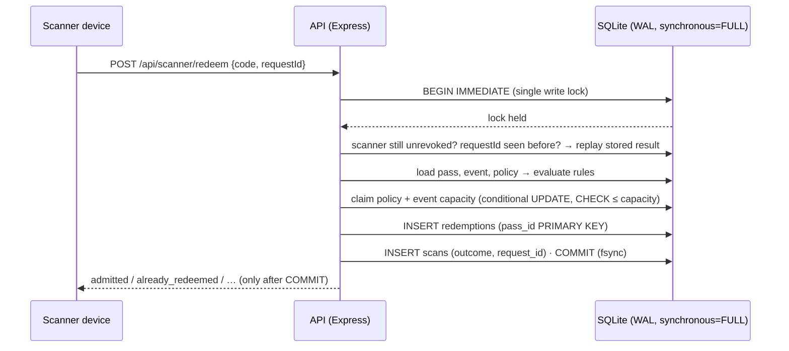
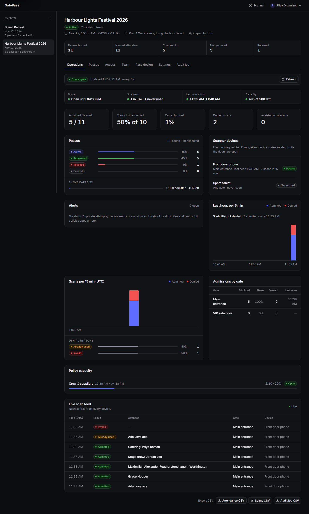
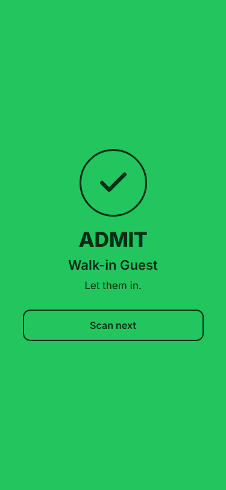
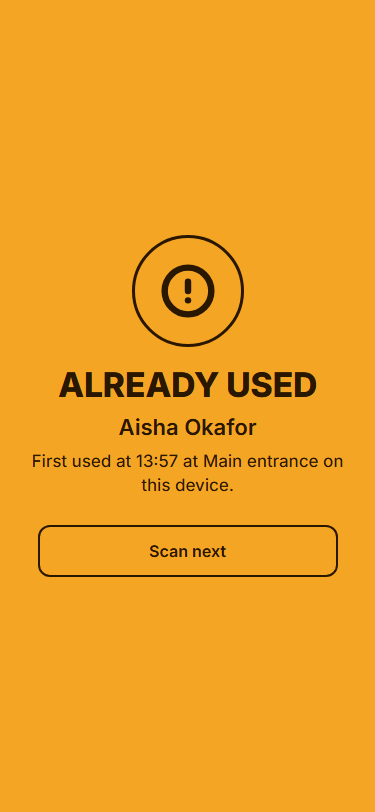
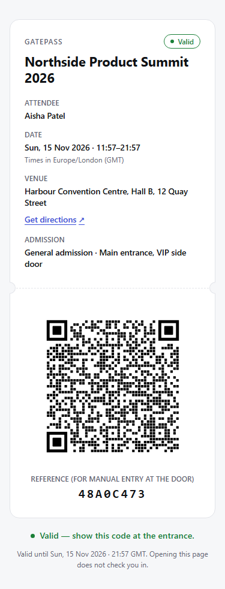
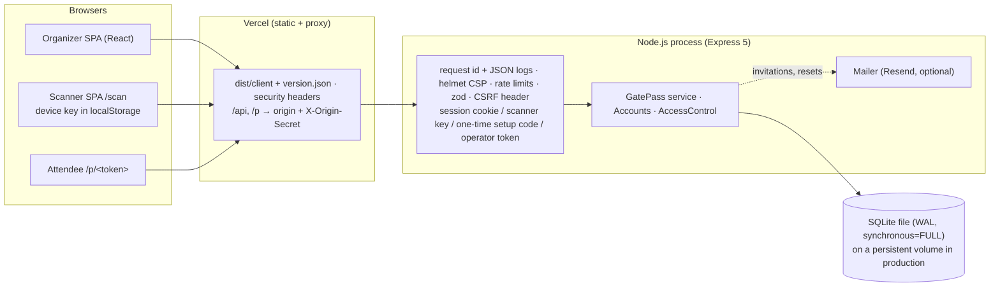

# GatePass

**Full-stack event admission with single-use QR passes, authenticated door scanners and auditable check-ins.**

Organizers configure events, gates and admission rules, issue QR passes, and monitor doors from a live dashboard. Admission is enforced inside a SQLite transaction: a pass can be admitted at most once, by an authorized device, within its time, gate and capacity restrictions.

**Stack:** TypeScript · React 19 · Express 5 · Node.js · SQLite WAL · Vite · Playwright · Vitest · Docker.

[Live demo](https://gatepass-sandy.vercel.app) · [Screenshots](#screenshots) · [Run locally](#run-it-locally) · [Architecture](docs/architecture.md)

**Release status:** the reviewed implementation is on [PR #15](https://github.com/tanmay-alpha/GatePass/pull/15), not yet merged into `main`. The public demo serves the older release and its API returned HTTP 503 on the latest check. Use the local walkthrough for a reliable evaluation. The free backend has no verified durable storage; do not use the public demo for real admissions.

Docs: [user guide](docs/USER_GUIDE.md) · [TODO](TODO.md) · [engineering audit & tracker](docs/engineering-audit.md) · [roadmap](docs/implementation-roadmap.md) · [security & threat model](docs/security-and-threat-model.md) · [test matrix](docs/test-matrix.md) · [performance](docs/performance.md) · [deployment runbook](docs/deployment-runbook.md) · [architecture](docs/architecture.md) · [decisions](docs/decisions/README.md)

## Engineering highlights

- **Concurrency correctness:** transactional redemption, database uniqueness/capacity constraints and retry-safe request IDs; tests race up to 100 scanners against one pass.
- **Recovery:** schema migrations with pre-upgrade backups, integrity verification, restore tooling and an isolated upgrade/rollback rehearsal.
- **Secure email outbox:** AES-256-GCM-sealed links, key rotation, per-event fair scheduling and explicit handling of potentially sent messages beyond the provider's deduplication window. No exactly-once email claim.
- **Operational performance:** chunked exports let door requests continue during downloads. On a laptop with a 25,000-pass event, admission p95 during exports fell from **1,784 ms to 170 ms**; this is not a hosted-capacity claim.
- **Verification:** the recorded full local run passed **501 Vitest tests** and **227 Playwright tests**, with 4 platform-specific and 272 browser-gated skips respectively. CI also exercises Linux/Windows, Node 22/24, Docker restart persistence, CodeQL and secret scanning.

Methods, tradeoffs and complete results: [test matrix](docs/test-matrix.md) · [performance](docs/performance.md) · [architectural decisions](docs/decisions/README.md).

## What it does

**Organizers (accounts with per-event roles)**
- Sign up or accept an invitation; sign in with an HTTP-only session cookie. Passwords are hashed with scrypt; sessions end after 24 h idle or 7 days. "Forgot your password?" emails a one-time link when email is configured.
- Events with a lifecycle — **draft → active → ended → archived** — an IANA time zone (all times shown in the event's zone), venue, optional event-wide capacity, and pass design. Clone an event's configuration (gates, policies with shifted windows) into a new draft.
- Team per event: the **owner** invites **managers** by one-time link (emailed when email is configured, otherwise shown once to share by hand; "New link" replaces a lost one). Managers run day-to-day operations; only owners change the lifecycle, manage the team, or export attendee data. People who are not on an event get `404` for it — even platform administrators.
- Gates and admission policies (entry window, gates allowed, capacity). A guided setup checklist shows what is still missing before doors open.
- Attendees: issue named or unnamed passes, import CSV with validation and duplicate preview, search/filter, revoke or reissue links, and generate A4 printable QR badge sheets.
- Reusable built-in and private event templates; clone configuration without copying attendees, credentials or admission history.
- Optional attendee pass emails: queue/retry/cancel, clear failure reasons and "Accepted by provider" rather than "Delivered"; live email requires operator configuration.
- Event-day dashboard: doors, capacity, scanner health, exact last admission, assisted admissions, timelines, alerts and data-freshness indicators. Admission-impacting changes require consequence-aware confirmation.
- Audited, owner-only streamed CSV exports: attendance, scan history, audit log and a concise event summary (attendance by gate, peak arrivals, denials and scanner activity).

**Door staff (scanner devices)**
- Each door device is set up from a **one-time setup link** (single use, expires after an hour) and receives its own key, bound to one event and optionally one gate; the permanent key never travels in a link. Rotate or revoke a device at any time.
- Camera scanning with the native `BarcodeDetector` or a self-hosted ZXing WebAssembly decoder, camera choice, torch, and manual entry of the link, token or the 8-character reference printed on the pass.
- Clear **Admit / Already used / Denied / Not verified** results (text, colour, sound, haptics on Android), announced to screen readers.
- **Fails closed**: no answer from the server means *Not verified — do not admit*. A retry after a dropped connection reuses the same request id, so the server returns the original verdict instead of a false "already used".
- Readiness checklist and a diagnostic camera code that cannot admit anyone. Attendee lookup exposes masked contact information and uses the same atomic redemption path.
- Installable scanner PWA with route-specific bundles and cached decoder assets. The cache contains the app shell, never API responses, pass pages or admission verdicts; offline admission is deliberately unsupported.

**Attendees**
- A read-only pass page at `/p/<token>` with the QR code, event time in the event's zone, admission details, a directions link for the venue and a print layout. Opening it never checks anyone in.

**Platform administrators**
- Manage accounts (disable, password resets, whether an invited account may create events) and organizer invitations. No access to event data unless added to an event's team. With email configured, a reset link goes only to the account's own address; without email, the administrator must give a reason (audited) and the account shows a notice at sign-in until it is acknowledged.

## How admission stays correct



- The commit is the linearization point: redemptions are serialized by one write lock, so concurrent scans of one pass behave as some sequential order (Herlihy & Wing, [Linearizability](https://doi.org/10.1145/78969.78972)). Tests record invocation/response times of 2, 25 and 100 simultaneous attempts and check that exactly one admits and no "already used" answer precedes the admitting request's invocation — on one laptop; that is evidence for this implementation, not a proof of global linearizability.
- The database refuses what the code must never do: a second redemption (`PRIMARY KEY`), over-capacity counters (`CHECK`), cross-event references and changes to past admissions (triggers).
- `synchronous=FULL` requests an fsync before acknowledging admission. Crash recovery is tested; power-loss durability also depends on the host's storage guarantees. An ephemeral demo filesystem is not durable.
- `node dist/server/index.js verify` checks integrity, foreign keys and nine admission invariants; `backup` and `restore` are verified and reversible. Details: [ADR 0003](docs/decisions/0003-redemption-atomicity.md), [ADR 0009](docs/decisions/0009-durable-storage.md), [test matrix](docs/test-matrix.md).

## Screenshots

Screenshots use synthetic data. The organizer Operations image is from the Phase 5 review; scanner and attendee captures below are from the earlier reviewed build.



| Scanner: admit | Scanner: already used | Attendee pass |
| --- | --- | --- |
|  |  |  |

More: [events](docs/screenshots/v3-events.png) · [setup checklist](docs/screenshots/v3-setup-checklist.png) · [passes](docs/screenshots/v3-passes.png) · [passes on a phone](docs/screenshots/v3-passes-mobile.png) · [CSV import preview](docs/screenshots/v3-import-preview.png) · [access](docs/screenshots/v3-access.png) · [audit log](docs/screenshots/v3-audit.png) · [sign-in](docs/screenshots/v3-sign-in.png) · [operations on a phone](docs/screenshots/v3-operations-mobile.png) · [scanner ready](docs/screenshots/v3-scanner-ready.png)

## Architecture



One Node.js process and one SQLite file (single writer, by design — [ADR 0001](docs/decisions/0001-sqlite-single-process.md)). The same process can serve the SPA itself; Vercel is an optional static front. `GET /api/health` is a readiness probe (database answers with the expected schema) and reports the build commit, which the release check compares with the frontend's `/version.json`. More in [docs/architecture.md](docs/architecture.md).

## Run it locally

Requires Node.js 22.13+ (built-in `node:sqlite`, no native build).

```sh
npm ci
cp .env.example .env
# In .env: generate ADMIN_TOKEN (at least 24 characters), set ALLOW_SIGNUP=true,
# and set APP_PUBLIC_URL=http://localhost:5173 for links opened through Vite.
# Generate a token: node -e "console.log(require('crypto').randomBytes(32).toString('base64url'))"
npm run dev               # terminal 1: API on http://127.0.0.1:3000
npm run dev:web           # terminal 2: UI on http://localhost:5173
```

Then, in the browser:

1. **Create an account** at http://localhost:5173 ("Create an account").
2. **Create an event**: "New event", a name, the time window and zone; choose *Active* so scanners admit straight away. The setup checklist shows what is left.
3. **Configure the doors** (optional): *Access* → add gates (e.g. North, South) and an admission policy with an entry window, allowed gates and a capacity.
4. **Issue a pass**: *Passes* → "Issue passes" (named or unnamed), or "Import CSV" with a preview. Open a pass link to see the attendee page.
5. **Set up a scanner**: *Access* → "Add device" (optionally bound to a gate). Open the one-time setup link on the door phone (or in another browser tab) — it works once and expires after an hour.
6. **Scan**: allow the camera and point it at the QR code, or type the pass link or the 8-character reference into manual entry. The first scan shows **Admit**; a second scan of the same pass shows **Already used**.

The camera needs HTTPS or `localhost`. Production build: `npm run build && npm start`.

`ADMIN_TOKEN` is a break-glass **operator** credential for the API (scripts, recovery, assigning an owner to an event created before accounts existed). The UI never asks for it. Configuration reference: [.env.example](.env.example) and [docs/local-development.md](docs/local-development.md).

## Tests

```sh
npm run typecheck && npm test        # Vitest: unit, API, roles, concurrency, migration, recovery, journey
npm run build && npm run test:e2e    # Playwright (Chromium, Firefox, WebKit, Pixel 7) against the built server
npx tsx scripts/load-test.ts         # HTTP load test with persisted-invariant checks
npm run audit:ci                  # standard npm audit; high/critical findings block CI, no exceptions
OLD_IMAGE=gatepass:old NEW_IMAGE=gatepass:new bash scripts/rollback-rehearsal.sh   # Docker: upgrade, then roll back on the pre-migration backup
```

What each suite covers and the latest results — including what has **not** been verified, such as camera scanning on physical phones — are in [docs/test-matrix.md](docs/test-matrix.md).

## Production readiness

**Suitable for a resume/portfolio demonstration; not certified for production event operations.** Local execution and automated verification are documented. A production release still requires PR approval/merge, durable hosting and recovery verification, live-email verification if email is enabled, physical-phone checks and a matching frontend/backend release check.

| | State (last full deployment inspection 2026-11-17; frontend version/API availability rechecked 2026-11-19) |
| --- | --- |
| Frontend | Vercel project `gatepass`, production deploys from `main`; previews build the static UI only and never reach the production API. Serves `/version.json` (build commit). |
| Backend | Render web service `gatepass-api`: **free plan, no persistent disk** (last Render API read 2026-11-15: `plan: free`, `disk: null`), `DEMO_MODE=true` (the UI warns that data resets). On 2026-11-17 it served `main` `8b86114` at schema 4; PR #15 (schema 6) is not deployed. Sleeps after 15 idle minutes. |
| Durable production | Deployment-ready but **not enabled**: `render.yaml` (Render Starter + 1 GB disk at `/data`, ≈ $7.25/month) or `docker-compose.yml` on a single host; comparison in [ADR 0009](docs/decisions/0009-durable-storage.md). Needs the owner's approval. Do not run a real event on the demo. |
| Email | Resend integration and the encrypted pass-email outbox built and tested against fake providers (crash recovery, the provider's 24 h de-duplication window, key rotation, fair scheduling); **live delivery not verified** (no API key, verified domain or `PASS_DELIVERY_KEY`). Without them, links are shared by hand. "Accepted by provider" is never shown as delivered. |
| Physical phones | Camera scanning and the installable scanner on a real iPhone/Android **not verified** — [checklist](docs/physical-device-checklist.md). Emulation does not count. |
| Release check | `scripts/release-check.ts` (CI: `release-verify.yml`) passes only when frontend `/version.json`, backend `build.commit` and the expected commit agree and the nondestructive smoke checks pass. |

Open items with acceptance criteria: [TODO.md](TODO.md).

## Known limitations

- Single process, single instance (SQLite single writer; in-memory rate limits). Do not run replicas against one database file.
- Email is optional; without it, invitation and reset links are shown once and shared manually. No MFA.
- No offline admission: if the scanner cannot reach the server, nobody is admitted.
- Throughput numbers come from a laptop ([performance](docs/performance.md)), including 25,000-pass events with dashboards and exports running; no hosted instance has been load-tested.
- `node:sqlite` is still marked experimental in Node.js.

## Attribution

GatePass is built on [CompleteTech-LLC/qr-code-toolkit](https://github.com/CompleteTech-LLC/qr-code-toolkit) (MIT License, Copyright (c) 2026 CompleteTech LLC). The upstream commits are retained in this repository with their original authors, dates and content. The messages of two upstream commits (the PR #1 and PR #4 commits) were edited to remove co-author trailers, so those commits, and every commit after them, have different hashes from upstream.

### Original GatePass work vs retained upstream components

| Retained from upstream | Written for GatePass |
| --- | --- |
| QR rendering (`src/qr/renderer.ts`), design presets and templates (`src/qr/design.ts`, logo rule narrowed to built-in presets), built-in logo icons (`src/qr/logo-icons.ts`); the original TypeScript/Vite/Express/Vitest tooling | Everything in `src/server` (event model, accounts and roles, hashed pass tokens, scanner keys, atomic redemption, admission policy engine, operations queries, SQLite schema and migrations, backup/verify/restore, security middleware), `src/client` (organizer dashboard, mobile scanner), `src/shared`, `tests`, `e2e`, `scripts`, `docs` and the Docker/Caddy/Vercel deployment files |

Removed from upstream: YOURLS integration, dynamic QR codes and redirects, landing pages, the JSON file store, logo uploads, payload builders, theme tokens and the generic studio UI. [docs/audit.md](docs/audit.md) records the audit behind these decisions.

Product names and logos in the built-in logo presets belong to their owners and do not imply endorsement.

### Third-party licenses

| Package | License | Use |
| --- | --- | --- |
| [express](https://github.com/expressjs/express) | MIT | HTTP server |
| [helmet](https://github.com/helmetjs/helmet) | MIT | Security headers |
| [express-rate-limit](https://github.com/express-rate-limit/express-rate-limit) | MIT | Rate limiting |
| [zod](https://github.com/colinhacks/zod) | MIT | Input validation |
| [qrcode](https://github.com/soldair/node-qrcode) | MIT | QR matrix and PNG output |
| [tsx](https://github.com/privatenumber/tsx) | MIT | Runs the TypeScript server in development (`npm run dev`) |
| [@playwright/test](https://github.com/microsoft/playwright) | Apache-2.0 | End-to-end tests (development only) |
| [react](https://github.com/facebook/react), react-dom | MIT | Organizer and scanner UI (bundled) |
| [lucide-react](https://github.com/lucide-icons/lucide) | ISC | UI icons (bundled) |
| [Inter](https://github.com/rsms/inter) via [@fontsource-variable/inter](https://github.com/fontsource/font-files) | OFL-1.1 | UI typeface (bundled, self-hosted) |
| [barcode-detector](https://github.com/Sec-ant/barcode-detector) | MIT | `BarcodeDetector` ponyfill (bundled) |
| [zxing-wasm](https://github.com/Sec-ant/zxing-wasm) | MIT | WebAssembly build of ZXing-C++ (bundled) |
| [zxing-cpp](https://github.com/zxing-cpp/zxing-cpp) | Apache-2.0 | Decoder compiled into `zxing-wasm` |

Each dependency keeps its own license; see `node_modules/<package>/LICENSE`.

## License

GatePass is released under the [MIT License](LICENSE). `LICENSE` keeps the upstream MIT text and the upstream copyright line `Copyright (c) 2026 CompleteTech LLC`, with an added copyright line for the GatePass modifications. The GatePass copyright and the upstream attribution are in [NOTICE](NOTICE).
