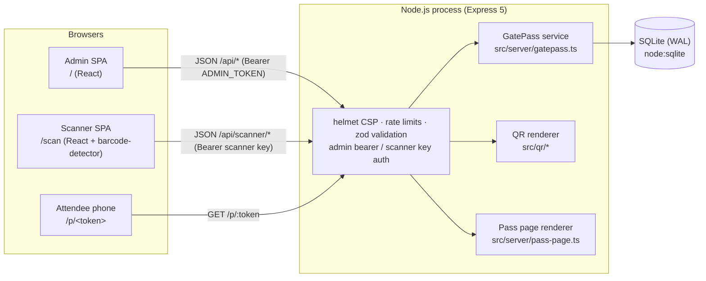
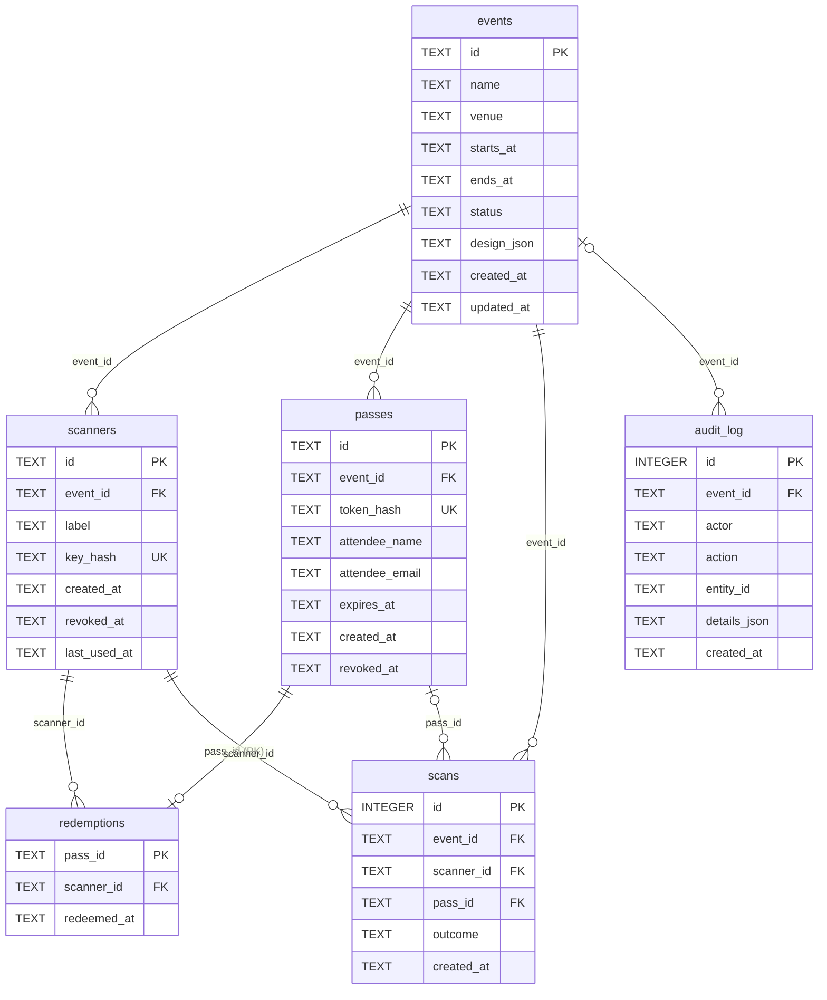
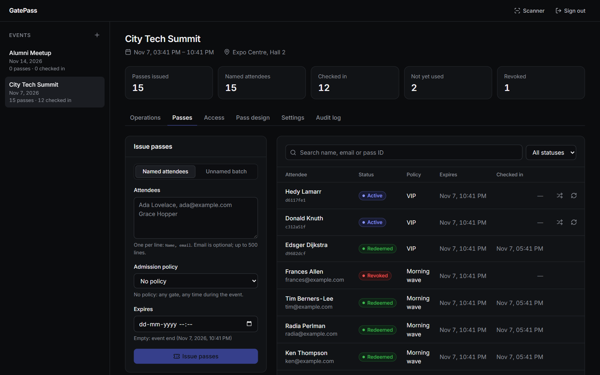
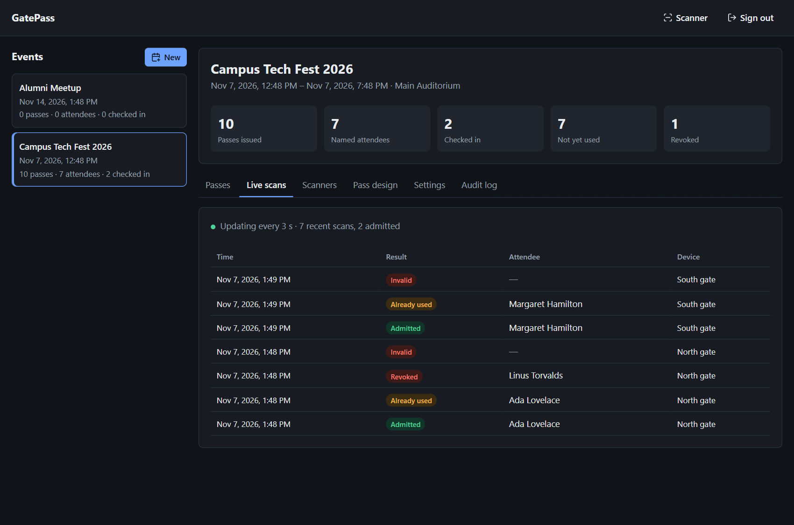
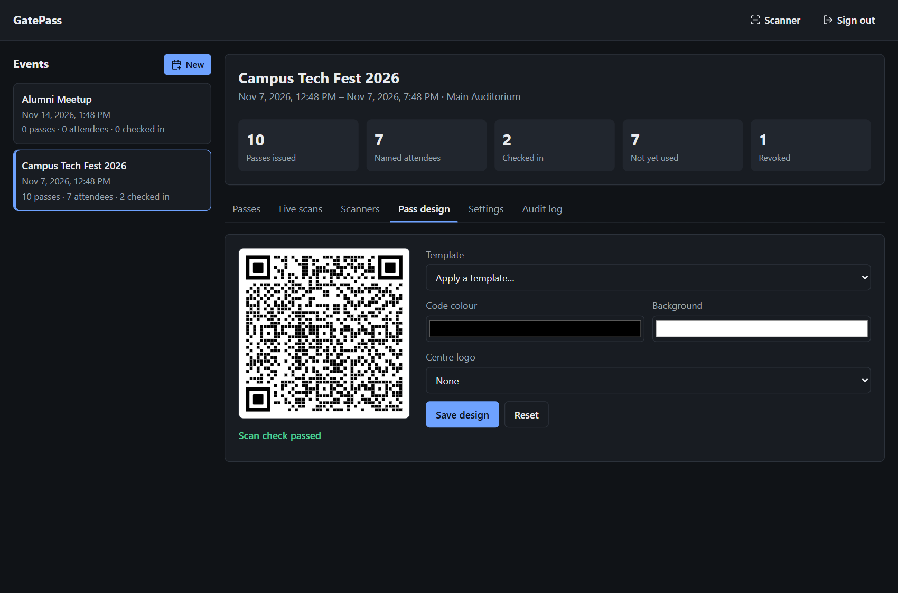
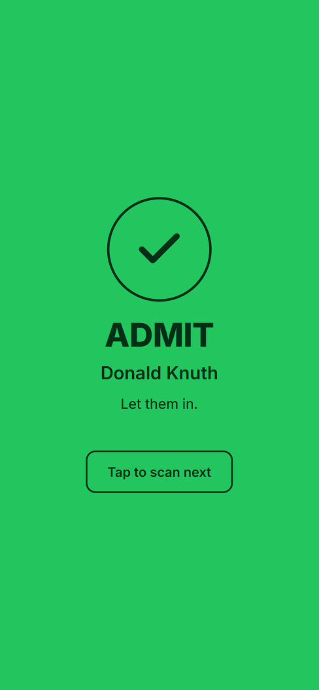
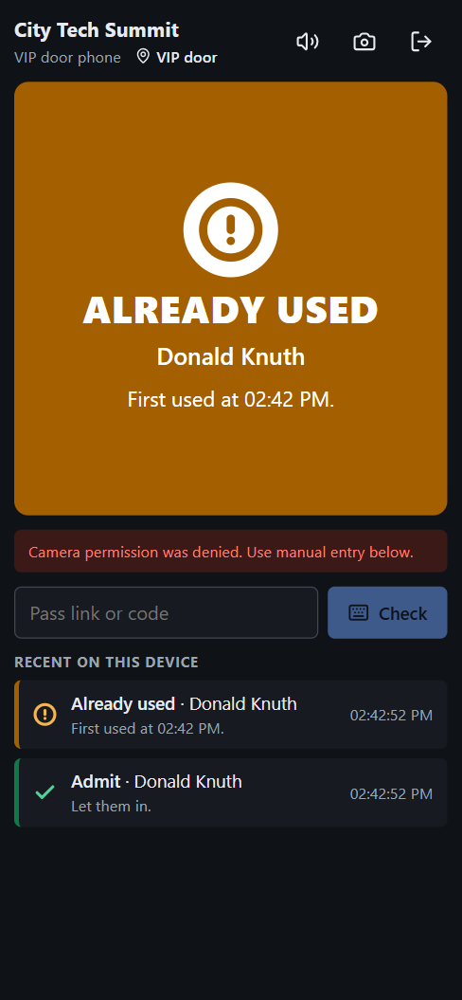
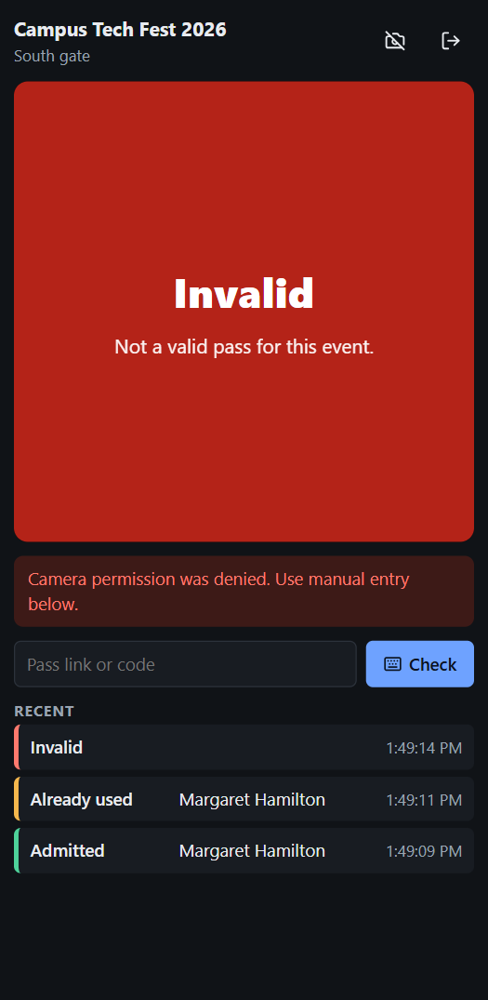
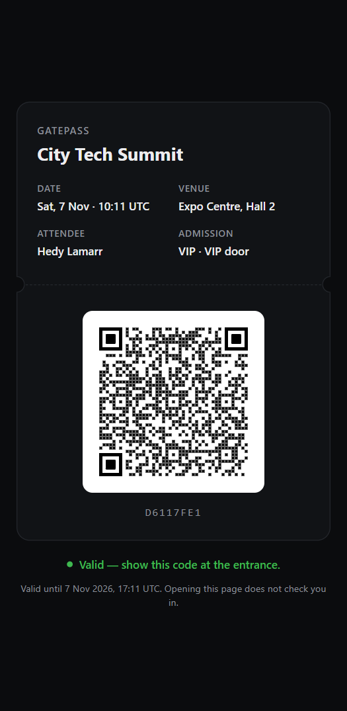

# GatePass

GatePass issues QR entry passes for events and checks them at the door. Each pass can be redeemed once. Only authenticated scanner devices can redeem it.

## The problem

Many events still check people in from a printed list or a screenshot of a ticket. A screenshot can be forwarded to any number of people. A printed list has no record of who has already come in. Nothing stops the same entry being used twice, and nobody can tell afterwards which device let a person in.

GatePass gives each attendee their own QR code. The code contains a random, unguessable token. A door device signs in with a scanner key that belongs to one event. When it scans a code, the server records the redemption inside a database transaction. A copied pass gets in once. Every later scan returns `already_redeemed` along with the time of the first check-in.

## Features

Only features that exist in this repository are listed.

- **Events**: create, edit, archive and reopen events (name, venue, start/end time, pass design). Each event shows counts of passes issued, named attendees, checked in and revoked. Archiving an event stops issuance, and its scanners get `event_closed` for every pass.
- **Pass issuance**: issue up to 500 passes per request. Passes can be named (name and optional email per attendee) or unnamed (a count). An optional expiry can be set; by default a pass expires when the event ends.
- **One-time token display**: the server stores only a hash of each token, so the admin UI shows new passes once. From there you can copy each link, download each QR code as PNG, or download a CSV of all pass links (`pass_id, attendee_name, attendee_email, expires_at, pass_url`).
- **Revoke**: a revoked pass is rejected at the door. A pass that has already been redeemed cannot be revoked.
- **Reissue**: replaces the token of an active pass (for example, when a code is lost or leaked). The pass ID and attendee stay the same, and the old QR code stops working immediately.
- **Scanner device keys**: each door device gets its own key for one event. The admin UI shows a setup link and QR code in the form `/scan#key=gps_...`. The key is in the URL fragment, which browsers do not send to the server. The scanner page saves the key on the device and removes the fragment from the address bar. Keys can be revoked one at a time; a revoked key is rejected on its next request.
- **Mobile scanner** at `/scan`: reads codes from the rear camera with [`barcode-detector`](https://github.com/Sec-ant/barcode-detector). It uses the browser's native `BarcodeDetector` when that supports QR codes, and otherwise the ZXing-C++ WebAssembly decoder served from the same origin (no CDN). Codes can also be typed or pasted (a full pass link or a bare token).
- **Scan outcomes**: `admitted`, `already_redeemed`, `expired`, `revoked`, `invalid`, `event_closed`. A pass from another event is reported as `invalid`.
- **Live scan feed**: the admin event page polls every 3 seconds for new scans.
- **Audit log**: admin actions (event created/updated, passes issued, pass revoked/reissued, scanner created/revoked) are stored per event. Every scan attempt is stored separately in the scan history.
- **Per-event pass design**: uses the upstream QR renderer (module shapes, eye styles, colours, gradients, built-in logo presets, templates). Each preview is decoded in the browser with the same detector the scanner uses. The admin UI will not save a design that fails this check.
- **Attendee pass page** at `/p/<token>`: the URL inside every QR code. It shows the event, the attendee name (if any), the pass status and, while the pass is active, the QR code. Opening it never redeems the pass.

## Architecture



One Node.js process serves the API, the attendee pass page and the built React bundle (`dist/client`). Admin and scanner UIs are separate React apps in one bundle; the app is chosen by the `/scan` path prefix. Details are in [docs/architecture.md](docs/architecture.md).

## Local setup

Requirements: Node.js 22.13 or newer. GatePass uses the built-in `node:sqlite` module, so there is no native build step.

```sh
npm ci
cp .env.example .env
# Set ADMIN_TOKEN in .env (at least 24 characters), e.g. the output of:
node -e "console.log(require('crypto').randomBytes(32).toString('base64url'))"
```

Start the API and the Vite dev server in two terminals:

```sh
npm run dev       # API on http://127.0.0.1:3000 (tsx watch, loads .env)
npm run dev:web   # UI on http://localhost:5173, proxies /api to port 3000
```

- Admin: open http://localhost:5173 and sign in with `ADMIN_TOKEN`. The token is kept in `sessionStorage` for that tab only.
- Scanner: create a scanner on an event's **Scanners** tab and open the setup link. You can also open http://localhost:5173/scan and paste the key. The camera needs a secure context, which means HTTPS or `localhost`. On plain HTTP to a LAN address, only manual entry works.
- Pass links use `APP_PUBLIC_URL` (default `http://localhost:3000`), so in development they open the pass page on the API server directly.

To run the production build locally: `npm run build && npm start`, then open http://localhost:3000.

See [docs/local-development.md](docs/local-development.md) for all environment variables and testing with a phone.

## Configuration

Validated at startup by `src/server/config.ts`. Empty values count as unset. The process exits with a message if validation fails.

| Variable | Default | Purpose |
| --- | --- | --- |
| `ADMIN_TOKEN` | required | Admin bearer token, at least 24 characters. |
| `APP_PUBLIC_URL` | `http://localhost:3000` | Origin encoded into pass QR codes as `${APP_PUBLIC_URL}/p/<token>`. Must be the public HTTPS origin in production. |
| `DATABASE_FILE` | `.local/data/gatepass.db` | SQLite file. Its directory must be persistent: it holds the database plus `-wal` and `-shm` files. |
| `HOST` | `127.0.0.1` | Bind address. Use `0.0.0.0` inside a container. |
| `PORT` | `3000` | Listen port. |
| `TRUST_PROXY` | unset (trust nothing) | Express `trust proxy` setting: a hop count such as `1`, `true`/`false`, `loopback`, or a subnet list. Needed so rate limits key on the real client IP behind a reverse proxy. |
| `CLIENT_DIR` | `dist/client` | Built SPA. Served only when it contains `index.html`. |
| `HTTPS_CERT_FILE`, `HTTPS_KEY_FILE` | unset | When both are set, Node serves HTTPS itself. Otherwise terminate TLS at a reverse proxy. |

## API reference

All API responses are JSON with `Cache-Control: no-store` unless noted otherwise. Errors use the shape `{ "error": "message" }`: 400 for validation failures (with the field path), 401 for missing or wrong credentials, 404 for unknown resources, 409 for state conflicts, 429 for rate limiting, and a generic `Internal server error` for 500. Request bodies are strict: unknown fields are rejected. The JSON body limit is 100 kB.

Auth: **admin** = `Authorization: Bearer <ADMIN_TOKEN>`. **scanner** = `Authorization: Bearer <scanner key>`. A scanner key is not accepted on admin routes, and the admin token is not accepted on scanner routes.

| Method | Path | Auth | Request | Response |
| --- | --- | --- | --- | --- |
| GET | `/api/health` | none | – | `200 {ok: true, service: "gatepass"}`; `503 {ok: false}` if the database is unusable |
| GET | `/api/qr/custom` | none | query `data` (1–1024 chars), `size` (default 300, rounded to 25 and clamped to 200–2000), `file` (`svg` default, `png`; `pdf`/`eps` → 400), `download` (bool), `config` (JSON-encoded design) | image body (`image/svg+xml` or `image/png`), attachment when `download` |
| POST | `/api/qr/custom` | none | JSON `{data, size?, file?, download?, config?}` | as above |
| GET | `/p/:token` | none (the token is the credential) | – | HTML pass page; identical `404` HTML for unknown and malformed tokens. Never redeems. |
| GET | `/api/admin/session` | admin | – | `{role: "admin"}` |
| GET | `/api/events` | admin | – | `EventSummary[]`, newest start first |
| POST | `/api/events` | admin | `{name (1–200), venue? (≤200), startsAt, endsAt, design?}` (ISO 8601, `endsAt > startsAt`) | `201 EventSummary` |
| GET | `/api/events/:eventId` | admin | – | `EventSummary` |
| PATCH | `/api/events/:eventId` | admin | any of `{name, venue, startsAt, endsAt, design, status: "active" \| "archived"}` | `EventSummary` |
| GET | `/api/events/:eventId/passes` | admin | query `status?` (`active`, `redeemed`, `revoked`, `expired`), `q?` (matches name, email or pass ID) | `Pass[]`, newest first |
| POST | `/api/events/:eventId/passes` | admin | `{attendees?: [{name?, email?}] (1–500)}` or `{count?: 1–500}` (not both; neither = one unnamed pass), `expiresAt?` (future; default event end) | `201 IssuedPass[]` (includes `token` and `passUrl`, shown once); `409` if the event is archived |
| POST | `/api/passes/:passId/revoke` | admin | – | `Pass`; idempotent; `409` if already redeemed |
| POST | `/api/passes/:passId/reissue` | admin | – | `IssuedPass` with a new `token`/`passUrl`; `409` unless the pass is active |
| GET | `/api/events/:eventId/scanners` | admin | – | `Scanner[]` (never includes keys) |
| POST | `/api/events/:eventId/scanners` | admin | `{label (1–100)}` | `201 {scanner: Scanner, key: "gps_..."}` (key shown once) |
| POST | `/api/scanners/:scannerId/revoke` | admin | – | `Scanner`; idempotent |
| GET | `/api/events/:eventId/scans` | admin | query `after?` (scan ID cursor), `limit?` (1–200, default 50) | `ScanRecord[]` with `id > after`, newest first |
| GET | `/api/events/:eventId/audit` | admin | – | latest 100 `AuditEntry` rows, newest first |
| GET | `/api/scanner/session` | scanner | – | `{scanner: {id, label}, event: {id, name, venue, startsAt, endsAt, status}}` |
| POST | `/api/scanner/redeem` | scanner | `{code}` (1–2048 chars: a pass URL or a bare 43-char token) | `ScanResult` |

Other `/api/*` paths return `404 {error: "Not found"}`. When `CLIENT_DIR` holds a build, every other GET path returns the SPA's `index.html`.

Response types are defined in [`src/shared/types.ts`](src/shared/types.ts):

```ts
EventSummary { id, name, venue, startsAt, endsAt, status: 'active' | 'archived', design, createdAt, updatedAt,
               passCount, attendeeCount, redeemedCount, revokedCount }
Pass         { id, eventId, attendeeName, attendeeEmail, expiresAt, createdAt, revokedAt, redeemedAt, redeemedBy,
               status: 'active' | 'redeemed' | 'revoked' | 'expired' }   // status derived at read time
IssuedPass   extends Pass { token, passUrl }
Scanner      { id, eventId, label, createdAt, revokedAt, lastUsedAt }
ScanResult   { outcome, scanId, checkedAt, pass?: { id, attendeeName, redeemedAt } }   // no pass for invalid
ScanRecord   { id, eventId, scannerId, scannerLabel, passId, attendeeName, outcome, createdAt }
AuditEntry   { id, eventId, actor, action, entityId, details, createdAt }
```

`ScanRecord.outcome` can also be `wrong_event` (see [Security model](#security-model)). All timestamps are UTC ISO 8601 strings.

### Redemption decision order

`POST /api/scanner/redeem` evaluates, in order:

1. Code is not a pass URL or token, or no pass has that token hash → `invalid`
2. Pass belongs to a different event than the scanner → stored as `wrong_event`, reported as `invalid`, no pass details
3. Scanner's event is archived → `event_closed`
4. Pass already redeemed → `already_redeemed` (with the original `redeemedAt`)
5. Pass revoked → `revoked`
6. `expiresAt <= now` → `expired`
7. Otherwise insert into `redemptions` → `admitted`

Every authenticated request with a well-formed body adds one row to `scans`, whatever the outcome. Requests rejected with 400, 401 or 429 are not recorded.

## Database design

SQLite through `node:sqlite`, opened with `journal_mode = WAL`, `foreign_keys = ON`, `busy_timeout = 5000` and `synchronous = NORMAL`. The schema is applied by ordered migrations in [`src/server/db.ts`](src/server/db.ts), with `PRAGMA user_version` recording which have run. All tables are `STRICT`. All foreign keys are `ON DELETE RESTRICT`, and the API has no delete routes.



| Table | Purpose | Key constraints | Indexes |
| --- | --- | --- | --- |
| `events` | Event metadata and pass design | `name` 1–200 chars; `venue` ≤ 200; `status IN ('active','archived')`; `CHECK (ends_at > starts_at)` | primary key |
| `scanners` | Door devices, one event each | `key_hash` `UNIQUE`, 64 hex chars (SHA-256); `label` 1–100 chars | `scanners_event_idx (event_id)` |
| `passes` | One row per attendee pass | `token_hash` `UNIQUE`, 64 hex chars; `attendee_name` ≤ 200; `attendee_email` ≤ 254; `expires_at` required | `passes_event_idx (event_id, created_at)` |
| `redemptions` | One row per redeemed pass | `pass_id` is the **primary key**: the database rejects a second redemption of the same pass | primary key |
| `scans` | Every scan attempt | `outcome IN ('admitted','already_redeemed','expired','revoked','invalid','event_closed','wrong_event')`; `pass_id` nullable | `scans_event_idx (event_id, id)` (cursor for the live feed) |
| `audit_log` | Admin actions | `event_id` nullable; `details_json` defaults to `'{}'` | `audit_event_idx (event_id, id)` |

Pass status is not stored. It is derived when read: `redeemed` if a `redemptions` row exists, else `revoked` if `revoked_at` is set, else `expired` if `expires_at <= now`, else `active`. Timestamps are stored as UTC ISO 8601 text, so comparing them as strings also orders them in time.

## Security model

What is protected, and how:

- **Pass tokens**: 32 bytes from `crypto.randomBytes`, base64url-encoded (43 characters, 256 bits). The database stores only `sha256(token)` (`passes.token_hash`, unique). The raw token is returned only in the issue/reissue response, so a lost pass is reissued, not recovered. Because the token has 256 bits of entropy, a leaked database cannot be brute-forced back into working tokens.
- **Admin authentication**: every management route requires `Authorization: Bearer <ADMIN_TOKEN>`. The comparison is constant-time: both values are SHA-256 hashed, then compared with `timingSafeEqual`. There is no unauthenticated mode, and the server refuses to start without a token of at least 24 characters.
- **Scanner keys**: `gps_` followed by a 256-bit random token. Only the SHA-256 hash is stored, and the key is shown once. Each key is tied to one event. It can only read its own session and redeem, and it cannot call admin routes. Revocation takes effect on the next request.
- **Single-use redemption**: the entire check-and-insert runs inside one `BEGIN IMMEDIATE` transaction, which takes SQLite's write lock before reading. `redemptions.pass_id` is a primary key, and the insert uses `ON CONFLICT (pass_id) DO NOTHING`. Exactly one concurrent scan gets `admitted`. Tests check this with 25 concurrent HTTP requests, with a second database connection, and with 8 worker threads that each open their own connection and are released at the same moment.
- **No state change on GET**: no GET route redeems, revokes or otherwise changes a pass, event or redemption. Opening or previewing `/p/<token>` (for example, by a link-preview bot) never checks anyone in. The only write on a GET is the scanner's `last_used_at` timestamp, updated when a scanner key authenticates.
- **Cross-event scans**: a valid pass scanned by another event's scanner is reported as `invalid`, with no pass details. It is stored as `wrong_event` so the admin feed can tell it apart from garbage input.
- **Error handling**: validation errors return 400 with the field path. Every other server error is logged and returned as a generic `500 {"error": "Internal server error"}`, with no SQL, file paths or stack traces.
- **Headers**: helmet with a strict Content Security Policy (`default-src 'self'`, `script-src 'self' 'wasm-unsafe-eval'` for the WebAssembly decoder, `frame-ancestors 'none'`, `object-src 'none'`, `base-uri 'none'`). Also `X-Frame-Options: DENY`, `Referrer-Policy: no-referrer` (pass URLs do not leak through `Referer`), and `Permissions-Policy: camera=(self), microphone=(), geolocation=()`. `/api` and `/p` responses are `no-store`. The pass page has its own CSP (`default-src 'none'`, no scripts), sends `X-Robots-Tag: noindex, nofollow`, and HTML-escapes all names.
- **Rate limits** (per client IP, fixed one-minute window, `express-rate-limit`): 600/min across all `/api` routes, 240/min on `/api/scanner/redeem` (counted before authentication), 60/min on `/p/:token`, and 120/min on `/api/qr/custom`. Behind a reverse proxy, set `TRUST_PROXY` so the real client IP is used.
- **Input validation**: every request body and query is parsed with zod strict schemas. Pass designs are normalised: unknown keys are dropped, colours must be `#rrggbb`, and logos must be built-in `#preset` references. User-supplied values cannot inject SVG attributes or point to external images.

What is **not** protected:

- `ADMIN_TOKEN` is a single shared secret. There are no user accounts, roles or per-person audit identity: every admin action is recorded with actor `admin`. Anyone with the token has full control.
- Rate-limit counters live in process memory. They reset on restart and are not shared between processes.
- Anyone who holds a pass link can open the pass page and see the event and the attendee name. The link is the pass; treat it like a ticket.
- A scanner key stored on a device (`localStorage`) works until it is revoked. A lost device must be revoked from the admin UI.
- `/api/qr/custom` is public (rate-limited) and renders any text up to 1024 characters.
- TLS is not enforced by the application. Run it behind HTTPS in production.

Report vulnerabilities as described in [SECURITY.md](SECURITY.md).

## Tests

```sh
npm test           # vitest run
npm run typecheck  # tsc --noEmit
npm run smoke:qr   # renders a sample pass QR to .local/smoke/
```

The tests use file-backed SQLite databases in a temp directory (not `:memory:`), so WAL mode and multiple connections are exercised for real.

| File | Covers |
| --- | --- |
| `tests/database.test.ts` | Schema constraints (foreign keys, uniqueness, checks); at most one `redemptions` row per pass; events with passes cannot be deleted; raw tokens never stored; migrations run once and data survives reopen; a corrupt database file fails loudly instead of being replaced; a failed batch issuance rolls back completely; exactly one admission across a second connection and across 8 worker threads with separate connections. |
| `tests/events-api.test.ts` | Event create/list/update/archive; UTC normalisation; validation errors; inverted time windows rejected; 404s; named and unnamed issuance with custom expiry and attendee counts; batch limits (1–500); no issuance for archived events; pass filtering and search (LIKE wildcards escaped); idempotent revocation with audit entries; reissue invalidates the old token and keeps the pass ID. |
| `tests/redemption.test.ts` | Admit once, then `already_redeemed` with the original time; exactly one admission among 25 concurrent HTTP scans; expiry boundary; revoked passes; unknown, malformed and injection-style codes reported as `invalid`; cross-event passes neither admitted nor revealed; `event_closed` after archiving; scanner session and the cursor-based scan feed; pass page never redeems; unknown and malformed tokens get identical 404 pages; HTML escaping on the pass page. |
| `tests/security-api.test.ts` | Every admin route rejects no token, a wrong token, a scanner key, a token without `Bearer`, and Basic auth; admin token rejected as a scanner key; revoked scanner keys rejected immediately; keys, tokens and hashes never returned from list endpoints; generic 500 responses; health check returns 503 when the database is closed; security and `no-store` headers; malformed JSON and oversized bodies return 4xx; redeem rate limit; QR render endpoint returns 400 for invalid input. |
| `tests/tokens.test.ts` | Token format and uniqueness; deterministic hashing; token extraction from raw codes and pass URLs only; constant-time comparison of different-length secrets. |
| `tests/qr-core.test.ts` | Retained upstream renderer: templates, logo presets, SVG/PNG output, PDF/EPS disabled, `gradientOnEyes`. |
| `tests/security.test.ts` | Design input validation: SVG attribute injection and non-preset logos rejected; unknown keys dropped. |

Shared setup is in `tests/helpers.ts` (temp database, controllable clock, seeded events). The worker-thread redemption fixture is `tests/fixtures/redeem-worker.mjs`.

The server and database behaviour above is covered by automated tests. The client has no unit tests. The UI shown under [Screenshots](#screenshots) was checked in headless Chromium, which has no native `BarcodeDetector`. That check exercised the ZXing WebAssembly fallback through the pass design scan check. Live camera capture has not been tested in automation, because the headless browser had no camera.

## Screenshots















## Deployment

[docs/deployment.md](docs/deployment.md) covers running GatePass with Docker, building for `linux/arm64`, and hosting on an Oracle Cloud VM behind an HTTPS reverse proxy. Production requirements that come from the code:

- `npm run build` creates `dist/client`. At runtime only `dependencies` are needed, so the image can use `npm ci --omit=dev`.
- `APP_PUBLIC_URL` must be the public HTTPS origin, because it is printed into every pass QR code. If you change it later, passes that were already issued still scan (the scanner only reads the `/p/<token>` part), but their links open the old origin.
- `HOST=0.0.0.0` inside a container. Set `TRUST_PROXY` when behind a proxy.
- Put the `DATABASE_FILE` directory on a persistent volume, and back up the database together with its `-wal` file.
- Run exactly one instance.
- Use `GET /api/health` as the health check.
- The scanner camera needs HTTPS.

## Known limitations

- **Single process, single instance.** SQLite and the in-memory rate limiter assume one Node.js process. Do not run replicas against the same database file.
- **`node:sqlite` is experimental in Node.js.** Its API may still change between Node releases; `npm start`/`npm run dev` pass `--disable-warning=ExperimentalWarning` to hide the startup warning. The module has no native build step, which is why it was chosen.
- **Polling, not push.** The admin scan feed polls every 3 seconds.
- **No offline scanning.** Every redemption is a server request, so the scanner needs network access. If the network is down, nobody can be admitted.
- **No email or SMS delivery.** Passes are distributed by copying links, the CSV, or PNG files.
- **PNG export lacks SVG styling.** PNGs are rendered by `qrcode` with only the body and background colours. Module shapes, eye styles, gradients and logos appear only in SVG (the pass page and previews).
- **No multi-user admin.** One shared token, no roles.
- **Event time window not enforced at the door.** Scans are accepted before `startsAt`. A pass stops working at its own `expiresAt` (by default the event end) or when the event is archived.
- **No deletion.** Events, passes and scanners can be archived or revoked but not deleted through the API.
- **Camera scanning not tested in automation.** Only the ZXing WebAssembly decoder was exercised, and only on rendered images. The native `BarcodeDetector` path and live camera capture have not been tested automatically. Test the actual door devices before an event.

## Attribution

GatePass is built on [CompleteTech-LLC/qr-code-toolkit](https://github.com/CompleteTech-LLC/qr-code-toolkit) (MIT License, Copyright (c) 2026 CompleteTech LLC). The upstream commits are retained in this repository with their original authors, dates and content. The messages of two upstream commits (the PR #1 and PR #4 commits) were edited to remove co-author trailers, so those commits, and every commit after them, have different hashes from upstream. The following upstream parts are retained:

- the QR renderer: `src/qr/renderer.ts`, `src/qr/design.ts`, `src/qr/logo-icons.ts`
- the design presets and templates
- the built-in logo icons
- the theme tokens

Removed from upstream: YOURLS integration, dynamic QR codes and redirects, landing pages, the JSON file store, logo uploads, payload builders and the generic studio UI. [docs/audit.md](docs/audit.md) records the audit behind these decisions.

Product names and logos in the built-in logo presets belong to their owners and do not imply endorsement.

### Third-party licenses

| Package | License | Use |
| --- | --- | --- |
| [express](https://github.com/expressjs/express) | MIT | HTTP server |
| [helmet](https://github.com/helmetjs/helmet) | MIT | Security headers |
| [express-rate-limit](https://github.com/express-rate-limit/express-rate-limit) | MIT | Rate limiting |
| [zod](https://github.com/colinhacks/zod) | MIT | Input validation |
| [qrcode](https://github.com/soldair/node-qrcode) | MIT | QR matrix and PNG output |
| [tsx](https://github.com/privatenumber/tsx) | MIT | Runs the TypeScript server in development (`npm run dev`) |
| [@playwright/test](https://github.com/microsoft/playwright) | Apache-2.0 | End-to-end tests (development only) |
| [react](https://github.com/facebook/react), react-dom | MIT | Admin and scanner UI (bundled) |
| [lucide-react](https://github.com/lucide-icons/lucide) | ISC | UI icons (bundled) |
| [barcode-detector](https://github.com/Sec-ant/barcode-detector) | MIT | `BarcodeDetector` ponyfill (bundled) |
| [zxing-wasm](https://github.com/Sec-ant/zxing-wasm) | MIT | WebAssembly build of ZXing-C++ (bundled) |
| [zxing-cpp](https://github.com/zxing-cpp/zxing-cpp) | Apache-2.0 | Decoder compiled into `zxing-wasm` |

Each dependency keeps its own license; see `node_modules/<package>/LICENSE`.

## License

GatePass is released under the [MIT License](LICENSE). `LICENSE` keeps the upstream MIT text and the upstream copyright line `Copyright (c) 2026 CompleteTech LLC`, with an added copyright line for the GatePass modifications. The GatePass copyright and the upstream attribution are in [NOTICE](NOTICE).
