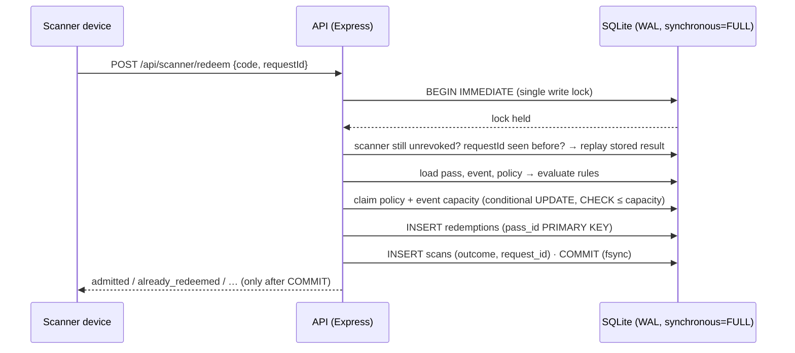
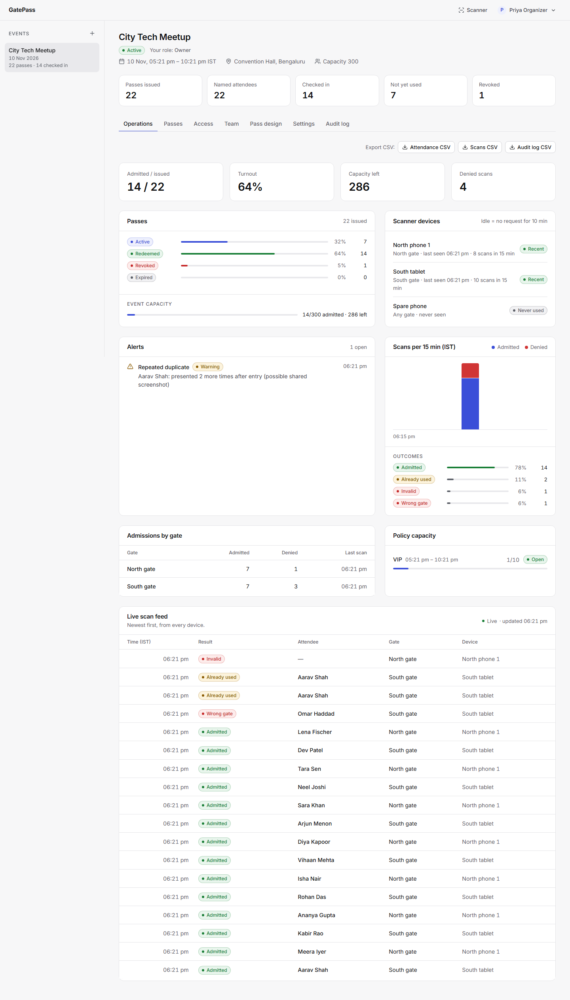
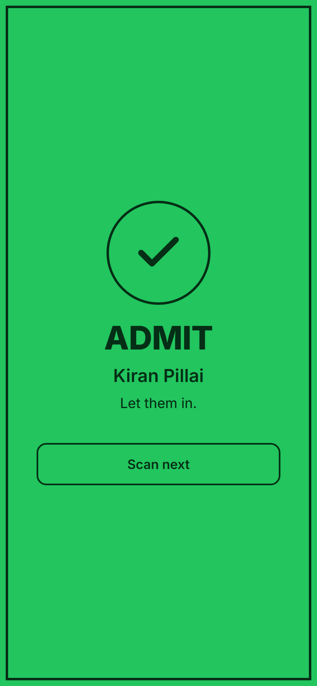
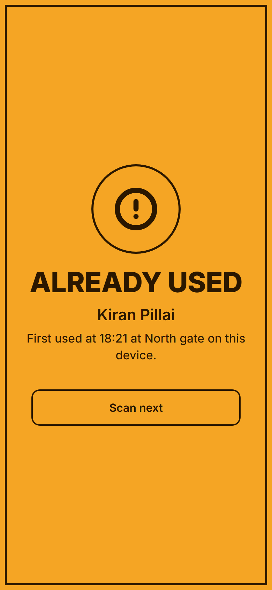
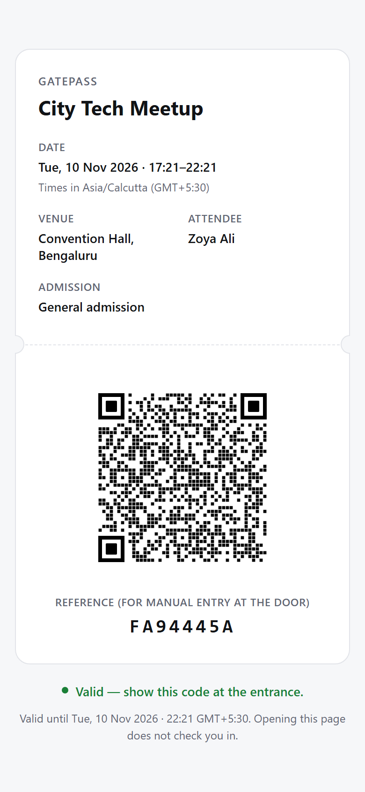
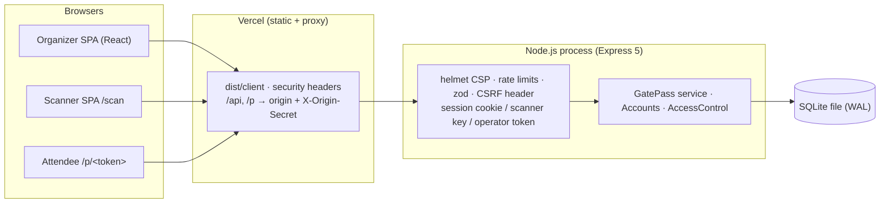

# GatePass

GatePass is an event admission system. Organizers set up events, gates and admission rules, issue QR passes, and hand door staff scanner devices. Each pass is admitted **at most once**, only by an authorized scanner of the same event, only where and when its rules allow, and never beyond capacity — enforced inside one database transaction and backed by database constraints, not just application code.

Live demo: https://gatepass-sandy.vercel.app — **demo only**: the free backend has no persistent disk, so data is erased whenever it restarts. See [Hosting status](#hosting-status).

Docs: [user guide](docs/USER_GUIDE.md) · [engineering audit & tracker](docs/engineering-audit.md) · [roadmap](docs/implementation-roadmap.md) · [security & threat model](docs/security-and-threat-model.md) · [test matrix](docs/test-matrix.md) · [performance](docs/performance.md) · [deployment runbook](docs/deployment-runbook.md) · [architecture](docs/architecture.md) · [decisions](docs/decisions/README.md)

## What it does

**Organizers (accounts with per-event roles)**
- Sign up or accept an invitation; sign in with an HTTP-only session cookie. Passwords are hashed with scrypt; sessions end after 24 h idle or 7 days.
- Events with a lifecycle — **draft → active → ended → archived** — an IANA time zone (all times shown in the event's zone), venue, optional event-wide capacity, and pass design. Clone an event's configuration (gates, policies with shifted windows) into a new draft.
- Team per event: the **owner** invites **managers** by one-time link. Managers run day-to-day operations; only owners change the lifecycle, manage the team, or export attendee data. People who are not on an event get `404` for it — even platform administrators.
- Gates and admission policies (entry window, gates allowed, capacity). A guided setup checklist shows what is still missing before doors open.
- Attendees: issue named or unnamed passes, import a CSV with a validation and duplicate preview before anything is issued, page/search/filter the list, revoke (one or many), reissue a lost code, print passes.
- Live operations: issued vs admitted, capacity remaining, admissions and denials by gate and reason, scanner device health, a 15-minute timeline and alerts (shared screenshots, invalid-code bursts, capacity nearly full).
- Exports (owner only, each download audited): attendance, scan history and audit log as CSV with spreadsheet formula injection neutralised. Searchable audit log of every administrative and security action.

**Door staff (scanner devices)**
- A scanner key bound to one event and optionally one gate, set up from a link; rotate or revoke it at any time.
- Camera scanning with the native `BarcodeDetector` or a self-hosted ZXing WebAssembly decoder, camera choice, torch, and manual entry of the link, token or the 8-character reference printed on the pass.
- Clear **Admit / Already used / Denied / Not verified** results (text, colour, sound, haptics on Android), announced to screen readers.
- **Fails closed**: no answer from the server means *Not verified — do not admit*. A retry after a dropped connection reuses the same request id, so the server returns the original verdict instead of a false "already used".

**Attendees**
- A read-only pass page at `/p/<token>` with the QR code, event time in the event's zone, and admission details. Opening it never checks anyone in.

**Platform administrators**
- Manage accounts (disable, one-time password-reset links) and organizer invitations. No access to event data unless added to an event's team.

## How admission stays correct



- The commit is the linearization point: redemptions are serialized by one write lock, so concurrent scans of one pass behave as some sequential order (Herlihy & Wing, [Linearizability](https://doi.org/10.1145/78969.78972)). Tests record invocation/response times of 2, 25 and 100 simultaneous attempts and check that exactly one admits and no "already used" answer precedes the admitting request's invocation — on one laptop; that is evidence for this implementation, not a proof of global linearizability.
- The database refuses what the code must never do: a second redemption (`PRIMARY KEY`), over-capacity counters (`CHECK`), cross-event references and changes to past admissions (triggers).
- `synchronous=FULL`: an admission reported to the door has been fsynced and survives a crash or power loss.
- `node dist/server/index.js verify` checks integrity, foreign keys and nine admission invariants; `backup` and `restore` are verified and reversible. Details: [ADR 0003](docs/decisions/0003-redemption-atomicity.md), [ADR 0009](docs/decisions/0009-durable-storage.md), [test matrix](docs/test-matrix.md).

## Screenshots

Captured from the current build with synthetic data (`docs/screenshots/`).



| Scanner: admit | Scanner: already used | Attendee pass |
| --- | --- | --- |
|  |  |  |

More: [passes](docs/screenshots/v2-passes.png) · [access](docs/screenshots/v2-access.png) · [team](docs/screenshots/v2-team.png) · [audit log](docs/screenshots/v2-audit.png) · [sign-in](docs/screenshots/v2-sign-in.png) · [operations on a phone](docs/screenshots/v2-operations-mobile.png)

## Architecture



One Node.js process and one SQLite file (single writer, by design — [ADR 0001](docs/decisions/0001-sqlite-single-process.md)). The same process can serve the SPA itself; Vercel is an optional static front. More in [docs/architecture.md](docs/architecture.md).

## Run it locally

Requires Node.js 22.13+ (built-in `node:sqlite`, no native build).

```sh
npm ci
cp .env.example .env      # set ADMIN_TOKEN (≥ 24 chars) and ALLOW_SIGNUP=true for local sign-up
npm run dev               # API on http://127.0.0.1:3000
npm run dev:web           # UI on http://localhost:5173 (proxies /api)
```

Create an account at http://localhost:5173, create an event, add a scanner and open its setup link. The camera needs HTTPS or `localhost`. Production build: `npm run build && npm start`.

`ADMIN_TOKEN` is a break-glass **operator** credential for the API (scripts, recovery, assigning an owner to an event created before accounts existed). The UI never asks for it. Configuration reference: [.env.example](.env.example) and [docs/local-development.md](docs/local-development.md).

## Tests

```sh
npm run typecheck && npm test        # Vitest: unit, API, roles, concurrency, migration, recovery
npm run build && npm run test:e2e    # Playwright (Chromium, Firefox, WebKit) against the built server
npx tsx scripts/load-test.ts         # HTTP load test with persisted-invariant checks
```

What each suite covers and the latest results — including what has **not** been verified, such as camera scanning on physical phones — are in [docs/test-matrix.md](docs/test-matrix.md).

## Hosting status

| | State |
| --- | --- |
| Frontend | Vercel project `gatepass`, production deploys from `main`. Preview deployments build the static UI only and never reach the production API ([runbook](docs/deployment-runbook.md)). |
| Backend | Render web service `gatepass-api`, **free plan, no persistent disk**, `DEMO_MODE=true` (the UI warns that data resets). Sleeps after 15 idle minutes; the first request can take ~50 s. |
| Durable production | Chosen design: the same container on a persistent disk (Render paid instance + 1 GB disk, ≈ $7.25/month per [ADR 0007](docs/decisions/0007-hosting.md), or a free single VM). **Not enabled — needs the owner's approval.** Until then, do not run a real event on the demo. |

## Known limitations

- Single process, single instance (SQLite single writer; in-memory rate limits). Do not run replicas against one database file.
- No email delivery: invitation and reset links are shown once and shared manually. No MFA.
- No offline admission: if the scanner cannot reach the server, nobody is admitted.
- Camera scanning on physical iPhone/Android devices has not been verified in this repository; use the manual checklist in the test matrix before an event.
- Throughput numbers come from a laptop ([performance](docs/performance.md)); the free Render instance has not been load-tested.
- `node:sqlite` is still marked experimental in Node.js.

## Attribution

GatePass is built on [CompleteTech-LLC/qr-code-toolkit](https://github.com/CompleteTech-LLC/qr-code-toolkit) (MIT License, Copyright (c) 2026 CompleteTech LLC). The upstream commits are retained in this repository with their original authors, dates and content. The messages of two upstream commits (the PR #1 and PR #4 commits) were edited to remove co-author trailers, so those commits, and every commit after them, have different hashes from upstream.

### Original GatePass work vs retained upstream components

| Retained from upstream | Written for GatePass |
| --- | --- |
| QR rendering (`src/qr/renderer.ts`), design presets and templates (`src/qr/design.ts`, logo rule narrowed to built-in presets), built-in logo icons (`src/qr/logo-icons.ts`); the original TypeScript/Vite/Express/Vitest tooling | Everything in `src/server` (event model, accounts and roles, hashed pass tokens, scanner keys, atomic redemption, admission policy engine, operations queries, SQLite schema and migrations, backup/verify/restore, security middleware), `src/client` (organizer dashboard, mobile scanner), `src/shared`, `tests`, `e2e`, `scripts`, `docs` and the Docker/Caddy/Vercel deployment files |

Removed from upstream: YOURLS integration, dynamic QR codes and redirects, landing pages, the JSON file store, logo uploads, payload builders, theme tokens and the generic studio UI. [docs/audit.md](docs/audit.md) records the audit behind these decisions.

Product names and logos in the built-in logo presets belong to their owners and do not imply endorsement.

### Third-party licenses

| Package | License | Use |
| --- | --- | --- |
| [express](https://github.com/expressjs/express) | MIT | HTTP server |
| [helmet](https://github.com/helmetjs/helmet) | MIT | Security headers |
| [express-rate-limit](https://github.com/express-rate-limit/express-rate-limit) | MIT | Rate limiting |
| [zod](https://github.com/colinhacks/zod) | MIT | Input validation |
| [qrcode](https://github.com/soldair/node-qrcode) | MIT | QR matrix and PNG output |
| [tsx](https://github.com/privatenumber/tsx) | MIT | Runs the TypeScript server in development (`npm run dev`) |
| [@playwright/test](https://github.com/microsoft/playwright) | Apache-2.0 | End-to-end tests (development only) |
| [react](https://github.com/facebook/react), react-dom | MIT | Organizer and scanner UI (bundled) |
| [lucide-react](https://github.com/lucide-icons/lucide) | ISC | UI icons (bundled) |
| [Inter](https://github.com/rsms/inter) via [@fontsource-variable/inter](https://github.com/fontsource/font-files) | OFL-1.1 | UI typeface (bundled, self-hosted) |
| [barcode-detector](https://github.com/Sec-ant/barcode-detector) | MIT | `BarcodeDetector` ponyfill (bundled) |
| [zxing-wasm](https://github.com/Sec-ant/zxing-wasm) | MIT | WebAssembly build of ZXing-C++ (bundled) |
| [zxing-cpp](https://github.com/zxing-cpp/zxing-cpp) | Apache-2.0 | Decoder compiled into `zxing-wasm` |

Each dependency keeps its own license; see `node_modules/<package>/LICENSE`.

## License

GatePass is released under the [MIT License](LICENSE). `LICENSE` keeps the upstream MIT text and the upstream copyright line `Copyright (c) 2026 CompleteTech LLC`, with an added copyright line for the GatePass modifications. The GatePass copyright and the upstream attribution are in [NOTICE](NOTICE).
