# GatePass user guide

This guide is for event organisers. You do not need any technical knowledge to follow it.

## 1. What GatePass does

GatePass gives each guest a pass with a QR code. At the door, staff scan the QR code with a phone.

- Each pass works **once**. A second scan of the same pass is refused.
- Only door phones that you have set up can check people in. A random phone cannot.
- You can see who has come in, at which door, in real time.

## 2. Who uses it

| Person | What they use | What they do |
| --- | --- | --- |
| Organiser (you) | The admin site | Create the event, issue passes, set up door phones, watch the dashboard. |
| Door staff | The scanner, on a phone, at `/scan` | Scan passes and follow what the screen says. |
| Attendee | Their pass link | Open the link and show the QR code at the door. |

## 3. Before you start

1. Open https://gatepass-sandy.vercel.app in your browser.
2. Sign in with the **admin token**. This is a long secret password.
   - Ask whoever set up GatePass for it.
   - If you set it up yourself, it is in the Render dashboard: **gatepass-api → Environment → ADMIN_TOKEN**.
   - Keep it private. Do not paste it into chats or emails. Anyone with it can run your events.

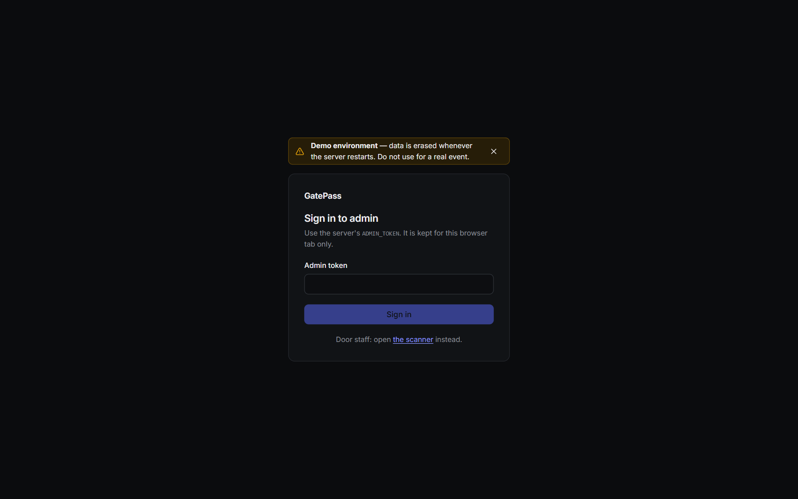

**About the live demo.** You will see a "Demo environment" banner. The demo runs on free hosting, so:

- All data is erased when the server restarts or is updated.
- After about 15 minutes with no use, the server goes to sleep. The next request can take up to a minute. The app shows "Waking up the server" while it waits.

## 4. Create an event

Click to create a new event and fill in:

- **Name** – for example "Spring Concert".
- **Venue** – where it takes place.
- **Start** and **End** – passes are only accepted between these two times. Before the start or after the end, every scan is refused.

If something is missing or wrong (for example, the end is before the start), the form tells you in plain words what to fix.

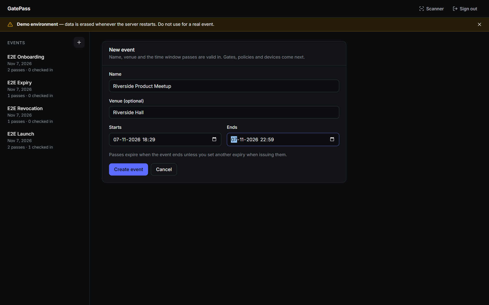

## 5. The setup checklist

After you create an event, you see **Set up this event**. Work from the top. It shows how many steps are done.

1. **Create event** – name, venue and the time the doors are open. Already done.
2. **Add gates** (optional) – one per entrance. Skip if you have a single door.
3. **Configure admission** (optional) – limit some passes to a time slot, gate or capacity. Skip for general admission.
4. **Issue passes** – add attendees and share each pass link.
5. **Set up a scanner** – open the setup link on each door phone.
6. **Begin entry** – scan the first pass at the door. Watch progress on Operations.

Optional steps have a **Skip** button. You can change your mind with **Undo skip**. **Hide steps** folds the list; **Continue** takes you to the next step.

Once you have passes and at least one scanner, the checklist changes to **Ready for doors**.

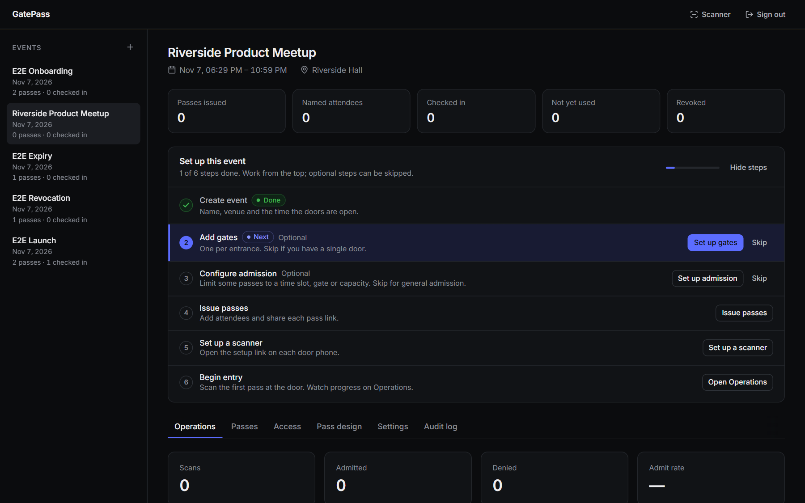

## 6. Gates and admission policies

A **gate** is an entrance, such as "Main door" or "VIP door".

An **admission policy** is a group of passes with its own rules. Each rule is optional:

- **Time window** – when these passes may enter.
- **Allowed gates** – which doors they may use.
- **Capacity** – the most people in this group who may enter.

Examples:

- **VIP**: only through the VIP door, at most 30 people.
- **Early entry**: only between 18:00 and 19:00.

A pass with **no policy** can enter at any gate, at any time during the event.

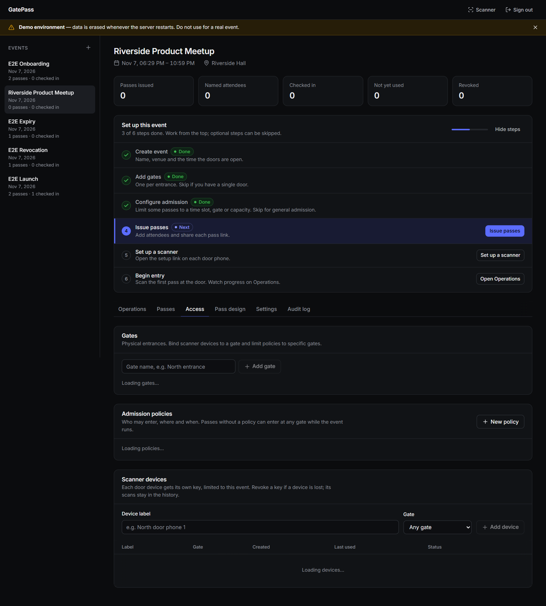

## 7. Issue and share passes

Open the **Passes** tab. You can:

- Paste a **list of names** (one per line) to make named passes, or
- Make a **batch of unnamed passes** by choosing a number.

You can choose a policy for the new passes.

**Important:** the pass links are shown **only once**, right after you create them. GatePass keeps only a fingerprint of each pass, not the link itself. Save them straight away using:

- **Copy link** for one pass,
- **PNG** to download the QR image,
- **CSV** to download all links as a spreadsheet.

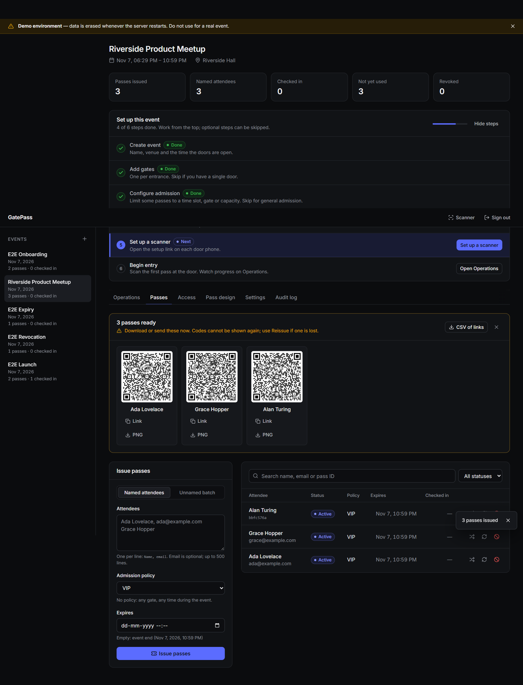

**Sending passes.** GatePass does not send emails. You send each link yourself, by email, chat or text message. The attendee opens the link and shows the QR code at the door.

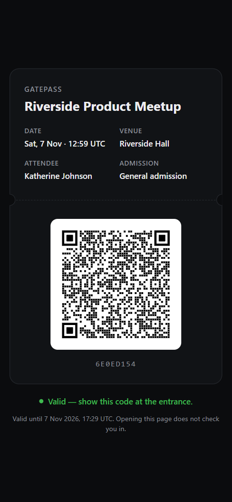

Other actions on a pass:

- **Reissue** – for a lost pass. You get a new link. The old QR code stops working.
- **Revoke** – cancels the pass. It will be refused at the door.
- **Change policy** – moves the pass to another group (for example, from General to VIP).

## 8. Set up a scanner (door phone)

1. In the **Access** tab, add a scanner device. Give it a name (for example "Main door phone") and pick its gate.
2. On the door phone, open the setup link, or scan the setup QR code with the phone camera.
3. The phone remembers its key. Staff only need to do this once per phone.

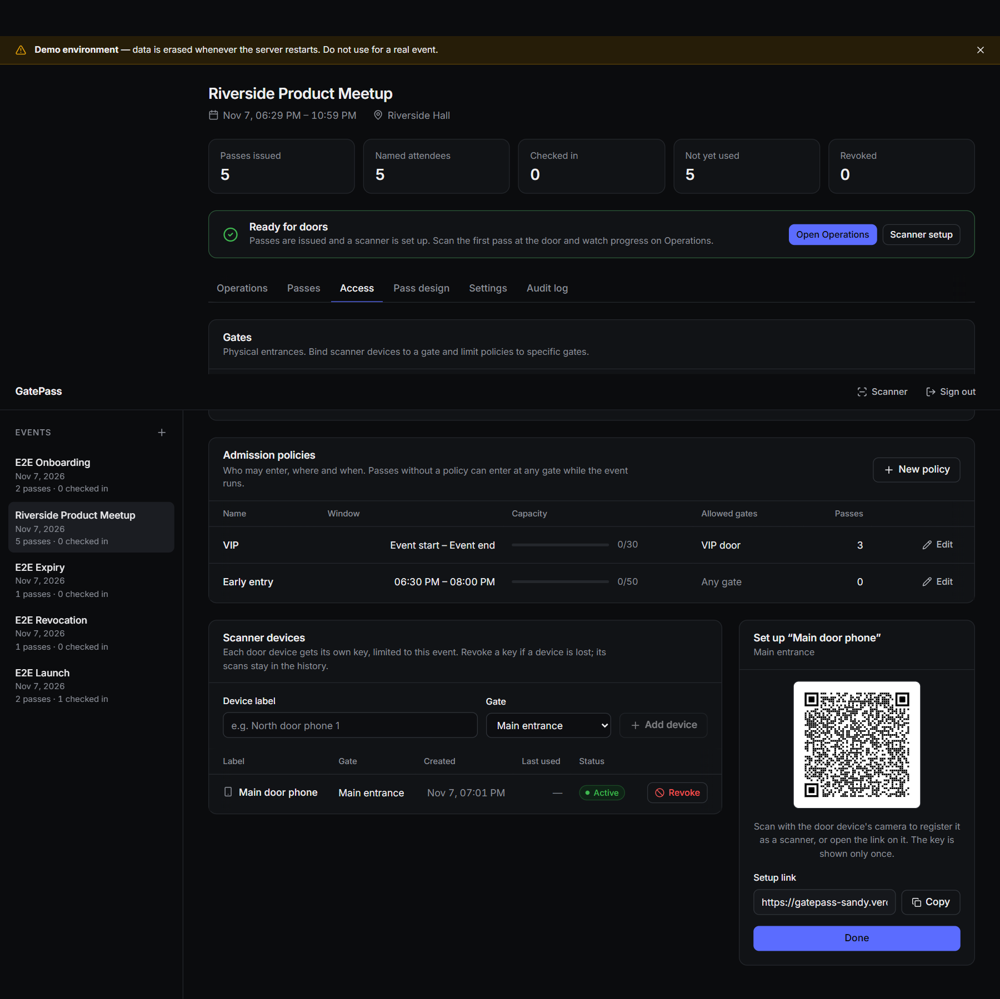

The scanner is now ready.

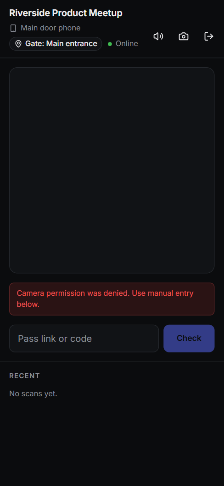

Good to know:

- The camera only works on a secure (HTTPS) address. The live site is secure.
- If the camera does not work, staff can type the code using **manual entry**.
- If a phone is lost or stolen, **revoke** that device in the Access tab. It can no longer check anyone in.

## 9. What happens when a pass is scanned

The server decides every scan. The phone shows a large, coloured result.

| Screen shows | Reason line | What staff should do |
| --- | --- | --- |
| **Admit** | Let them in. | Let the person in. |
| **Already used** | First used at (time). | Do not admit. The pass was used before. Ask for ID or call the organiser. |
| **Denied** | This pass was revoked by the organiser. | Do not admit. Send to the organiser. |
| **Denied** | This pass has expired. | Do not admit. |
| **Denied** | Not a valid pass for this event. | Do not admit. It may be for another event, or fake. |
| **Denied** | Check-in for this event is closed. | Do not admit. The event is closed or archived. |
| **Denied** | Entry opens at (time). | Ask them to come back at that time. |
| **Denied** | Entry closed at (time). | Do not admit. Their time slot is over. |
| **Denied** | Use gate: (gate name). | Send them to the right door. |
| **Denied** | (Group) is full (number). | Do not admit. That group has reached its limit. |
| **Not verified** | No response / no connection from the server. | **Do not admit.** Scan again. |

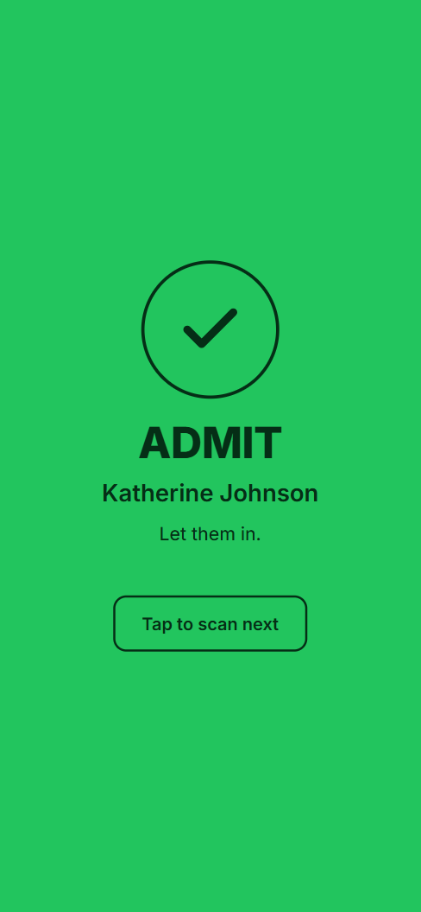

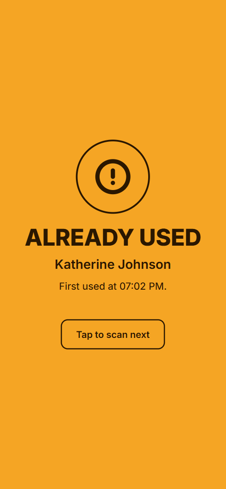

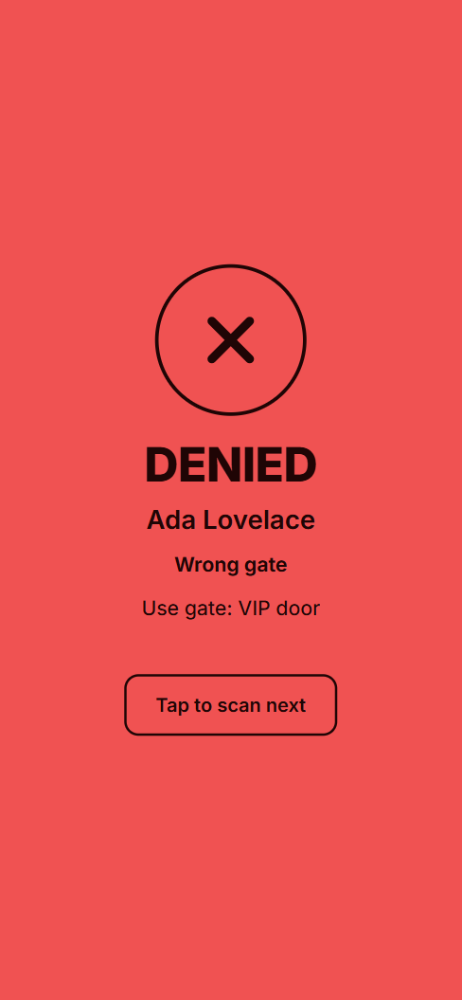

If staff scan too fast, they may see "Too many scans, wait a moment". Pause and try again.

**Opening a pass link never checks someone in.** Only a scan from a set-up door phone does. After entry, the attendee's pass page shows that it has been used.

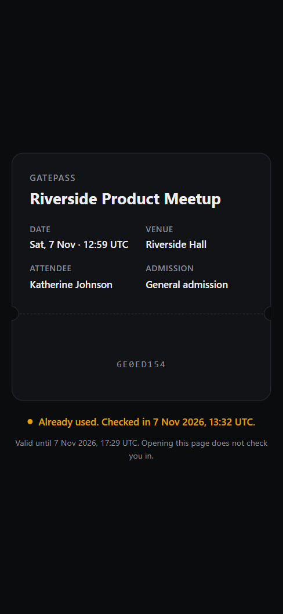

## 10. The dashboard (Operations)

The **Operations** tab shows the event live.

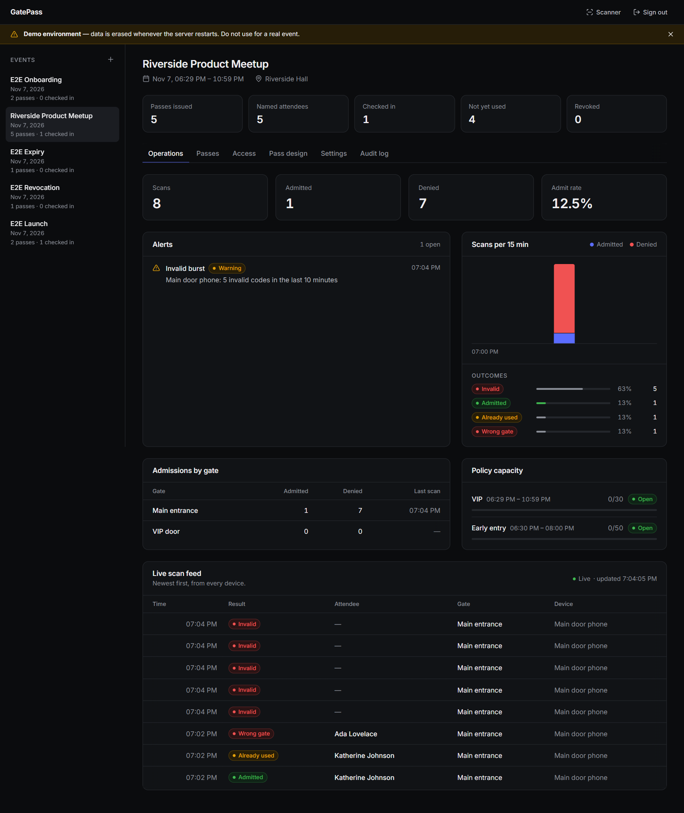

- **Key numbers** – total scans, people admitted, scans denied.
- **Alerts** – things that need your attention (see below).
- **Per-gate table** – admitted and denied at each gate, and the last scan time.
- **Capacity bars** – how full each admission group is.
- **Timeline** – admitted and denied scans in 15-minute blocks.
- **Live feed** – the latest scans as they happen.

### Alerts

| Alert | What it means | What to do |
| --- | --- | --- |
| Pass presented again after entry (2 or more times) | Someone may be sharing a screenshot of a pass. | Tell door staff to check ID for that name. |
| Pass scanned at several gates | The same pass was tried at different doors. | Check whether the pass was copied. |
| Many invalid codes from one device (5 in 10 minutes) | Someone may be trying fake codes, or a printout is damaged. | Check that door and the passes being shown there. |
| Group near capacity (90% or more) | An admission group is almost full. | Raise the capacity if you have room, or warn the door. |

### Audit log

The **Audit log** lists every change made by organisers: events created, passes issued, revoked or reissued, devices added or revoked, and so on.

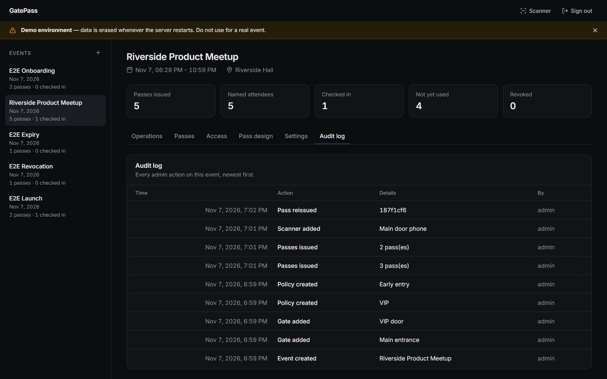

### Fixing mistakes

- **Wrong event times?** Edit them in **Settings**.
- **Pass in the wrong group?** Use **Change policy** on that pass.
- **Group full too early?** Raise the capacity of the policy.
- **Event over?** Archive it. Scans are then refused. You can reopen it if needed.

## 11. When the server is slow or down

- If the server is slow, the scanner shows **"Checking… slow connection"**.
- After about 12 seconds with no answer, it shows **Not verified**. Do not admit; scan again.
- If the phone loses its internet connection, an offline banner appears and the **Check** button is turned off.

Nobody can be admitted while the server cannot be reached. For a real event, plan a fallback, such as a printed guest list at each door.

## 12. Current limitations

We want to be honest about what GatePass does not do yet:

- **Demo data resets.** On free hosting, data is erased when the server restarts or is updated.
- **One shared admin token.** There are no separate staff accounts. Everyone who manages events uses the same token.
- **No emailing.** GatePass does not send passes. You send the links yourself.
- **No offline scanning.** Door phones need an internet connection.
- **Pass links show the name.** Anyone who has a pass link can see the attendee's name on it.
- **Camera scanning is untested on a real phone.** The developer has not yet tried camera scanning on an actual phone. Test it before your event; manual entry is the backup.
- **Time zone.** Times are shown in the time zone of the browser you are using.
