# GatePass user guide

This guide is for event organisers, the managers who help them, and door staff. You do not need any technical knowledge to follow it. Button and field names are written in **bold**, exactly as they appear on screen.

## 1. What GatePass does

GatePass gives each guest a pass with a QR code. At the door, staff scan the QR code with a phone.

- Each pass works **once**. A second scan of the same pass is refused.
- Only door devices that you have set up for the event can check people in. A random phone cannot.
- You can see who has come in, at which gate, while the event runs.
- The server decides every scan. If the phone cannot reach the server, nobody is admitted.

## 2. Who uses it

| Person | What they use | What they do |
| --- | --- | --- |
| Organiser (event owner) | The admin site, with their own account | Creates the event, invites managers, opens and closes the event, exports data. |
| Event manager | The admin site, with their own account | Issues passes, sets up gates, admission policies and door devices, watches the dashboard. |
| Door staff | The scanner at `/scan`, on a phone or tablet | Scan passes and follow what the screen says. Door staff do not need an account. |
| Attendee | Their pass link | Opens the link and shows the QR code at the door. |

## 3. The demo environment

If you see this banner, you are on a demo server:

> **Demo environment** — data is erased whenever the server restarts. Do not use for a real event.

On the public demo (https://gatepass-sandy.vercel.app):

- All data, including accounts, is erased when the server restarts or is updated.
- The server goes to sleep after a period with no use. The next request can take up to a minute; the app shows "Waking up the server… this can take up to a minute on the free demo." while it waits.

Do not run a real event on the demo. You can close the banner with the **×** button; it comes back in a new browser tab.

## 4. Your account

### Create an account

1. Open the GatePass address in your browser. You see **Sign in to GatePass**.
2. Click **Create an account**.
3. Enter **Your name**, **Email** and a **Password** of at least 10 characters. A short sentence is easy to remember.
4. Click **Create account**.

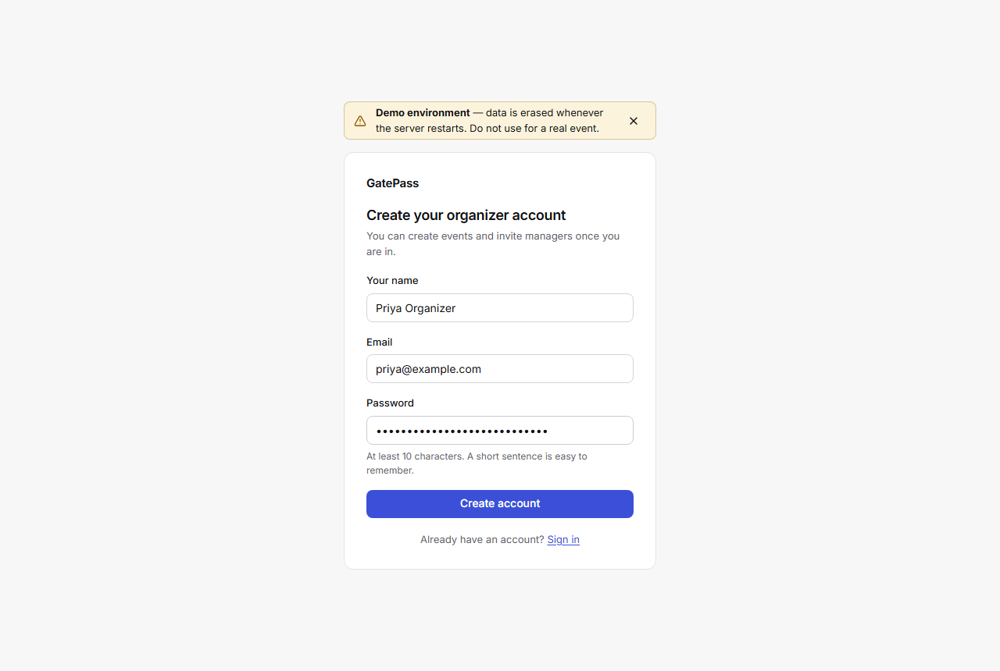

If the sign-in screen says "New accounts are by invitation", this server does not allow self-registration. Ask your GatePass administrator for an invitation link.

### Accept an invitation

An invitation is a one-time link for one email address. GatePass does not send emails; the person who invited you sends you the link.

1. Open the link. The page shows what you are invited to, for example **Join City Tech Meetup** as an **Event manager**, and when the link expires.
2. If you do not have an account yet, enter **Your name** and **Choose a password**, then click **Create account and accept**.
3. If you already have an account with that email, sign in on the same page and click **Sign in and accept**.

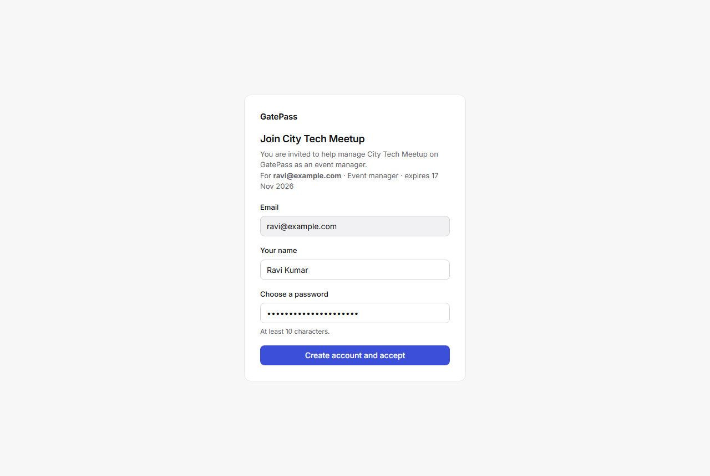

Invitation links expire after 7 days and work once. If the page says the link is no longer valid, ask for a new one.

### Signing in, passwords and sessions

- Sign in with your email and password. After several wrong passwords, sign-in is paused for a while ("Too many attempts").
- To change your password, open the menu with your name (top right) and choose **Change password**. Your other devices are signed out.
- Forgot your password? Ask your GatePass administrator for a reset link. A reset link works for one hour.
- You stay signed in for up to 7 days, or until 24 hours pass without using GatePass. Then you sign in again.

## 5. Create an event

Click **New event** (the **+** next to **Events** in the left column) and fill in:

- **Name** – for example "City Tech Meetup".
- **Venue (optional)**.
- **Time zone** – the zone of the venue. **Starts** and **Ends** are times on a clock in this zone. Attendees, door staff and the dashboard all see times in this zone, labelled (for example "IST"), even if their own device is set to another zone.
- **Starts** and **Ends** – passes are accepted only between these times.
- **Event capacity (optional)** – the most people admitted across every gate and policy, for example the venue limit. Leave it empty for no limit. When it is reached, every further scan is refused with "The event is full".
- **Start as** – **Draft** or **Active**.
  - **Draft**: set up gates, passes and devices first. Scanners refuse every pass until you open the event.
  - **Active**: scanners admit valid passes as soon as the event window starts.

Passes expire when the event ends, unless you set another expiry when you issue them.

Click **Create event**. If something is missing or wrong (for example, the end is before the start), the form says what to fix.

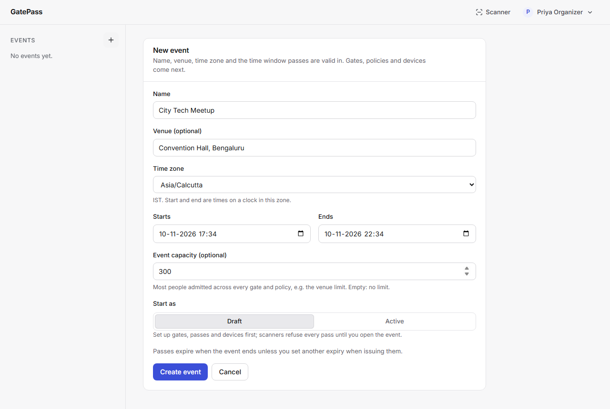

## 6. The setup checklist

A new event shows **Set up this event**, with how many steps are done. Work from the top.

1. **Create event** – done when the event exists.
2. **Add gates** (optional) – one per entrance. Skip if you have a single door.
3. **Configure admission** (optional) – limit some passes to a time slot, gate or capacity. Skip for general admission.
4. **Issue passes** – add attendees and share each pass link.
5. **Set up a scanner** – open the setup link on each door phone.
6. **Open the event (set Active)** – scanners refuse every pass while the event is a draft.
7. **Begin entry** – scan the first pass at the door and watch progress on **Operations**.

Each step has a button that takes you to the right place. Optional steps have **Skip**; **Undo skip** brings them back. **Hide steps** folds the list and **Show steps** opens it again. When folded, **Continue** goes to the next step.

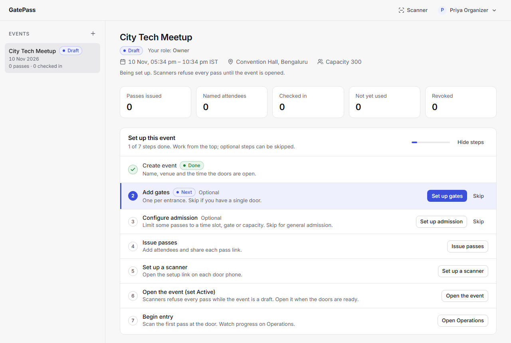

When the event is Active and has passes and at least one scanner, the checklist changes to **Ready for doors**. After the first scan it disappears.

## 7. Gates and admission policies

Open the **Access** tab.

A **gate** is an entrance, such as "North gate". Type a name and click **Add gate**. Use the pencil to rename a gate and the bin to delete it. A gate can only be deleted if no device, policy or past check-in uses it.

An **admission policy** is a group of passes with its own rules. Click **New policy** and set:

- **Name** – for example "VIP" or "Early entry".
- **Entry opens** and **Entry closes** – when these passes may enter. Empty means the event start and end.
- **Capacity** – the most people in this group who may enter. Empty means no limit.
- **Allowed gates** – which gates they may use. None selected means any gate.

Click **Create policy**.

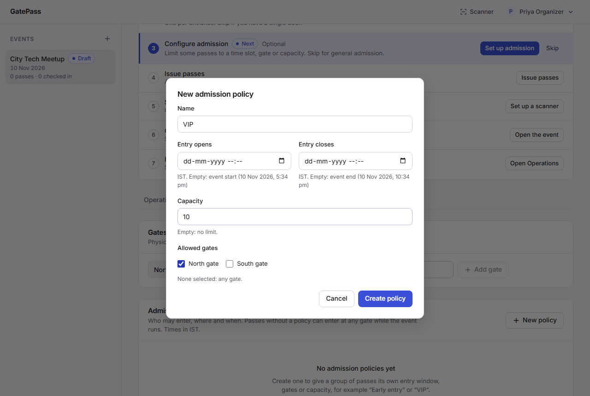

A pass with **no policy** can enter at any gate, at any time while the event runs. A policy can only be deleted if no pass and no past check-in uses it.

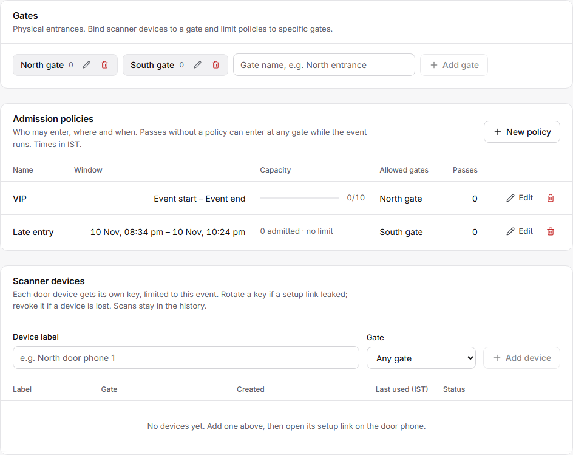

## 8. Issue passes

Open the **Passes** tab.

### Issue passes by hand

Under **Issue passes**, choose:

- **Named attendees** – one per line, as `Name, email`. Email is optional. Put quotes around names that contain a comma. Up to 500 lines at a time.
- **Unnamed batch** – a **Number of passes** from 1 to 500.

You can pick an **Admission policy** and an **Expires** time (empty means the event end). Click **Issue passes** (the button shows how many, for example **Issue 3 passes**).

**Important:** the pass codes are shown **only once**, right after you create them. GatePass keeps only a fingerprint of each pass, not the link. Save them straight away:

- **Link** copies one pass link.
- **PNG** downloads one QR image.
- **CSV of links** downloads every link, with its reference, as a spreadsheet.
- **Print passes** prints them (see section 9).

If you lose a pass link, use **Reissue** (see "Find and manage passes" below). The old code then stops working.

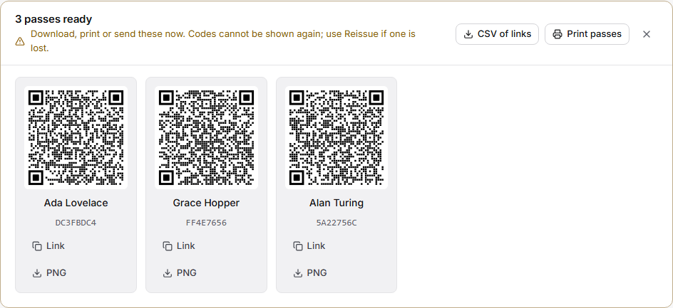

### Import a CSV file

1. Click **Import CSV**.
2. Choose a **CSV file**, or paste rows into **Or paste rows**. A header row such as `Name,Email` (or `First name,Last name,Email`) tells GatePass which column is which. Without a header, the first column is the name and the second the email. Up to 2,000 rows and 2 MB per file.
3. Optionally choose an **Admission policy** and **Expires** time.
4. Click **Preview import**. Nothing is issued yet.
5. **Check the import** shows how many passes will be issued, the first rows as GatePass read them, and every skipped row with its reason:
   - **Already has a pass** – that email already has a pass for this event that is not revoked.
   - **Duplicate in file** – the same email appears earlier in the file.
   - **Invalid email**, **Too long** or **Empty row**.
6. Click **Issue N passes** to confirm, or **Back** to change the rows.

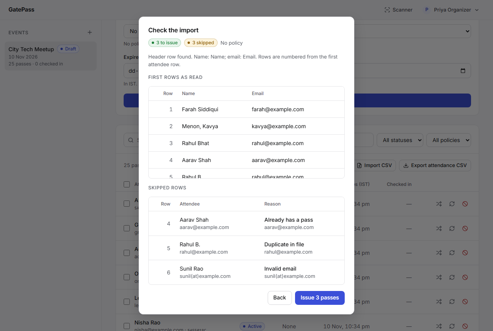

After the import, the new passes are shown once, the same as passes issued by hand.

### Send passes to attendees

GatePass does not send emails. You send each link yourself, by email, chat or text message, or you hand out printed passes. The attendee opens the link and shows the QR code at the door.

The pass page shows the event, the times in the event's time zone, the attendee's name, what the pass allows (for example "General admission"), the QR code and an 8-character **Reference (for manual entry at the door)**. Opening the page does not check anyone in.

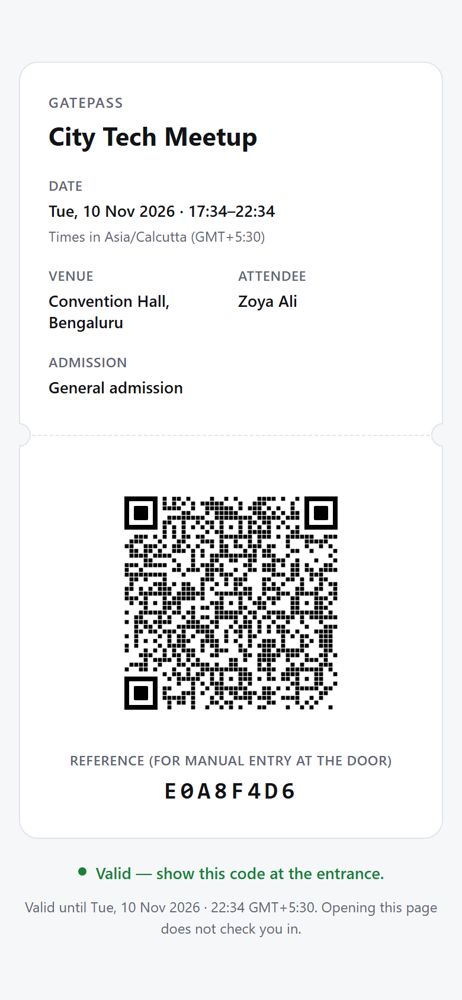

### Find and manage passes

The list shows every pass with its status (**Active**, **Redeemed**, **Revoked**, **Expired**), policy, expiry and check-in time. Search by name, email or pass ID, and filter by status or policy. The list shows 50 passes per page; use **Previous** and **Next**.

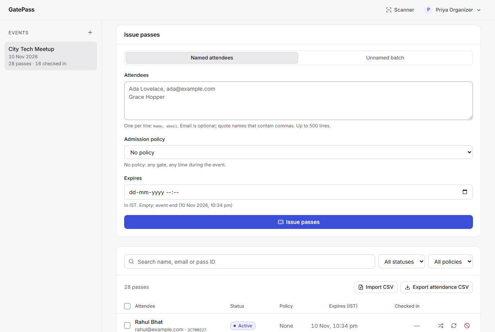

Actions on a pass (icons at the end of the row):

- **Change policy** – moves the pass to another group, for example from no policy to VIP. The QR code stays the same.
- **Reissue** – for a lost pass. You get a new code and link, shown once. The old code stops working immediately.
- **Revoke** – cancels the pass. It is refused at the door. This cannot be undone; issue a new pass if it was a mistake.

To revoke many passes, tick them and click **Revoke selected**. Passes that were already used or revoked are skipped.

Owners can also click **Export attendance CSV**.

## 9. Print passes

Right after issuing or importing, click **Print passes** on the "passes ready" card. GatePass prepares one cut-out pass per attendee and opens your browser's print dialog. Each printed pass has the QR code, the attendee's name, the event, the time, the venue and the reference ("Ref"), which door staff can type in if the QR code will not scan.

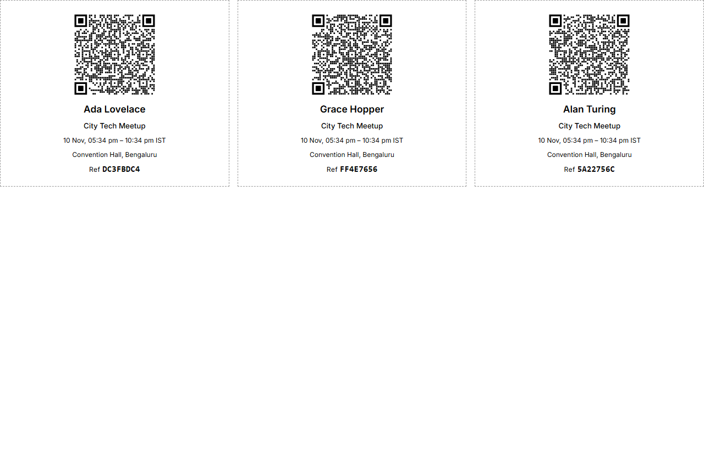

Printing is limited to 500 passes at a time; for larger batches use the CSV of links. You can only print while the codes are still on screen. To print a pass later, **Reissue** it first.

## 10. Set up door devices (scanners)

Each door phone or tablet gets its own key, which only works for this event.

1. In the **Access** tab, under **Scanner devices**, enter a **Device label** (for example "North phone 1") and choose its **Gate** (or **Any gate**).
2. Click **Add device**. A setup card appears with a QR code and a **Setup link**.
3. On the door device, scan the setup QR code with the camera, or open the setup link. The device remembers its key; staff only do this once per device.
4. Click **Done**. The key is shown only once.

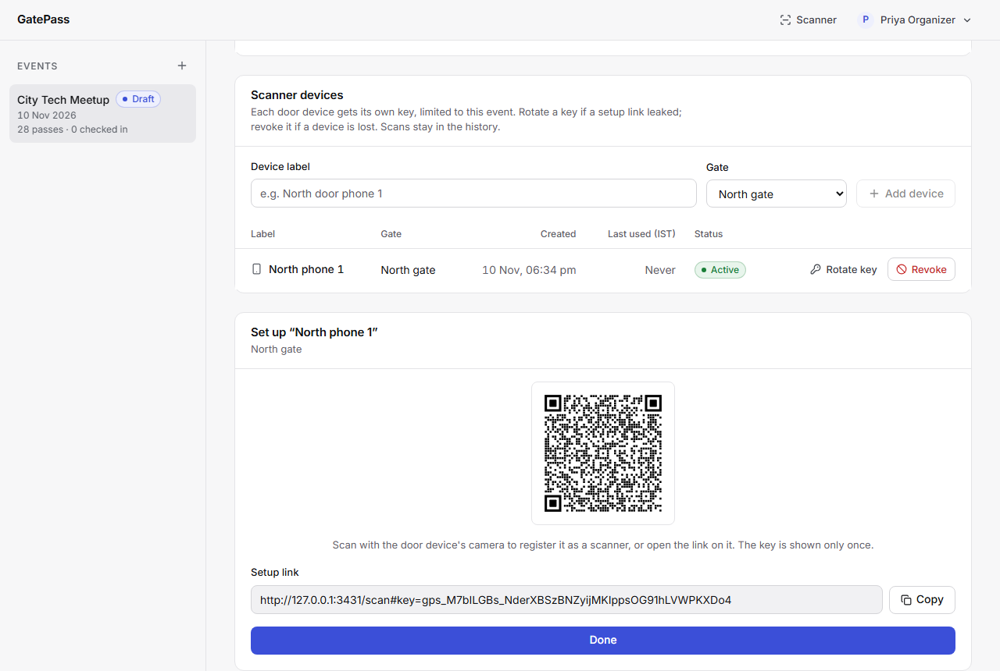

Treat the setup link like a key: anyone who has it can scan for your event.

- **Rotate key** – use this if a setup link was shared by mistake. The old key and link stop working immediately and you get a new setup link. History and gate stay the same.
- **Revoke** – use this if a device is lost or stolen. It can no longer scan. Its past scans stay in the history. To use it again, add it as a new device.

The device table shows when each device was **Last used**.

### Open the event

When gates, passes and devices are ready, open the **Settings** tab and click **Open the event**, then confirm. Only the owner can do this. The checklist then shows **Ready for doors**.

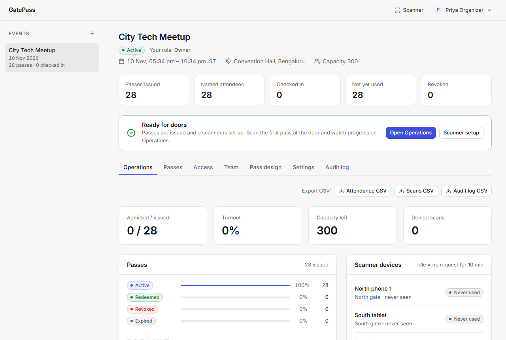

## 11. Scanning at the door

### The scanner screen

The top of the screen shows the event name, the device label, the gate (for example **Gate: North gate**), the event's local time and the connection (**Online**, **Slow connection** or **Offline**). The icons on the right switch the sound, camera and flashlight (when the device has one) and sign the device out.

1. Tap **Tap to start scanning**. This turns on the camera and the sound for results.
2. Point the camera at the attendee's QR code.
3. Read the result and do what it says.

If the camera does not work, type the 8-character reference from the pass (or paste the pass link) into **Pass link or code** and tap **Check**.

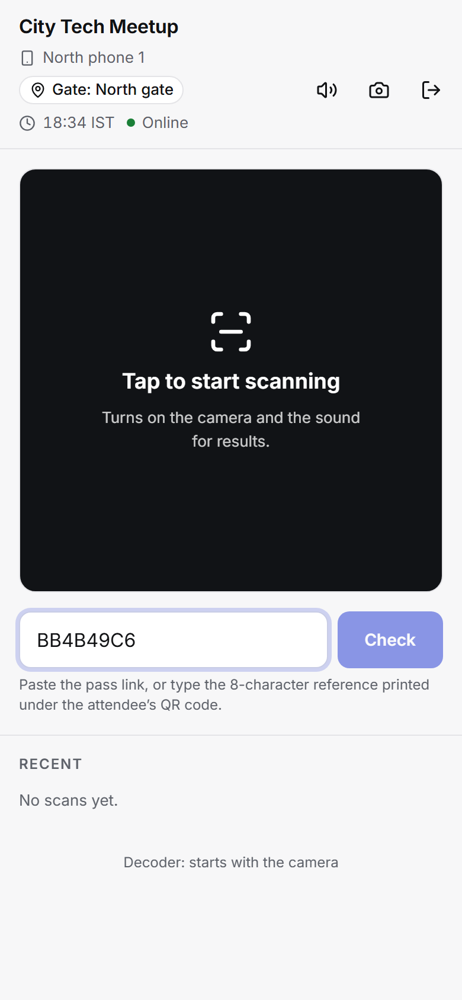

The camera only works on a secure (HTTPS) address. If the event is not Active, the scanner shows a warning that every pass will be refused.

### Results

The result covers the whole screen. Colour, icon and headline all differ, so staff do not have to rely on colour alone. **Scan next** (or a tap anywhere) returns to scanning. The **Recent** list keeps the last 15 results.

| Headline | Reason and detail | What staff should do |
| --- | --- | --- |
| **Admit** | Let them in. | Let the person in. |
| **Already used** | First used at (time) at (gate). | **Do not admit.** The pass was used before. Ask for ID or call the organiser. |
| **Denied** | Revoked – This pass was revoked by the organiser. | Do not admit. Send them to the organiser. |
| **Denied** | Expired – This pass has expired. | Do not admit. |
| **Denied** | Invalid – Not a valid pass for this event. | Do not admit. It may be for another event, or fake. |
| **Denied** | Event closed – Check-in for this event is closed. | Do not admit. The event is a draft, ended or archived. |
| **Denied** | Too early – Entry opens at (time). | Ask them to come back at that time. |
| **Denied** | Too late – Entry closed at (time). | Do not admit. Their time slot is over. |
| **Denied** | Wrong gate – Use gate: (gate name). | Send them to the right gate. |
| **Denied** | Capacity full – (group) is full, or The event is full. | Do not admit. The limit has been reached. |
| **Not verified** | No response or no connection from the server. | **Do not admit.** Tap **Retry verification**. |

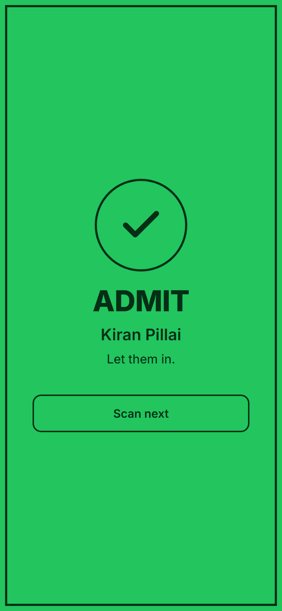

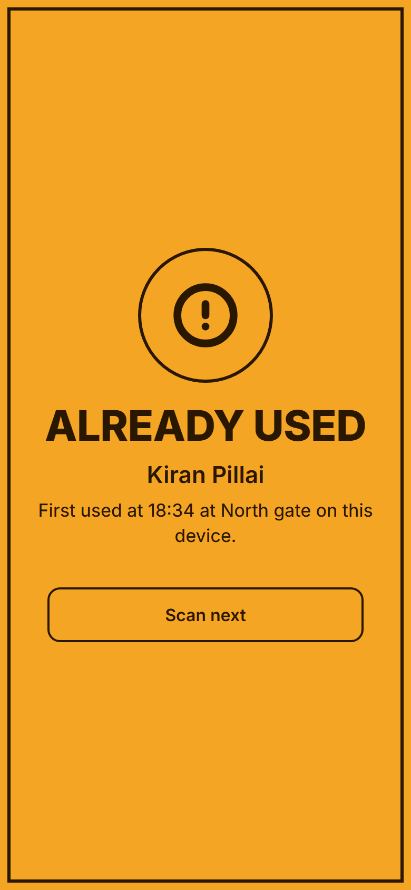

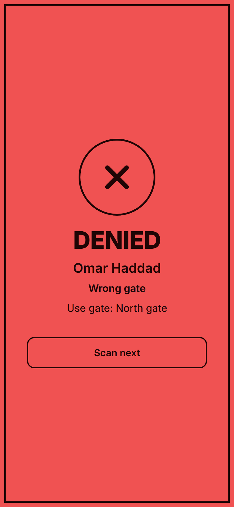

If staff scan too fast they may see "Too many scans, wait a moment". Pause and try again.

### Not verified, and retrying after reconnecting

**Not verified** means the phone did not get an answer from the server. The server may or may not have checked the pass. Never admit on **Not verified**.

Tap **Retry verification** when the connection is back. The phone sends the same check again, so the server cannot count the pass twice:

- If the server had already admitted the pass, the result is **Admit** with **Confirmed after reconnect**. Let the person in; this is not a second use.
- Otherwise the result is the normal answer for that pass.

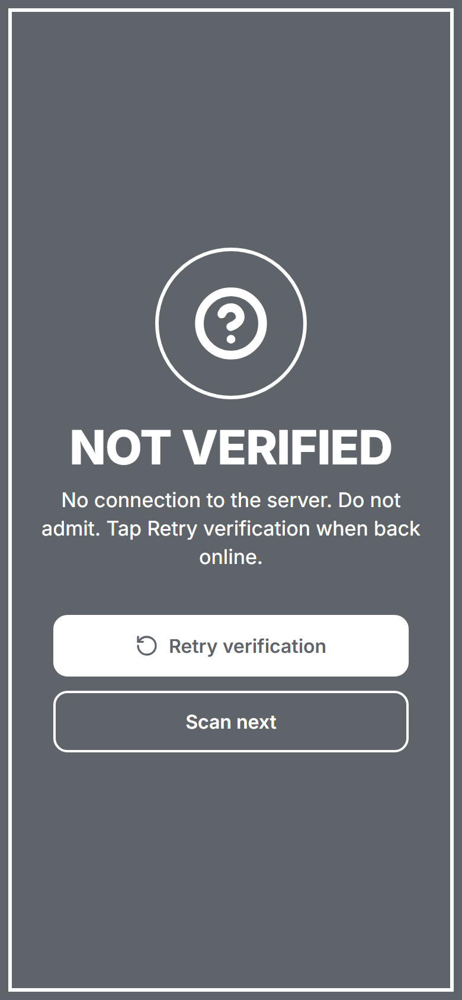

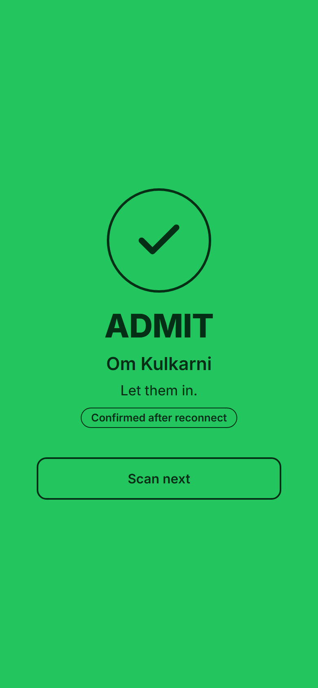

If the check takes longer than usual, the scanner shows "Checking… slow connection". After 12 seconds with no answer it shows **Not verified**.

### Offline means do not admit

When the device loses its internet connection, a red banner says "Scanning paused — offline. Do not admit anyone until the connection returns." Scanning and the **Check** button stop until the connection returns.

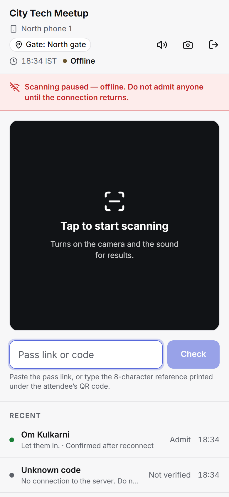

GatePass has no offline mode. Nobody can be admitted while the server cannot be reached. For a real event, plan a fallback with the organiser, for example a printed guest list at each door.

### After entry

Opening a pass link never checks anyone in; only a scan from a set-up device does. After entry, the attendee's pass page says "Already used" with the check-in time, and no longer shows the QR code.

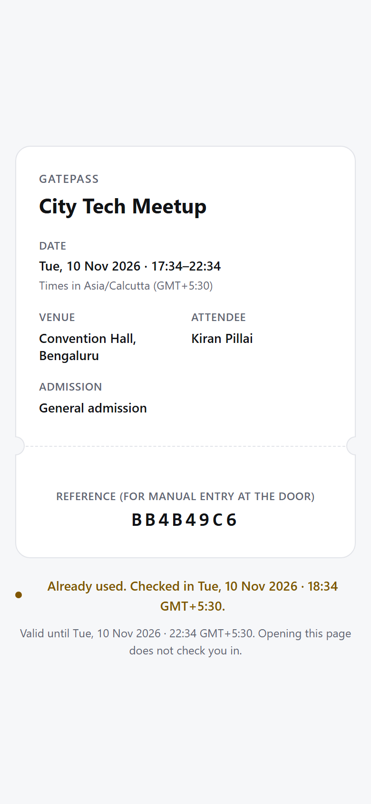

## 12. Team: owners and managers

Open the **Team** tab. Each event has one **Owner** (the person who created it) and any number of **Managers**.

To invite a manager:

1. Enter the **Manager email** and click **Create invitation**.
2. Copy the **Invitation link** and send it to that person yourself. No email is sent. The link is shown only once, works once, only for that email address, and expires after 7 days.
3. The **Invitations** list shows each invitation as **Pending**, **Accepted**, **Revoked** or **Expired**. You can **Revoke** a pending invitation.

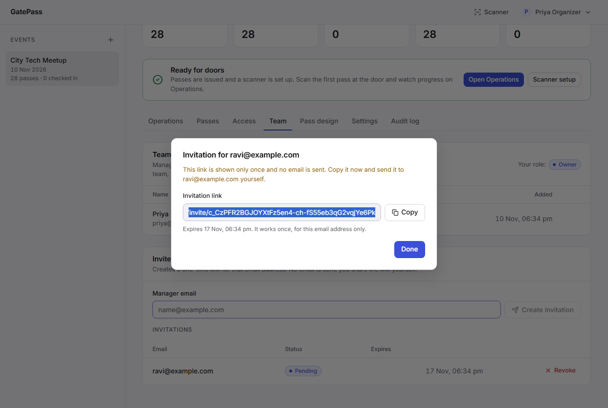

When the manager accepts, they appear in the team list. The owner can:

- **Remove** a manager. They lose access to this event immediately. Their past actions stay in the audit log. If they set up door devices, those device keys are revoked too.
- **Make owner** – hands the event to that manager. You become a manager and cannot undo this yourself.

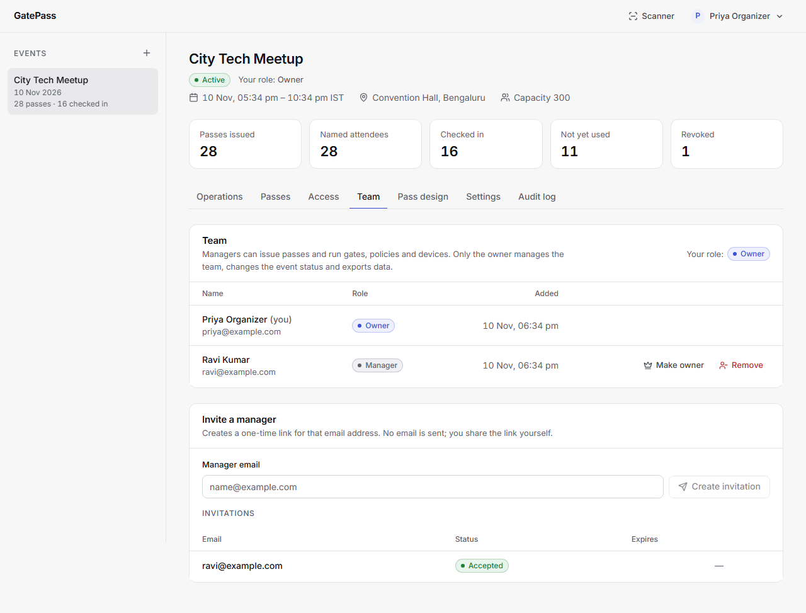

### What each role can do

| Action | Owner | Manager |
| --- | --- | --- |
| See the event, dashboard, passes and audit log | Yes | Yes |
| Edit event details, pass design, gates and policies | Yes | Yes |
| Issue, import, reissue, revoke passes; change a pass's policy | Yes | Yes |
| Add, rotate and revoke door devices | Yes | Yes |
| Clone the event (you become owner of the copy) | Yes | Yes |
| Open, end, archive or reopen the event | Yes | No |
| Invite and remove managers; transfer ownership | Yes | No |
| Download CSV exports | Yes | No |

Platform admins (people who manage accounts on the server) do not see events unless they are on the event's team.

## 13. Operations dashboard and exports

The **Operations** tab shows the event live. It refreshes by itself while the tab is open.

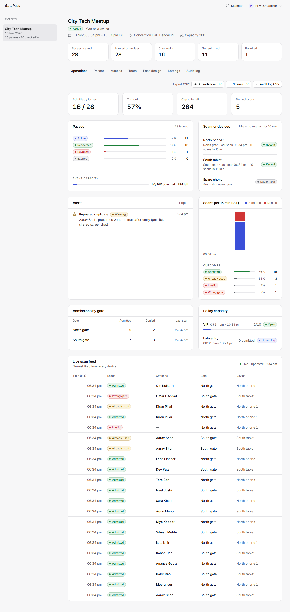

- **Admitted / issued**, **Turnout**, **Capacity left** and **Denied scans**.
- **Passes** – how many passes are Active (valid, not used yet), Redeemed, Revoked and Expired, and the **Event capacity** bar.
- **Scanner devices** – each device with its gate and when it was last seen: **Recent**, **Idle** (no request for 10 minutes), **Never used** or **Revoked**. An idle device at an open door may have lost its connection or been closed.
- **Alerts** – see below.
- **Scans per 15 min** – admitted and denied scans over time, with the **Outcomes** breakdown.
- **Admissions by gate** – admitted and denied at each gate, and the last scan time.
- **Policy capacity** – how full each admission policy is, and whether it is **Upcoming**, **Open**, **Full** or **Closed**.
- **Live scan feed** – the latest scans from every device, newest first.

### Alerts

| Alert | When it appears | What to do |
| --- | --- | --- |
| **Repeated duplicate** | A pass was presented again 2 or more times after entry. Someone may be sharing a screenshot. | Tell door staff to check ID for that name. |
| **Multiple gates** | The same pass was scanned at different gates. | Check whether the pass was copied. |
| **Invalid burst** | One device saw 5 or more invalid codes within 10 minutes. Someone may be trying fake codes, or a printout is damaged. | Check that door and the passes being shown there. |
| **Near capacity** | An admission policy is at 90% or more of its capacity. | Raise the capacity if you have room, or warn the door. |

### Exports

Owners see **Export CSV:** with **Attendance CSV**, **Scans CSV** and **Audit log CSV**. The files open in any spreadsheet program. Managers do not see exports.

## 14. Audit log

The **Audit log** tab lists every change to the event and who made it, newest first: events created or updated, status changes, passes issued, imported, revoked or reissued, policy changes, devices added, rotated or revoked, gates, team changes and invitations. Search by person, name or ID, or filter by type of action. **Load older** shows earlier entries.

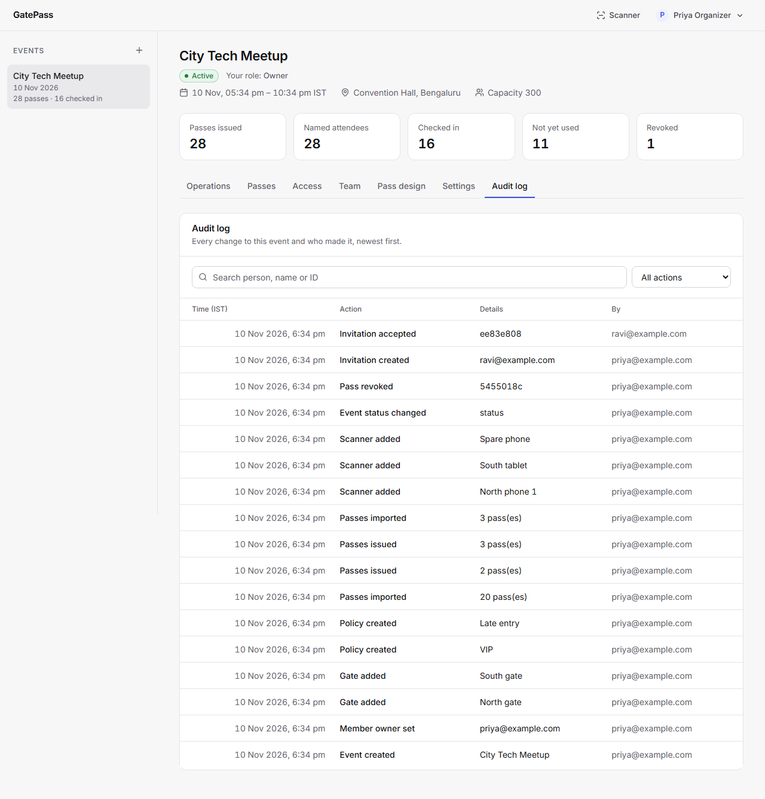

## 15. Event lifecycle: end, archive, reopen, clone

Open the **Settings** tab. **Event status** shows where the event is. Only an **Active** event admits anyone.

| Status | What it means | Moves available (owner only) |
| --- | --- | --- |
| **Draft** | Being set up. Scanners refuse every pass. | **Open the event**, **Archive** |
| **Active** | Doors open. Scanners admit valid passes inside the event and policy windows. | **End the event**, **Archive** |
| **Ended** | Closed. Scanners refuse every pass; no new passes can be issued. | **Reopen the event**, **Archive** |
| **Archived** | Read-only history. Nothing can be changed and no one is admitted. Scans, passes and the audit log stay available. | **Restore as ended** |

Each move asks you to confirm.

**Event details** lets you change the name, venue, time zone, times and capacity. Capacity cannot be set lower than the number of people already admitted.

**Clone event** creates a new draft with the same venue, time zone, capacity, pass design, gates and policies. Policy times move with the new start. Passes, devices and the team are not copied. Enter a **New event name**, **New start** and **New end**, then click **Clone event**.

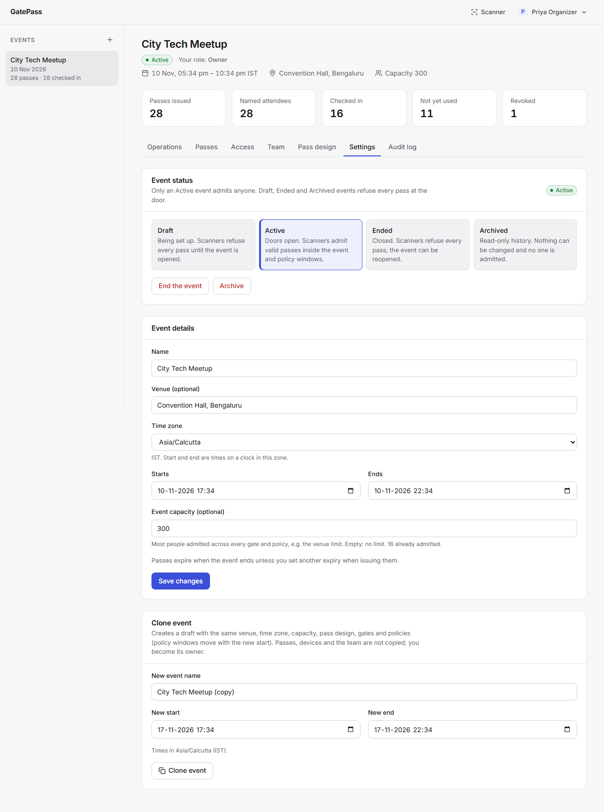

The **Pass design** tab changes the look of the QR code (colours, templates, logo). Every design is checked with the same decoder the scanner uses before you can save it. It applies to passes issued or reissued after saving.

## 16. Troubleshooting

| Problem | What to do |
| --- | --- |
| "Waking up the server…" | Wait up to a minute (demo only). |
| "Too many attempts" when signing in | Wait the time shown, then try again. Ask your administrator for a reset link if you forgot your password. |
| "Your session has ended" | Sign in again. Sessions end after 7 days, or after 24 hours without use. |
| Invitation or reset link "no longer valid" | It expired, was revoked or was already used. Ask for a new one. |
| Every scan says Denied – Event closed | The event is a draft, ended or archived. The owner opens it in **Settings**. |
| Scans say Too early or Too late | Check the event times and the policy's **Entry opens** / **Entry closes** in the event's time zone. |
| Scans say Wrong gate | The pass's policy does not allow this device's gate. Send the guest to the gate shown, or change the pass's policy. |
| A group fills up too early | Raise the policy's **Capacity** on the **Access** tab, or the event capacity in **Settings**. |
| A guest lost their pass | Find them on the **Passes** tab and **Reissue**. Send the new link. |
| The scanner says the key is not valid or the device was revoked | Ask the organiser for a new setup link (add the device again, or **Rotate key**). |
| The camera does not start | Allow camera access in the browser, use **Retry camera**, or type the reference with **Pass link or code**. The scanner must be on an HTTPS address. |
| **Not verified** or offline | Do not admit. Restore the connection, then **Retry verification**. |
| A device shows **Idle** on the dashboard | Check the device at that gate: it may be offline, asleep or closed. |
| Need to change something on an archived event | The owner clicks **Restore as ended** in **Settings**. |

## 17. Current limitations

- **Demo data resets.** On the demo server, all data is erased when the server restarts or is updated.
- **No emailing.** GatePass does not send passes, invitations or reset links. You send them yourself.
- **No offline scanning.** Door devices need an internet connection. Plan a fallback for real events.
- **Pass links show the name.** Anyone who has a pass link can see the attendee's name on it.
- **Camera scanning on real phones is not verified.** Camera scanning has not yet been tested on a physical iPhone or Android phone. Test it on your own devices before your event; manual entry of the reference is the backup.
- **Pass codes are shown once.** Lost links cannot be shown again; reissue the pass instead.
