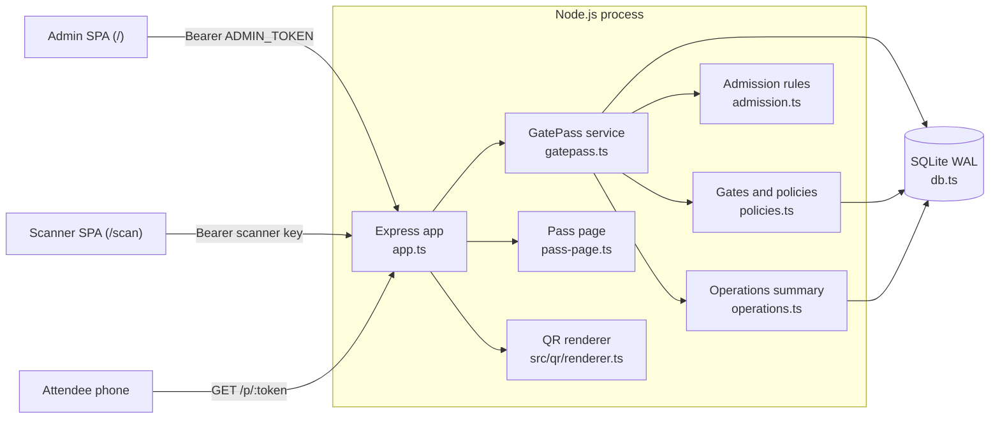
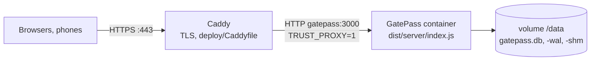
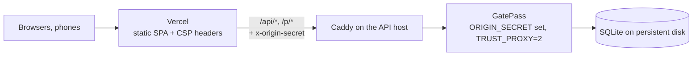

# Architecture

GatePass runs as one Node.js process. It serves a JSON API, a server-rendered attendee pass page and the built React bundle, and stores everything in one SQLite file. Design decisions are recorded in [decisions/](decisions/README.md); the threat model is in [threat-model.md](threat-model.md).



## Server modules

| Module (`src/server/`) | Responsibility |
| --- | --- |
| `index.ts` | Entry point: loads config, opens the database, starts HTTP or HTTPS, shuts down on `SIGTERM`/`SIGINT` (forced exit after 10 s). `node dist/server/index.js backup <file>` writes a verified online backup instead. |
| `config.ts` | Validates environment variables with zod. Refuses `TRUST_PROXY=true`, an `ADMIN_TOKEN` under 24 characters and an `ORIGIN_SECRET` under 32. |
| `app.ts` | Express app: optional `X-Origin-Secret` gate, helmet/CSP, `Permissions-Policy`, `no-store`, rate limits, zod request schemas, admin and scanner authentication, routes, static SPA. |
| `http.ts` | Error handler (zod → 400, 4xx pass-through, generic 500), `rateLimit` wrapper around `express-rate-limit`, `FailureThrottle` (in-memory per-IP count of failed authentications), bearer-token parsing. |
| `gatepass.ts` | Domain service: events, passes, scanners, redemption, scan feed. Every write runs in `transaction()`. |
| `policies.ts` | `AccessControl`: gates, admission policies, policy-gate links, the capacity claim used by redemption. |
| `admission.ts` | `evaluateAdmission`: pure, ordered admission rules. No I/O. |
| `operations.ts` | Read-only aggregates for the operations dashboard: totals, per-gate and per-policy counts, 15-minute timeline, alerts. |
| `audit.ts` | Writes and reads `audit_log` rows for admin actions. |
| `db.ts` | Opens SQLite (`node:sqlite`), sets pragmas, runs migrations (with pre-upgrade backup and newer-schema guard), `VACUUM INTO` backup, `BEGIN IMMEDIATE` transaction helper. |
| `tokens.ts` | Token generation (32 random bytes), SHA-256 hashing, token extraction from scanned text, constant-time comparison. |
| `pass-page.ts` | Script-free HTML for `/p/:token`; every value HTML-escaped. |
| `values.ts` | UTC ISO-8601 normalisation and SQLite constraint-error detection. |

Other code: `src/qr/` is the QR renderer retained from upstream; `src/shared/types.ts` holds types shared with the client; `src/client/` is the React bundle (`main.tsx` picks the scanner app for `/scan`, the admin app otherwise; `qr-detector.ts` chooses native `BarcodeDetector` or the self-hosted ZXing WebAssembly decoder; `csv.ts` builds formula-safe CSV exports).

## Request pipeline

In order, for every request:

1. If `ORIGIN_SECRET` is set, anything except `/api/health` without a matching `X-Origin-Secret` header gets 403.
2. helmet sets security headers; `Permissions-Policy` allows the camera for this origin only; `/api` and `/p` responses are `Cache-Control: no-store`.
3. `/api/*` except `/api/scanner/*`: 600 requests per minute per client IP.
4. JSON bodies are capped at 100 kB; handlers parse bodies and queries with strict zod schemas.
5. Admin routes compare the bearer token with `ADMIN_TOKEN` in constant time. Scanner routes look up `sha256(key)` among unrevoked scanners and attach the scanner (event, optional gate) to the request. A failed check is counted per IP by `FailureThrottle` (`http.ts`): the response is 401, or 429 with `Retry-After` once that IP has more than 60 failures in 5 minutes. Valid credentials are never refused by the throttle.
6. Per-route limits: scanner session 60 per minute and redeem 240 per minute, both **per scanner device** (keyed after authentication, so gates behind one NAT address do not share a bucket); `/api/qr/custom` 120 per minute per IP (admin only); `/p/:token` 60 per minute per IP.
7. Service methods are synchronous (`node:sqlite` is synchronous). Errors with a 4xx `status` are returned as is; anything else becomes a generic 500.

Client IPs come from `req.ip`, which honours `X-Forwarded-For` only for the number of hops set in `TRUST_PROXY`.

## Admission model

Each event has **gates** (named doors) and **admission policies** (an entry window, an optional capacity and an optional list of allowed gates). A pass belongs to one policy or to the default policy (`passes.policy_id IS NULL`: event start to event end, any gate, no cap). A scanner is either bound to one gate or unrestricted (`scanners.gate_id IS NULL`). Cross-event references are refused by the service and by triggers. Full design: [ADR 0004](decisions/0004-admission-policy-engine.md).

`evaluateAdmission` decides in this order: `invalid` (unknown code), `wrong_event` (reported to the scanner as `invalid`), `event_closed`, `already_redeemed`, `revoked`, `expired`, `too_early`, `too_late`, `wrong_gate`, `capacity_full`. A gate restriction applies only when both the scanner and the policy name gates.

## Redemption flow

```mermaid
sequenceDiagram
  participant S as Scanner device
  participant A as Express (app.ts)
  participant G as GatePass.redeem
  participant D as SQLite
  S->>A: POST /api/scanner/redeem {code}, Bearer gps_…
  A->>D: SELECT scanner WHERE key_hash = sha256(key) AND revoked_at IS NULL
  A->>A: per-device limit, zod {code ≤ 2048 chars}
  A->>G: redeem(scanner, code)
  G->>D: BEGIN IMMEDIATE (takes the write lock)
  G->>D: pass by sha256(token), with redemption row
  G->>D: event window and status (no per-event counts)
  G->>D: policy and allowed gates (if the pass has a policy)
  G->>G: evaluateAdmission(now, scanner, event, pass, policy)
  alt admitted by the rules and pass has a policy
    G->>D: UPDATE admission_policies SET admitted_count = admitted_count + 1<br/>WHERE id = ? AND (capacity IS NULL OR admitted_count < capacity)
    Note over G,D: 0 rows changed → capacity_full
  end
  opt still admitted
    G->>D: INSERT INTO redemptions … ON CONFLICT (pass_id) DO NOTHING
  end
  G->>D: INSERT INTO scans (outcome, gate); UPDATE scanners.last_used_at
  G->>D: COMMIT (any error → ROLLBACK of all of the above)
  G-->>S: {outcome, scanId, checkedAt, pass?, detail?}
```

`BEGIN IMMEDIATE` makes a second connection wait (up to `busy_timeout = 5000` ms) until the first commits, so it reads the committed redemption and counter. Two schema rules back this up: `redemptions.pass_id` is the primary key, and `admission_policies` has `CHECK (capacity IS NULL OR admitted_count <= capacity)`. See [ADR 0003](decisions/0003-redemption-atomicity.md).

A `wrong_event` result never includes pass or policy details. Every attempt, admitted or not, is stored in `scans` with the scanner and gate.

## Pass lifecycle


Status is not stored; it is computed on read from the `redemptions` row, `revoked_at` and `expires_at`. Redeemed passes cannot be revoked or moved to another policy. Only active passes can be reissued. `expiresAt` defaults to the event end, and issuance refuses an expiry at or before the event start.

The QR code encodes `${APP_PUBLIC_URL}/p/<token>`. The scanner accepts that URL from any origin (matched on the `/p/<43-character token>` suffix) or the bare token. Opening `/p/<token>` never changes state.

## Scanner setup

The admin creates a scanner (optionally bound to a gate) and receives a `gps_…` key once. The UI shows `${origin}/scan#key=<key>` as a link and QR code. The scanner page reads the fragment, stores the key in `localStorage` and removes the fragment with `history.replaceState`; browsers do not send fragments to servers. A 401 from any scanner request clears the stored key. The camera loop (`src/client/scanner/ScannerStation.tsx`) runs detection every 150 ms, ignores the same code for 4 s and holds each result for 2.5 s. Without a secure context or camera permission the page offers manual entry.

## Operations dashboard and audit

`GET /api/events/:id/operations` returns read-only aggregates computed from `scans`, `gates` and `admission_policies`:

- totals and per-outcome counts; admitted/denied per gate (plus "Any gate" for unrestricted scanners); admitted versus capacity per policy with state `upcoming`/`open`/`full`/`closed`; a timeline in 15-minute buckets (last 96);
- alerts (`ALERT_RULES` in `operations.ts`): a pass rejected as `already_redeemed` 2 or more times; a pass scanned at 2 or more gates; 5 or more invalid or wrong-event codes from one device within 10 minutes; a policy at 90 % of capacity or more.

The admin client polls this endpoint and `GET /api/events/:id/scans?after=<last id>` (cursor on the `(event_id, id)` index) while the tab is visible. Admin mutations write `audit_log` rows with actor `admin`: `event.created`, `event.updated`, `passes.issued`, `pass.policy_changed`, `pass.revoked`, `pass.reissued`, `scanner.created`, `scanner.revoked`, `gate.created`, `policy.created`, `policy.updated`.

## Pass design

Each event stores a normalised `DesignConfig` in `events.design_json`. The admin client renders previews through `POST /api/qr/custom` (admin token required). The pass page renders SVG on the server with the event's design. The design tab decodes the preview with the scanner's detector and will not save a design that fails to decode.

## Persistence

Schema: [README.md#database-design](../README.md#database-design). Migrations are an append-only array in `db.ts`, tracked by `PRAGMA user_version`; each runs in its own transaction with the version bump. Before migrating an existing file the server writes `<file>.pre-v<N>.bak` (`VACUUM INTO`, then `PRAGMA integrity_check` on the copy). A database with a newer schema version than the build, or a corrupt file, stops startup; neither is ever replaced. One process per database file.

## Deployment topologies

Details: [deployment.md](deployment.md) and [ADR 0007](decisions/0007-hosting.md).

**Single host (recommended).** Docker Compose on one VM (for example an Oracle Cloud Always Free Ampere A1 instance):



The app port is published on `127.0.0.1` only. Caddy has no access log, because pass URLs are credentials.

**Vercel frontend + API host (optional).** `vercel.mjs` serves the static `dist/client` build from Vercel and proxies `/api/*` and `/p/*` to `GATEPASS_BACKEND_ORIGIN`, setting `x-origin-secret` on every proxied request:



The GatePass server never runs on Vercel: Vercel functions have no persistent filesystem for SQLite. With `ORIGIN_SECRET` set, requests that skip Vercel get 403 (except `/api/health`).
