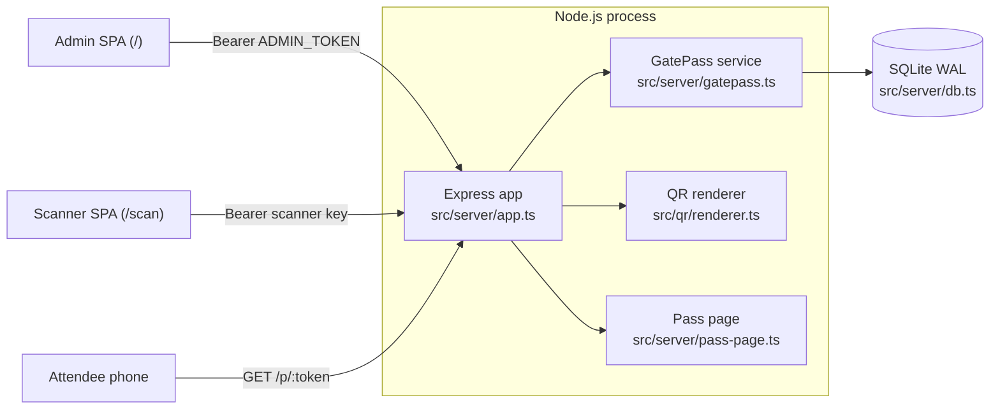
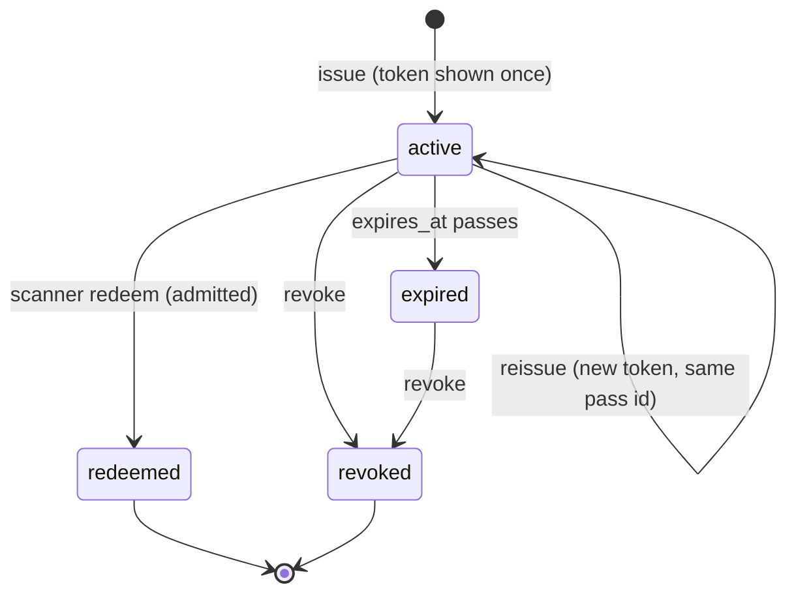

# Architecture

GatePass runs as one Node.js process. It serves a JSON API, a server-rendered attendee pass page, and a built React bundle, and stores data in a single SQLite file.

## Source layout

| Path | Responsibility |
| --- | --- |
| `src/server/index.ts` | Entry point. Loads config, opens the database, starts HTTP or HTTPS, and shuts down cleanly on `SIGTERM`/`SIGINT` (closes the server, then the database; forced exit after 10 s). |
| `src/server/config.ts` | Validates environment variables with zod. Converts `TRUST_PROXY` into the value Express expects. |
| `src/server/app.ts` | Express app: helmet/CSP, `Permissions-Policy`, `no-store` on `/api` and `/p`, rate limits, zod request schemas, admin and scanner auth middleware, routes, static SPA hosting. |
| `src/server/http.ts` | Error handler (zod → 400, 4xx pass-through, generic 500), rate-limit wrapper around `express-rate-limit`, bearer-token parsing. |
| `src/server/gatepass.ts` | Domain service: events, passes, scanners, redemption, scan feed, audit log. All writes go through `transaction()`. |
| `src/server/db.ts` | Opens SQLite (`node:sqlite`), sets pragmas, runs migrations, provides the `BEGIN IMMEDIATE` transaction helper. |
| `src/server/tokens.ts` | Token generation, SHA-256 hashing, token extraction from scanned text, constant-time comparison. |
| `src/server/pass-page.ts` | Script-free HTML for `/p/:token`, with all values HTML-escaped. |
| `src/qr/` | QR renderer, design presets/templates and logo icons, retained from upstream. |
| `src/shared/types.ts` | Types shared by server and client. |
| `src/client/main.tsx` | Picks `ScannerApp` when the path starts with `/scan`, otherwise `AdminApp`. |
| `src/client/admin/` | Admin UI: event list and form, and per-event tabs for Passes, Live scans, Scanners, Pass design, Settings and Audit log. |
| `src/client/scanner/ScannerApp.tsx` | Door scanner: key setup, camera loop, manual entry, result overlay. |
| `src/client/qr-detector.ts` | QR detector: native `BarcodeDetector` when it supports QR, otherwise the ZXing WebAssembly ponyfill served from this origin. |

## Request flow

1. helmet sets security headers on every response. `/api` and `/p` responses are marked `Cache-Control: no-store`.
2. `/api/*` is rate-limited to 600 requests per minute per client IP. Some routes have additional limits: redeem 240/min, QR render 120/min, pass page 60/min.
3. JSON bodies are capped at 100 kB. Route handlers parse bodies and queries with zod strict schemas.
4. Admin routes compare `Authorization: Bearer` against `ADMIN_TOKEN` in constant time. Scanner routes hash the key and look up an unrevoked scanner, then store it in `res.locals.scanner`.
5. The service methods are synchronous (`node:sqlite` is synchronous). An error with a 4xx `status` is returned to the client as is; anything else becomes a generic 500.

## Pass lifecycle

Status is not stored. It is computed on every read from the `redemptions` row, `revoked_at` and `expires_at`. Redeemed passes cannot be revoked. Only active passes can be reissued.

The QR code encodes `${APP_PUBLIC_URL}/p/<token>`. The scanner accepts either that URL (any origin, matched on the `/p/<43-char token>` suffix) or the bare token.

## Redemption

`GatePass.redeem` runs inside one `BEGIN IMMEDIATE` transaction:

1. Extract the token from the scanned text and look up the pass by `sha256(token)`.
2. Decide the outcome, in order: `invalid`, then `wrong_event` (reported as `invalid`), `event_closed`, `already_redeemed`, `revoked`, `expired`.
3. If none of those apply, `INSERT INTO redemptions ... ON CONFLICT (pass_id) DO NOTHING`. One changed row means `admitted`. Zero rows means `already_redeemed`.
4. Insert one row into `scans`.

`BEGIN IMMEDIATE` takes the write lock before the read, so a second connection waits (up to `busy_timeout = 5000` ms) and then sees the committed redemption. The primary key on `redemptions.pass_id` enforces the same rule at the schema level. `tests/database.test.ts` checks this with 8 worker threads, each holding its own connection.

## Scanner setup

The admin creates a scanner and receives a `gps_...` key once. The UI builds `${origin}/scan#key=<key>` and shows it as a link and a QR code. The scanner page reads the fragment, saves the key in `localStorage`, and removes the fragment with `history.replaceState`. Browsers do not send URL fragments to the server, so the key does not appear in server or proxy access logs. When any scanner request returns 401 (for example, after the key is revoked), the page clears the stored key.

The camera loop runs detection about every 150 ms. It ignores the same code for 4 s after a scan and shows each result for 2.5 s. It also vibrates where the device supports it. Without a secure context (HTTPS or `localhost`) or camera permission, the page falls back to manual entry.

## Live feed and audit

The admin **Live scans** tab polls `GET /api/events/:id/scans?after=<last id>` every 3 seconds. The `(event_id, id)` index on `scans` makes this a cheap range scan. Admin mutations write `audit_log` rows with actor `admin`. The actions are `event.created`, `event.updated`, `passes.issued`, `pass.revoked`, `pass.reissued`, `scanner.created` and `scanner.revoked`.

## Pass design

Each event stores a normalised `DesignConfig` in `events.design_json`. The admin client renders previews and issued-pass images through `POST /api/qr/custom`. The pass page renders SVG on the server with the event's design. The Pass design tab decodes the preview in the browser with the scanner's detector and will not save a design that fails to decode. PNG output uses `qrcode` with body and background colours only.

## Persistence

See [Database design](../README.md#database-design) for the full schema. Migrations are an append-only array in `src/server/db.ts`, tracked by `PRAGMA user_version`. A corrupt database file makes startup fail; it is never replaced. The database must live on persistent storage, and only one process may use it.
