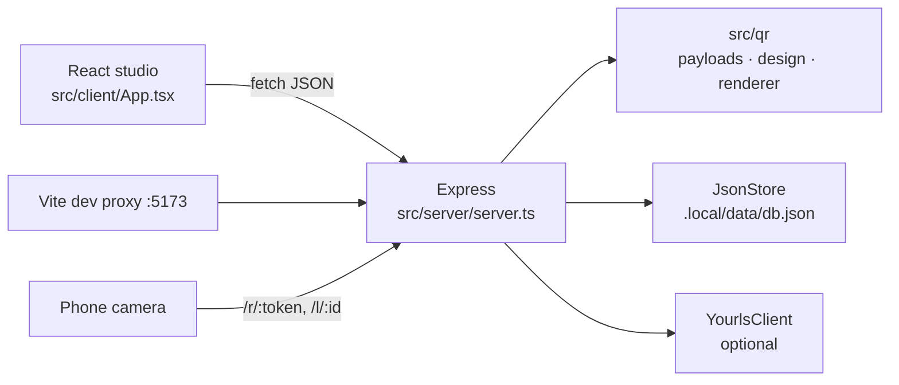

# Phase 1 audit — QR Code Toolkit → GatePass

Audit of upstream `CompleteTech-LLC/qr-code-toolkit` at `b72b6ce` before any GatePass change.

## History (4 commits, 2 authors)

| Commit | Author | Change |
| --- | --- | --- |
| `ed942e4` | romgenie | README only. |
| `28ba628` | romgenie | Whole application published in one commit: React studio, Express API, JSON store, QR renderer, YOURLS client/plugin, tests, CI. |
| `d354ae9` (PR #1) | Timothy Gregg | Audit snapshots cloned so later edits cannot rewrite history; landing feedback accepts urlencoded forms and rejects empty input; PDF/EPS return 400 instead of 500; `gradientOnEyes` honoured. |
| `b72b6ce` (PR #4) | Timothy Gregg | Line-ending normalisation of the PR #1 files (no behaviour change). |

No history exists for the authentication or persistence design; both arrived fully formed in `28ba628`.

## Architecture

- **Client → server**: plain `fetch` to same-origin `/api/*`; Vite proxies `/api`, `/qr`, `/uploads`, `/l`, `/r` to port 3000 in development. The production server serves `dist/client`.
- **QR creation path**: `App.saveQr` → `POST /api/qr-codes` → zod schema → `payloadSchemas[type]` → `buildPayload` (static) or local/YOURLS short link (dynamic) → `JsonStore.upsertQr` + `addAudit('created')`.
- **Rendering**: `renderQr` (`src/qr/renderer.ts`) — `qrcode` matrix → hand-built SVG with module shapes, eyes, gradients, preset logos; PNG via `qrcode.toBuffer` (colours only).
- **Redirects**: `GET /r/:token` resolves by id *or* YOURLS keyword and 302s to the stored destination; `GET /l/:id` renders a server-side HTML landing page.
- **Audit history**: `auditEvents[]` in the JSON file with deep-cloned before/after snapshots; actor is always `"system"`.

## Baseline (Node 24.14.1, Windows)

| Check | Result |
| --- | --- |
| `npm run typecheck` | pass |
| `npm test` | 34/34 pass (4 files) |
| `npm run build` | pass (JS 291 kB / 89 kB gzip) |
| `npm run smoke:qr` | pass |
| `npm audit` | **fails**: 8 advisories (1 critical `dompurify`, high `multer`, `body-parser`, `undici`, `zod`; moderate `qs`, `vitest`). The upstream CI step `npm audit --audit-level=high` would fail today. |

## Defects confirmed by probe

| Defect | Evidence |
| --- | --- |
| Corrupt data file is silently replaced by an empty database | `JsonStore.all()` catches any read/parse error and calls `save()` with defaults; probe wrote `{corrupt` and the file became empty collections. Total data loss. |
| Non-atomic, non-transactional writes | `writeFile` directly over the live file; concurrent requests share one in-memory object; a crash mid-write corrupts the file (and then the bug above wipes it). |
| Validation errors returned as 500 | Invalid colour → `500 Colors must be six-digit hex values`; malformed `config` query JSON → `500` with the raw `JSON.parse` message. |
| Internal error messages leaked | Global error handler returns `error.message` for every status, including 500 (fs, YOURLS, parser errors). |
| Duplicate short keywords accepted | Two records with keyword `dup` both return 201; `/r/dup` reaches only the first. |
| `PATCH /api/qr-codes/:id` bypasses schema | Empty `name` accepted; body fields read without zod; the live record is mutated before persistence succeeds. |
| `status` field is never enforced | `disabled`/`archived` records still redirect. |
| `npm start` is POSIX-only | `NODE_ENV=production tsx …` fails under `cmd`/PowerShell. |

## Security concerns

- **Authentication is optional and fail-open**: with `ADMIN_TOKEN` unset every management, upload and audit route is public. Comparison is `===` (not constant-time). The browser UI cannot send the token, so real deployments must rely on a proxy.
- **Public unauthenticated render endpoint** (`/api/qr/custom`) has no rate limit; a 2000 px SVG for a large payload is CPU-heavy.
- **Rate limiter** keys on `req.ip` without `trust proxy` configuration (all clients share one bucket behind a proxy) and never evicts buckets (unbounded memory).
- **Uploads** pull in `multer`, `dompurify`, `jsdom` (the critical/high advisories) to sanitise SVG logos served publicly.
- **Landing pages** load Google Fonts (third-party requests from every scanner) and set no CSP.
- No security headers beyond `nosniff` on the SPA/API.
- Dynamic redirect targets are validated as http(s) at write time — acceptable, but the redirect surface is unrelated to event entry.
- Dependencies: type packages, Vite, Vitest, supertest and jsdom are all listed as runtime `dependencies`.

## Test coverage gaps

- No test for persistence failure, corruption, or concurrency.
- No test for PATCH validation, keyword collisions, or disabled records.
- Auth test covers only list/create with a token; no test for timing-safe comparison or for unauthenticated upload/render/stats.
- No client tests; no test for the production static server.
- YOURLS tests cover only the happy path.

## Retain / refactor / remove

| Area | Decision | Reason |
| --- | --- | --- |
| `src/qr/renderer.ts`, `design.ts`, `logo-icons.ts` | **Retain unchanged** (logo rule narrowed to built-in presets) | Working, tested SVG/PNG renderer with input validation; GatePass renders every pass with it using a per-event design. |
| `POST/GET /api/qr/custom` | **Retain**, add rate limit, map validation errors to 400 | Useful for pass previews and existing regression tests. |
| QR core tests (`qr-core.test.ts`, design part of `security.test.ts`) | **Retain** | Regression coverage for retained rendering. |
| Express + zod + Vite + React + Vitest | **Retain** | Target stack. |
| In-memory rate limiter | **Refactor**: bucket eviction, `TRUST_PROXY` support | Single-process deployment keeps this sufficient. |
| Error handler | **Refactor**: generic 500s, zod → 400 with field path | Stops leaking internals. |
| `optionalAdminAuth` | **Replace** with mandatory bearer auth (admin token + hashed per-event scanner keys, constant-time compare) | Fail-closed; scanner and admin privileges separated. |
| `JsonStore` | **Remove** → SQLite (`node:sqlite`) | Needs transactions, constraints and atomic redemption. `node:sqlite` has no native build step, which matters for ARM64. |
| Dynamic QR records, `/r`, `/l`, landing pages, feedback | **Remove** | Unrelated to event entry; adds a public redirect/HTML surface. |
| YOURLS client + PHP plugin | **Remove** | Short links are irrelevant to pass verification; plugin is a self-described scaffold. |
| Logo uploads (`multer`, `dompurify`, `jsdom`) | **Remove** | Source of critical/high advisories; built-in logos cover pass branding. |
| `payloads.ts`, `sample-content.ts`, generic studio UI | **Remove** | GatePass encodes only pass URLs; keeping 22 unused payload builders is dead weight. |
| Theme tokens / theme toggle | **Retain** | Working light/dark support, reused by the new UI. |
| Gallery scripts, `public/samples` | **Remove** | Tied to removed landing pages/studio. |

## Smallest safe approach

1. Keep one Express process and one SQLite file (WAL, foreign keys, busy timeout). No Redis, queues or extra services.
2. Model `events`, `passes`, `scanners`, `scans` (every attempt, including failures) and `audit_log`.
3. Pass token = 32 random bytes (base64url). Only `sha256(token)` is stored (`UNIQUE`). The token is shown once at issuance; lost tokens are rotated (`reissue`), not recovered.
4. The QR encodes `APP_PUBLIC_URL/p/<token>`. `GET /p/<token>` shows the holder their pass and never changes state. Only an authenticated scanner `POST /api/scanner/redeem` redeems.
5. Redemption is one conditional `UPDATE … WHERE redeemed_at IS NULL AND revoked_at IS NULL AND expires_at > now` inside a transaction; `changes === 1` decides the winner, so two concurrent scans (or two processes) cannot both succeed.
6. React UI split by path: `/` admin dashboard, `/scan` mobile scanner using `jsqr` on camera frames, with manual entry fallback.

## Implementation plan

1. Remove out-of-scope features; add SQLite schema, config validation, auth, events API (+ tests).
2. Pass issuance, revocation, reissue, scanner keys, atomic redemption, pass page (+ concurrency/expiry/auth/exposure/DB-failure tests).
3. Admin dashboard and scanner UI.
4. Security headers, dependency audit, Dockerfile/compose for `linux/arm64`, CI, README.
