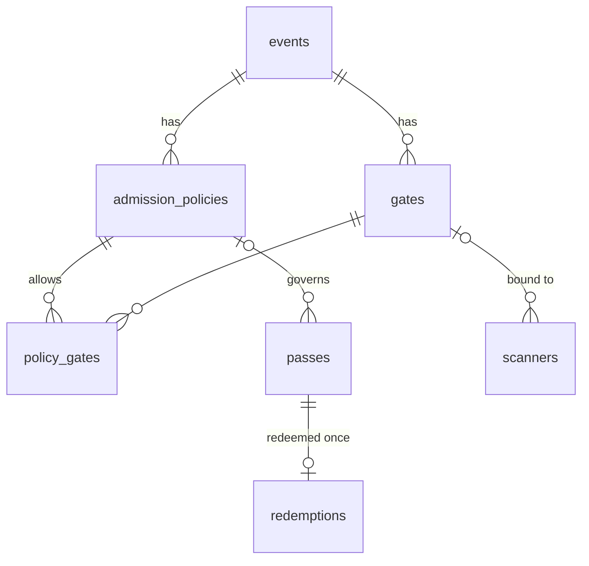

# 0004 — Admission policy engine

Status: accepted (implemented in migration 2)

## Problem

Before this change a pass was admitted at any time before `expires_at`, through any scanner of its event, with no limit on how many people entered. Real events need:

- several entry gates (VIP door, main door, staff entrance);
- timed entry slots (18:00–18:30 wave, 18:30–19:00 wave);
- a hard cap per slot that holds under concurrent scans;
- scanners that only work at the gate they are placed at.

It also fixed a defect: passes were accepted before the event started.

## Data model

| Table / column | Purpose |
| --- | --- |
| `gates(id, event_id, name)` | Named entry points, unique per event. |
| `admission_policies(id, event_id, name, opens_at, closes_at, capacity, admitted_count)` | Window (NULL = event start/end) and optional capacity. `CHECK (capacity IS NULL OR admitted_count <= capacity)` enforces the cap inside SQLite. |
| `policy_gates(policy_id, gate_id)` | Allowed gates. No rows = any gate. |
| `passes.policy_id` | NULL = default policy: event window, any gate, no cap. Existing passes keep working. |
| `scanners.gate_id` | NULL = scanner may admit at any gate (existing scanners). |
| `redemptions.gate_id, policy_id` / `scans.gate_id` | Reporting per gate and per policy. |

Triggers reject a pass, scanner or policy-gate link that points at another event's policy or gate, so a bug or a crafted request cannot cross events even if application validation is bypassed.

## Evaluation order (`POST /api/scanner/redeem`)

All steps run in one `BEGIN IMMEDIATE` transaction.

1. Unknown code → `invalid`. Pass of another event → stored `wrong_event`, reported `invalid`.
2. Event archived → `event_closed`.
3. Already redeemed → `already_redeemed`; revoked → `revoked`; `expires_at <= now` → `expired`.
4. `now < window start` → `too_early`; `now >= window end` → `too_late`. Window = policy window, else event start/end.
5. Scanner bound to a gate that the policy does not allow → `wrong_gate`.
6. `UPDATE admission_policies SET admitted_count = admitted_count + 1 WHERE id = ? AND (capacity IS NULL OR admitted_count < capacity)`; zero rows changed → `capacity_full`.
7. `INSERT INTO redemptions … ON CONFLICT (pass_id) DO NOTHING`; zero rows → `already_redeemed` (defensive; step 3 already covers it under the write lock).
8. Every attempt is written to `scans` with the gate.

Steps 6 and 7 both happen or neither does: an error rolls the whole transaction back, so the counter can never count a redemption that does not exist.

## Failure cases

| Case | Behaviour |
| --- | --- |
| Two scans of one pass at once | Write lock serialises them; second sees the redemption → `already_redeemed`. Primary key backs this up. |
| N scans of different passes against capacity K < N | Exactly K admitted: the conditional `UPDATE` is serialised by the write lock, and the `CHECK` constraint would abort a transaction that exceeded K. |
| Organiser lowers capacity below admissions | `PATCH` returns 409 (the `CHECK` fails). |
| Organiser changes a policy window during the event | Takes effect on the next scan; history is unchanged. |
| Pass moved to another policy after redemption | Rejected (409); counters would no longer match. |
| Crash mid-transaction | SQLite rolls back; counter and redemptions stay consistent. |
| Scanner at a gate scanning a default-policy pass | Admitted: default policy allows every gate. |

## Alternatives considered

- **Count redemptions at scan time** (`SELECT COUNT(*) FROM redemptions WHERE policy_id = ?`) instead of a counter. Correct under the write lock and avoids denormalisation, but costs O(admitted) per scan and leaves the cap enforced only by application code. The counter plus `CHECK` is O(1) and enforced by the database; a test checks the counter equals the count.
- **Per-gate capacity.** Capacity belongs to an entry slot (a time window for a group), not a door; gates already restrict where. Can be added later as its own table if needed.
- **Many gates per scanner.** A device stands at one door. One nullable `gate_id` is simpler to explain and audit.
- **Redis/queue for counters.** Unnecessary: one process, one SQLite writer, and the transaction is short (measurements in [performance.md](../performance.md); with `synchronous = FULL` the per-commit flush dominates).
