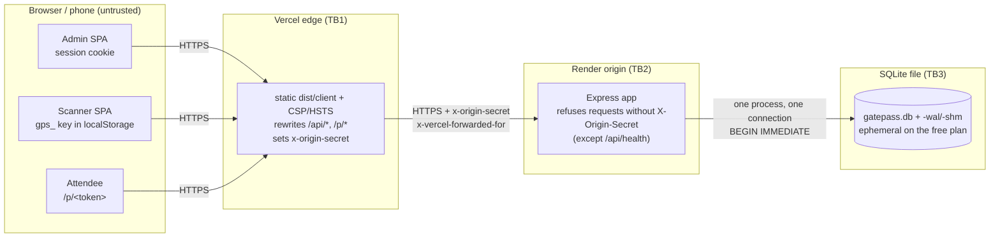

# Security and threat model (accounts, roles, durable storage)

This document covers GatePass on branch `feat/accounts-durability-operations`: organizer accounts with event roles, the operator break-glass token, scanner devices, attendee pass links and the Vercel → Render deployment.

This document replaces the earlier single-token documents: [threat-model.md](threat-model.md) and [security.md](security.md) now only point here and keep a short record of the 2026-11-07 review. Vulnerability reporting is in [SECURITY.md](../SECURITY.md).

A static security review of the accounts code (findings R1 to R11, tracked as `SR-01` to `SR-11`) was carried out on this branch. It read the code only and ran no proof-of-concept requests. Its fixes and residual risks are reflected below and summarised in [Security review of the accounts code](#security-review-of-the-accounts-code).

Requirement chapters refer to [OWASP ASVS 5.0](https://asvs.owasp.org/). Finding IDs refer to [engineering-audit.md](engineering-audit.md).

## Assets

| Asset | Where it lives | Why it matters |
| --- | --- | --- |
| Redemption records (`redemptions`, `scans`) | SQLite (`DATABASE_FILE`) | They are the admission truth. A lost redemption lets a pass in twice; a forged one turns a guest away. |
| Capacity counters (`events.admitted_count`, `admission_policies.admitted_count`) | SQLite, with `CHECK (admitted_count <= capacity)` | Fire-code limits. |
| Pass tokens | Attendee's link `/p/<token>` and QR code; SHA-256 only in `passes.token_hash` | Holding the token admits the attendee once. |
| Scanner keys (`gps_…`) | Door device `localStorage`; SHA-256 only in `scanners.key_hash` | Allow redemption for one event, optionally one gate. |
| Account credentials | scrypt hash in `users.password_hash`; session cookie `__Host-gatepass_session` (SHA-256 in `sessions.id_hash`) | Access to every event the account belongs to. |
| Invitation and reset links | URL fragment `#/invite/<token>`, `#/reset/<token>`; SHA-256 in `invitations` / `password_resets` | Create accounts, join events, take over an account's password. |
| `ADMIN_TOKEN` (operator) | Render environment and the operator's local secret store | Full API access to every event (break glass). |
| `ORIGIN_SECRET` | Vercel (Production) and Render environments | Without it, the origin refuses everything except `/api/health`. |
| Attendee personal data (name, email) | `passes`, CSV exports, backups | Privacy; exports and backups leave the system. |
| Audit log | `audit_log` | Accountability for administrative and security actions. |

## Actors

| Actor | Holds | Can |
| --- | --- | --- |
| Platform admin | Account with `platform_role = platform_admin` | Manage accounts (list, disable or enable, issue reset links for accounts that are not platform admins) and invite organizers and platform admins. **Cannot** see events they are not a member of through the role alone (`tests/accounts-api.test.ts`, "does not let a platform admin read organizers’ events through their role alone"). Exception: by issuing a reset link for an organizer, a platform admin can take over that account (SR-02, accepted). |
| Organizer / event owner | Account; `owner` row in `event_members` (one per event, enforced by a partial unique index) | Everything on their event, including lifecycle, team, ownership transfer and exports. Any account can create events and becomes their owner. |
| Event manager | Account; `manager` row for one event | Day-to-day operations: edit, gates and policies, passes, scanners, audit view. Cannot change lifecycle or team, and cannot export. |
| Scanning staff device | `gps_…` scanner key | `GET /api/scanner/session` and `POST /api/scanner/redeem` for its own event (and gate). No account. |
| Attendee | Their pass link | View their own pass page. Opening it never redeems. |
| Operator (break-glass) | `ADMIN_TOKEN` as `Authorization: Bearer` | API-only access to every event and every platform action, audited as `operator`. Not offered in the UI. |
| Anonymous attacker | Network access to the public URL, and possibly a leaked link | Guess tokens, replay links, brute-force sign-in, attempt CSRF, spoof proxy headers. |
| Malicious insider | A valid account (manager or owner), a scanner device, or platform-admin rights | Exceed their role, read another event, misuse exports or reset links. |

## Trust boundaries

- **TB1, browser → Vercel edge.** TLS. The edge serves the static SPA with CSP, HSTS, `X-Frame-Options: DENY`, `nosniff`, `Referrer-Policy: no-referrer` and `Permissions-Policy` (`vercel.mjs:84-92`). Production deployments proxy `/api/*` and `/p/*` to `GATEPASS_BACKEND_ORIGIN`. Preview deployments never use production values: they are static-only (503 for `/api/*` and `/p/*`) unless a separate preview origin is configured (`vercel.mjs:52-80`, INF-01).
- **TB2, edge → Render origin.** Vercel *sets* `x-origin-secret`, replacing any client value. The server compares it in constant time and answers 403 to everything except `/api/health` (`app.ts:160-164`). `CLIENT_IP_HEADER=x-vercel-forwarded-for` gives the rate-limit key; the server uses its last entry and honours it only together with `ORIGIN_SECRET` (`app.ts:165-172`, `config.ts:44-46`).
- **TB3, process → SQLite file.** Local file, one writer. Every write runs in a `BEGIN IMMEDIATE` transaction with `synchronous = FULL` (`db.ts:296`). Anyone with shell access to the container can read the file. On the Render free plan the file disappears on restart or deploy (INF-05).

## STRIDE by boundary

| Boundary | STRIDE | Threat | Mitigation (code) | Residual |
| --- | --- | --- | --- | --- |
| TB1 | Spoofing | Stolen admin session through XSS | Session cookie is HttpOnly, Secure, SameSite=Strict with the `__Host-` prefix (`app.ts:156-158,251-256`). CSP `script-src 'self' 'wasm-unsafe-eval'`, no inline script. | The scanner key in `localStorage` is readable by any script on the origin (SEC-02, accepted). |
| TB1 | Tampering | CSRF on cookie-authenticated writes | Custom header `X-GatePass-CSRF: 1` required on unsafe methods carrying the cookie and on every auth or invitation write; `Sec-Fetch-Site: cross-site` refused; no CORS (`app.ts:218-228`). | — |
| TB1 | Information disclosure | Pass links in browser history, chat apps or proxy logs | Links are bearer credentials by design (ADR 0002). `no-store`, `noindex` and `no-referrer` are sent; links can be revoked and reissued. | Vercel sees `/p/<token>` paths (SEC-05, accepted). |
| TB1 | Information disclosure | Clickjacking or framing of the scanner | `frame-ancestors 'none'`, `X-Frame-Options: DENY`. | — |
| TB1 | Elevation of privilege | Preview build reaches production data | Previews never read `GATEPASS_BACKEND_ORIGIN` or `ORIGIN_SECRET`; a preview origin equal to the production one is refused (`vercel.mjs:59-67`). Vercel stores those two variables for Production only. | — |
| TB2 | Spoofing | Client bypasses Vercel and talks to the origin directly | `ORIGIN_SECRET` gate (403). | `/api/health` is public; it reveals only `ok`, `demo` and `signup`. |
| TB2 | Spoofing | Forged `X-Forwarded-For` to dodge rate limits | `TRUST_PROXY=true` is refused (`config.ts:20-23`). The CDN header is used only with the origin secret, last entry only. | Rate-limit and throttle state is in process memory (lost on restart; not shared between instances). |
| TB2 | Denial of service | Credential stuffing, token guessing | Per-IP failure throttle: 60 failures in 5 min → 429. Per-account throttle: 10 failed sign-ins in 15 min, after which the account is refused even with the correct password until the window ends (`app.ts:395-396`, SR-01). `authLimit` of 20/min per IP on auth routes. API limit 600/min per IP; scanner redeem 240/min **per device** (`app.ts:206-242,341,643`). | Distributed guessing of 256-bit tokens is limited only by their entropy. Passwords are checked only against a 16-entry local list (`accounts.ts:48-51`), so weak but long passwords such as `Password123!` are accepted. A locked account also locks out its owner for the window. |
| TB2 | Repudiation | Who changed what | `audit_log` with actor `user:<id>`, `operator` or `anonymous`; sign-in, failure (with IP), sign-out, password change and failed password change, reset (with `requestedBy`), invitation, member and export actions (`accounts.ts`, `gatepass.ts`). Event and policy updates record `from`/`to` values for capacity, status, windows and policy gates (`gatepass.ts:229-230`, `policies.ts:180-184`). | Non-authentication rows record no IP or user agent (SEC-13). Failed operator-token attempts and bad invitation or reset tokens are not audited (SR-07). |
| TB2 | Information disclosure | Cross-tenant reads through ID-addressed routes | `requireEvent` resolves the event that owns `:passId`, `:policyId`, `:gateId` or `:scannerId` and authorizes the caller against it (`app.ts:300-323`). Non-members get 404 (`gatepass.ts:137-145`). A `wrong_event` scan is reported as `invalid` with no details. | The 404 text differs between "Pass/Gate/… not found" and "Event not found", so it reveals whether a random UUID exists (SR-09, open, informational). |
| TB2 | Information disclosure | A manager bulk-reads attendee data that the CSV exports reserve for owners | Exports need the owner-only `export` permission and are audited as `export.downloaded`. | `GET /api/events/:id/passes` (`view`, up to 5000 rows) returns attendee names and emails to managers with no export audit row; the same applies to the scan and audit lists (SR-04, accepted by design: managers need names at the door). |
| TB2 | Elevation of privilege | Manager acting as owner; scanner key used as a session | Permission lists in `permissions.ts:15-18`, checked server-side. Scanner keys are never accepted on account routes and sessions never on scanner routes. Removing a member revokes the scanner keys they issued for that event; disabling an account revokes their open reset links and the invitations they created (SR-03, `accounts.ts:131-135,403-407`). | A platform admin can issue a reset link for an organizer and so take over the account. Only the operator can reset a platform admin, and a password change cancels open reset links. The takeover is audited (`user.password_reset_created`, and `user.password_reset_used` with `requestedBy`) and ends the victim's sessions (SR-02, accepted: account recovery without email needs it). Accounts created from manager invitations are full organizers, so an owner can create organizer accounts even when `ALLOW_SIGNUP=false` (SR-06, open). |
| TB3 | Tampering | Lost or duplicated admission on crash or concurrency | `BEGIN IMMEDIATE`; `redemptions.pass_id` primary key; capacity `CHECK`s; `synchronous = FULL`; requestId replay; redemptions immutable (triggers). | Acknowledged writes are durable only on a persistent disk (INF-05). |
| TB3 | Tampering | Inconsistent restore | `restore` verifies integrity and the version, keeps the old files, re-verifies nine admission invariants and rolls back on failure (`integrity.ts`). | A restore drops admissions made after the backup; the runbook says so. |
| TB3 | Information disclosure | Database or backup copied off the host | Credentials are stored only as hashes (SHA-256 for 256-bit tokens, scrypt for passwords). | Attendee names and emails are in clear text; backups must be access-controlled. |

## Role and permission matrix

Enforced in the backend: `authorize` (`gatepass.ts:137-145`), `requireEvent` and `requirePlatformAdmin` (`app.ts:289-323`), and the scanner and pass routes. A platform admin who is also on an event's team gets that team role's permissions on that event, and nothing more. "—" means refused: 404 for events the caller is not on, 403 otherwise.

| Action (endpoint) | Platform admin (no membership) | Owner | Manager | Scanner device | Attendee (pass link) | Operator (`ADMIN_TOKEN`) | Anonymous |
| --- | --- | --- | --- | --- | --- | --- | --- |
| Register (`POST /api/auth/register`) | — | — | — | — | — | — | ✅ only if `ALLOW_SIGNUP=true` |
| Accept invitation | ✅ (token holder) | ✅ | ✅ | — | — | — | ✅ (token holder) |
| Create event (`POST /api/events`) | ✅ (becomes owner) | ✅ | ✅ (owner of the new event) | — | — | ✅ (no owner assigned) | — |
| List events | own memberships only | own | own | — | — | all | — |
| View event, gates, policies, passes, scans, operations, scanner list, team (`view`) | — | ✅ | ✅ | — | — | ✅ | — |
| Edit details or design; clone (`edit`) | — | ✅ | ✅ | — | — | ✅ | — |
| Change status draft/active/ended/archived (`lifecycle`) | — | ✅ | — | — | — | ✅ | — |
| Invite managers, remove members, transfer ownership (`team`) | — | ✅ | — | — | — | ✅ (may assign a non-member owner) | — |
| Gates and policies (`access`) | — | ✅ | ✅ | — | — | ✅ | — |
| Issue, import, revoke, bulk-revoke, reissue, change policy (`passes`) | — | ✅ | ✅ | — | — | ✅ | — |
| Create, rotate or revoke scanners (`scanners`) | — | ✅ | ✅ | — | — | ✅ | — |
| Audit log (`audit`) | — | ✅ | ✅ | — | — | ✅ | — |
| CSV exports: attendance, scans, audit (`export`) | — | ✅ | — | — | — | ✅ | — |
| Render QR (`/api/qr/custom`) | ✅ | ✅ | ✅ | — | — | ✅ | — |
| Manage users, reset links, platform invitations | ✅ | — | — | — | — | ✅ | — |
| Scanner session and redeem | — | — | — | ✅ own event (gate rules via policy) | — | — | — |
| View pass page (`/p/:token`) | holder of the link | holder | holder | — | ✅ own pass | holder | holder of the link |

Negative tests for each role: `tests/accounts-api.test.ts` ("tenant isolation" and "event roles") and `e2e/accounts.spec.ts` ("owner invites a manager who can issue passes but not manage the team or export").

## Sessions and CSRF

- **Session id**: 32 random bytes (base64url). Only its SHA-256 is stored (`sessions.id_hash`, `CHECK (length = 64)`). A new id is issued on every sign-in, registration, invitation acceptance and password change, so a planted id is never adopted.
- **Cookie**: `__Host-gatepass_session=<id>; Path=/; HttpOnly; SameSite=Strict; Max-Age=604800; Secure` when `APP_PUBLIC_URL` is HTTPS. Over plain HTTP (local development) it is `gatepass_session` without `Secure`.
- **Lifetime**: 7 days absolute and 24 hours idle (`accounts.ts:12-13`). `last_seen_at` is written at most every 5 minutes.
- **Revocation**: sign-out (that session); password change (all others; the caller gets a fresh one; open reset links are cancelled); password reset (all sessions); disabling the account (all sessions, open reset links and the invitations the account created; authentication also checks `disabled_at`).
- **Sign-in**: unknown emails are verified against a dummy scrypt hash, so response time does not reveal which accounts exist. Every failure answers "Email or password is incorrect." and is audited. After 10 failures in 15 minutes the account is refused with 429, even for the correct password, until the window ends (SR-01).
- **CSRF**: the custom header plus `Sec-Fetch-Site` rule described above. The path is lower-cased before the `/auth/` and `/invitations/` comparison, because Express routing ignores case (`app.ts:221`, SR-08). Bearer clients (scanner devices, the operator) are exempt because browsers never attach bearer tokens on their own.

## Token and secret inventory

| Credential | Format and entropy | Stored as | Lifetime | Rotation / revocation |
| --- | --- | --- | --- | --- |
| Pass token | 32 random bytes, base64url (43 chars) = 256 bits | SHA-256 hex, `passes.token_hash UNIQUE` | Until `expires_at` (default: event end), redemption or revocation | Reissue (new token, the old one stops at once); revoke; bulk revoke |
| Scanner key | `gps_` + 32 random bytes | SHA-256, `scanners.key_hash UNIQUE`; `key_issued_by` records who created or last rotated it | Until revoked or rotated; no expiry | Rotate (`POST /api/scanners/:id/rotate`); revoke, re-checked under the write lock; revoked automatically when the member who issued it is removed from the event (SR-03) |
| Session id | 32 random bytes | SHA-256, `sessions.id_hash` | 7 d absolute / 24 h idle | Sign-out, password change or reset, account disable |
| Invitation token | 32 random bytes; delivered in the URL fragment `#/invite/<token>` | SHA-256, `invitations.token_hash` | 7 days (`INVITATION_TTL_MS`) | One-time (conditional `UPDATE … WHERE accepted_at IS NULL AND revoked_at IS NULL AND expires_at > now`, re-checked in the transaction); revocable; bound to the invited email; revoked when the account that created it is disabled. The preview is `POST /api/invitations/preview` with the token in the body, so the token never appears in a request path or proxy log (`app.ts:437-441`, SR-11). |
| Password reset token | 32 random bytes; delivered in the URL fragment `#/reset/<token>` | SHA-256, `password_resets.token_hash` | 1 hour | One-time; issuing a new link invalidates older unused ones; a password change or disabling the account cancels open links. Only the operator can issue one for a platform admin (`accounts.ts:337`). |
| Password | 10–128 characters, not on a small common list, not equal to the email | scrypt N=2^15, r=8, p=3, 16-byte salt, 32-byte key; parameters stored with the hash | Until changed | Change (needs the current password) or reset |
| `ADMIN_TOKEN` | ≥ 24 characters (`config.ts:4-6`); generate 32 random bytes | Environment only; constant-time comparison | Until rotated | Change the Render env var and redeploy, then verify ([deployment-runbook.md](deployment-runbook.md#secret-rotation)) |
| `ORIGIN_SECRET` | ≥ 32 characters | Vercel (Production) and Render environments | Until rotated | Change on both sides and redeploy both |

## OWASP ASVS 5.0 mapping

| ASVS 5.0 chapter | What GatePass does | Honest gaps |
| --- | --- | --- |
| V3 Web Frontend Security | Host-only `__Host-` cookie with HttpOnly, Secure and SameSite=Strict. CSP without inline script; `frame-ancestors 'none'`; `nosniff`; `no-referrer`; HSTS (helmet default on the origin, explicit on Vercel). The pass page has a script-free CSP `default-src 'none'`. `Sec-Fetch-Site` check. | The scanner key is reachable from script on the same origin. |
| V4 API and Web Service | zod `strictObject` schemas reject unknown fields; JSON bodies capped at 512 kB; bounded lengths and counts (import ≤ 2000 rows, bulk revoke ≤ 500). No CORS. `Cache-Control: no-store` on `/api` and `/p`. Per-IP and per-device rate limits. Generic 500s; `SQLITE_BUSY` → 503 with `Retry-After`. | Rate-limit state is per process and in memory. |
| V6 Authentication | scrypt hashing; 10-character minimum, 128 maximum; local common-password list; generic failure message; dummy-hash timing equalisation; per-IP throttle and a per-account lock that also refuses the correct password; one-time, expiring invitation and reset links stored as hashes. | **No MFA. No email verification**: with `ALLOW_SIGNUP=true` (the live demo, by owner decision) anyone can register any address. Invitations bind to an email, but the link is delivered by hand. **No breached-password API**: the local list has 16 entries, so `Password123!` is accepted. Registration answers 409 for an existing email, which enumerates accounts when sign-up is open, limited to 20 requests/min per IP (SR-05, accepted for the demo). Accepting a manager invitation creates an organizer account even when sign-up is closed (SR-06, open). |
| V7 Session Management | 256-bit random ids stored hashed; new id at every authentication; absolute and idle timeouts; server-side revocation on sign-out, password change, reset and disable. | No "active sessions" list for users. |
| V8 Authorization | Every event route resolves the owning event and checks role permissions on the server (`requireEvent`). 404 for non-members, 403 for missing permissions. Scanner keys are scoped to one event (and gate); a reused `requestId` with a different code is refused with 409 (`gatepass.ts:518-519`, SR-10). Platform role grants no event access. Negative tests per role. | The operator token is all-powerful by design (break glass). Platform admins can take over organizer accounts through reset links (SR-02, audited, accepted). Managers can list attendee names and emails without the `export` permission (SR-04, accepted). 404 messages reveal whether a UUID exists (SR-09, open). |
| V14 Data Protection | Credentials stored only as hashes. Attendee name and email are optional. Exports are owner-only, audited as `export.downloaded` and formula-neutralised. `no-store` on API and pass responses. | Attendee data is clear text in the database and backups. Failed sign-in audit rows keep the typed email and IP. |
| V16 Security Logging and Error Handling | `audit_log` records account, invitation, member, pass, scanner, gate, policy, event and export actions with actor labels, failed sign-ins and failed password changes, and before/after values for event and policy capacity, status, windows and gates. Errors return no SQL or stack traces. | Non-authentication audit rows carry no IP or user agent. Failed operator-token attempts and bad invitation or reset tokens are not audited (SR-07). There is no alerting on security events. |

## Security review of the accounts code

Static review of `app.ts`, `accounts.ts`, `permissions.ts`, `gatepass.ts`, `audit.ts`, `csv.ts`, `pass-page.ts`, migration 3 in `db.ts`, `integrity.ts` and their helpers. The reviewer had no shell, so every finding was derived from the code, not from running requests. Statuses follow [engineering-audit.md](engineering-audit.md); "pending verification" means the regression test exists but has not yet run in a recorded full suite.

| ID | Review severity | Finding | Status |
| --- | --- | --- | --- |
| SR-01 (R1) | Medium | The per-account lock let the correct password through, so guessing from many addresses was limited only per IP. | Fixed (pending verification) |
| SR-02 (R2) | Medium | A platform admin could take over any account through a reset link and so read its events; password changes did not cancel reset links; admins could reset admins. | Partly fixed (pending verification): operator-only reset for platform admins, link cancellation on password change, `requestedBy` audited. Residual accepted by the owner: a platform admin can reset an organizer and sign in as them. |
| SR-03 (R3) | Medium | Removed managers kept the scanner keys they had issued; disabled admins' pending invitations stayed valid. | Fixed (pending verification) |
| SR-04 (R4) | Medium | Managers can read attendee names and emails through the passes list (up to 5000 rows) with no export audit. | Accepted risk (by design) |
| SR-05 (R5) | Low | Registration answers 409 for an existing email. | Accepted risk (live demo) |
| SR-06 (R6) | Low | Manager invitations create organizer accounts even when sign-up is closed. | Open (deferred) |
| SR-07 (R7) | Low | Audit gaps: failed password change, failed operator token, bad invitation or reset tokens; no before/after values. | Partly fixed (pending verification): failed password change and before/after values audited. Failed operator-token and bad-token attempts are still not audited. |
| SR-08 (R8) | Info | The CSRF path comparison was case-sensitive. Not exploitable. | Fixed (pending verification; no test) |
| SR-09 (R9) | Info | Entity 404 messages reveal whether an ID exists. | Open (deferred) |
| SR-10 (R10) | Info | A repeated `requestId` was not tied to the code. | Fixed (pending verification; no test) |
| SR-11 (R11) | Info | The invitation token was in a GET path. | Fixed (pending verification) |

The review found no injection, no cross-event read through ID-addressed routes, no stored XSS on the pass page, no CSV formula injection, no session fixation, no CSRF bypass, no race on one-time links and no account enumeration through sign-in timing. It also checked email case handling, client IP header spoofing, brute force of the 8-character scanner reference (32 bits, resolved only within the scanner's event) and `requestId` replay across scanners, and found them not vulnerable.

## Outstanding threats and accepted risks

1. **Non-durable live demo** (INF-05): the Render free instance loses the database on every restart or deploy. Accepted by the owner while `DEMO_MODE=true` shows the warning. The remedy is [ADR 0009](decisions/0009-durable-storage.md).
2. **Platform admin can take over organizer accounts through reset links** (SR-02 residual): required for account recovery without email. Platform admins can no longer reset other platform admins, and a password change cancels open links. The takeover is audited with `requestedBy` and ends the victim's sessions. Accepted by the owner.
3. **Managers can bulk-read attendee data** (SR-04): the passes, scans and audit lists return names and emails to managers without an `export.downloaded` row. Accepted by design; restricting it would need a separate permission for personal data in lists.
4. **Sign-up reveals existing emails** (SR-05): 409 on registration while `ALLOW_SIGNUP=true`. Accepted for the live demo; limited to 20 requests/min per IP.
5. **Closing sign-up does not stop new organizer accounts** (SR-06): an owner can invite any address as a manager, and accepting creates an organizer who can create events. Open.
6. **Audit gaps** (SR-07 partial, SEC-13): failed operator-token attempts and bad invitation or reset tokens are not audited; non-authentication rows carry no IP or user agent.
7. **Entity 404 messages differ** (SR-09): they reveal whether a random UUID exists. Open; informational.
8. **Weak passwords accepted** (SR-01 note): only a 16-entry local list is checked; no breached-password API. No MFA and no email verification (V6 gaps above).
9. **Scan ids are a global sequence** (SEC-06): a scanner device can estimate platform-wide scan volume from `scanId`. Deferred.
10. **In-memory rate limits per process**: a restart clears the counters, including the per-account lock, and they would not be shared across instances. The design runs exactly one instance (ADR 0001).
11. **Pass links in URL paths** (SEC-05): visible to the Vercel edge. Accepted; leaked links are revoked or reissued.
12. **Scanner setup links carry the permanent key** (SEC-08): mitigated by rotation, revocation and automatic revocation when the issuing member is removed; one-time enrollment is deferred.
13. **Operator token is all-powerful**: break-glass use only. It is never shown in the UI, every use is audited as `operator`, and it is rotated after any disclosure (PA-2). Failed attempts are not audited (SR-07).
14. **Clone by managers**: a manager may clone an event they manage and becomes owner of the copy. Only configuration is copied (no passes, scanners or team), so no attendee data moves.
15. **Physical camera paths unverified** (ORCH-01): a correctness risk at the door, not a security one. Any failure ends in "Not verified, do not admit".
16. **No offline scanning**: a venue network or server outage stops admission, because single use needs the server ([ADR 0002](decisions/0002-hashed-bearer-tokens.md)).
17. **A compromised proxy or CDN** (Vercel, Caddy) can read and replay every credential it carries. Out of the application's control.
