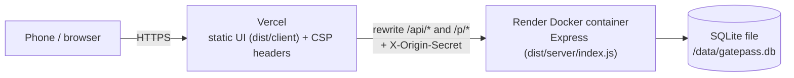
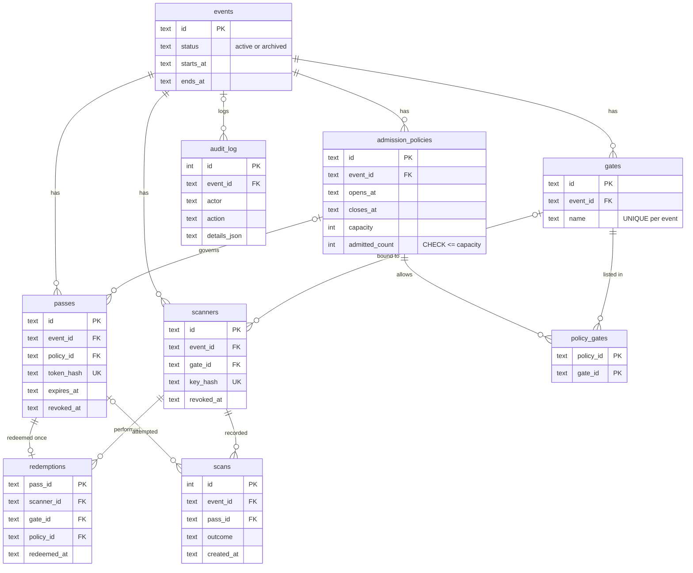

# Technical walkthrough

A guided tour of how GatePass works, written for code reviews and interviews. For the full reference see [architecture.md](architecture.md), the [decision records](decisions/README.md) and [security.md](security.md).

## 1. Summary and request path

GatePass issues single-use QR passes for an event and checks them at the door. An organiser uses the admin app to create an event, its gates and admission policies, issue passes, and register door phones as scanners. Each attendee gets a link (`/p/<token>`) that shows their QR code. Door staff open `/scan` on a phone; the camera reads the QR code and the server decides, inside one SQLite transaction, whether to admit. The backend is one Node.js process (Express) with one SQLite file. In the live demo, Vercel serves the static React build and forwards API and pass-page traffic to a Docker container on Render.

- `vercel.mjs` proxies `/api/(.*)` and `/p/(.*)` to `GATEPASS_BACKEND_ORIGIN` and **sets** `x-origin-secret` on each proxied request (replacing anything the client sent). Every other path is the static SPA, with `index.html` as fallback.
- The server, started with the same `ORIGIN_SECRET`, answers 403 to any request without the matching header, except `/api/health`. Clients therefore cannot skip Vercel and talk to Render directly.
- The same server can also run on its own (it serves `dist/client` itself when the directory exists), for example behind Caddy on one VM ([ADR 0007](decisions/0007-hosting.md)).

## 2. Frontend map

`src/client/main.tsx` is the single entry point. If the path starts with `/scan` it renders `ScannerApp`, otherwise `AdminApp`. Both apps ship in one bundle.

| Piece | What it does |
| --- | --- |
| `admin/AdminApp.tsx` | Sign-in form, event sidebar and hash routing (`#/events/<id>/<tab>`). Any 401 signs the admin out. |
| `admin/EventForm.tsx` | Create or edit an event's name, venue and time window. |
| `admin/EventDetail.tsx` | Event header with stats and the tab bar: Operations, Passes, Access, Pass design, Settings, Audit log. |
| Setup checklist | "Set up this event" card above the tabs: create event, add gates, configure admission, issue passes, set up a scanner, begin entry. Done states come from the counts in `EventSummary` (`gateCount`, `policyCount`, `passCount`, `scannerCount`, `scanCount`). |
| `admin/OperationsPanel.tsx` + `ScanFeed.tsx` | Live totals, alerts, timeline, per-gate and per-policy numbers, and the scan feed. Polls every 5 s (`LIVE_POLL_MS`) only while the page is visible. |
| `admin/PassesPanel.tsx` | Pass list with status filter and search; revoke, reissue, change policy. |
| `admin/IssueForm.tsx` | Issue passes from a list of attendees or by count, optionally under a policy. |
| `admin/IssuedPasses.tsx` | Shows freshly issued pass links (the only time tokens are visible) and exports them as CSV. |
| `admin/AccessPanel.tsx` | Gates plus the two sections below. |
| `admin/PoliciesSection.tsx` | Create and edit admission policies (window, capacity, allowed gates). |
| `admin/ScannersSection.tsx` | Register door devices; shows the one-time setup link `/scan#key=<key>` as text and QR code. |
| `admin/DesignPanel.tsx` | QR design editor; previews through `POST /api/qr/custom` and refuses to save a design its own detector cannot decode. |
| `admin/SettingsPanel.tsx` | Edit or archive the event. |
| `admin/AuditPanel.tsx` | Read-only list of admin actions from `audit_log`. |
| `scanner/ScannerApp.tsx` | Gets the scanner key, loads `/api/scanner/session`, then shows the station. |
| `scanner/ScannerStation.tsx` | Camera loop: detect every 150 ms, ignore the same code for 4 s, 12 s request timeout, manual entry fallback. |
| `scanner/ResultOverlay.tsx` | Full-screen verdict (Admit / Already used / Denied / error) with colour, icon and headline; held for 2.5 s. |
| `api.ts` | `fetch` wrapper: bearer token, deadline, `ApiError` with `http` / `timeout` / `network`, "waking up the server" hint after 3 s. |
| `qr-detector.ts` | Native `BarcodeDetector` when it supports QR, otherwise the ZXing WebAssembly decoder served from our own origin. |
| `csv.ts` | CSV export with every cell quoted and formula injection neutralised. |

**Client-side auth.**

- *Admin*: the admin types `ADMIN_TOKEN` once. It is kept in `sessionStorage`, so it is gone when the tab closes, and sent as `Authorization: Bearer …` on every request.
- *Scanner*: the setup link carries the key in the URL fragment (`/scan#key=gps_…`). Browsers never send fragments to servers or proxies. `ScannerApp` reads it once, stores it in `localStorage` (a door phone should survive a reload), and removes it from the address bar and history with `history.replaceState`. A 401 clears the stored key.

## 3. Backend modules (`src/server/`)

| Module | Responsibility |
| --- | --- |
| `index.ts` | Entry point: load config, open the database, create the app, listen over HTTP or HTTPS, shut down cleanly on `SIGTERM`/`SIGINT`. `index.js backup <file>` writes a verified backup instead. |
| `config.ts` | Validates environment variables with zod. Refuses a short `ADMIN_TOKEN` (< 24) or `ORIGIN_SECRET` (< 32), `TRUST_PROXY=true`, and `CLIENT_IP_HEADER` without `ORIGIN_SECRET`. |
| `app.ts` | Express app: origin-secret gate, client-IP header, helmet/CSP, rate limits, zod schemas, admin and scanner auth, all routes, SPA fallback. |
| `http.ts` | `httpError`, the error handler (zod → 400, 4xx passed through, everything else a generic 500), `rateLimit`, `FailureThrottle`, bearer-token parsing. |
| `gatepass.ts` | Domain service `GatePass`: events, passes, scanners, `redeem`, scan feed. Every write runs in `transaction()`. |
| `admission.ts` | `evaluateAdmission`: pure, ordered admission rules. No I/O, so it is unit-tested directly. |
| `policies.ts` | `AccessControl`: gates, admission policies, policy–gate links and `claimCapacity`. |
| `operations.ts` | Read-only dashboard aggregates: outcome counts, per gate, per policy, 15-minute timeline, alerts (`ALERT_RULES`). |
| `db.ts` | Opens SQLite (`node:sqlite`), sets pragmas, runs append-only migrations, `VACUUM INTO` backup, `BEGIN IMMEDIATE` transaction helper. |
| `tokens.ts` | 256-bit token generation, SHA-256 hashing, token extraction from scanned text, constant-time `safeEqual`. |
| `audit.ts` | Writes and reads `audit_log` rows; called inside the mutating transaction. |
| `pass-page.ts` | Script-free, server-rendered HTML for `/p/:token`, with every value HTML-escaped. |

`values.ts` is a small helper (UTC ISO dates, SQLite constraint-error detection).

## 4. API routes (from `app.ts`)

| Method | Path | Auth | Purpose |
| --- | --- | --- | --- |
| GET | `/api/health` | public | Liveness (`SELECT 1`); adds `demo: true` in demo mode. Exempt from the origin secret. |
| GET | `/p/:token` | public (60/min per IP) | Attendee pass page with QR. Read-only: opening it never redeems. |
| GET, POST | `/api/qr/custom` | admin (120/min) | Render a QR (svg/png/pdf/eps) for design previews and setup links. |
| GET | `/api/admin/session` | admin | Check the admin token. |
| GET, POST | `/api/events` | admin | List or create events. |
| GET, PATCH | `/api/events/:eventId` | admin | Read or update an event (including archive). |
| GET | `/api/events/:eventId/operations` | admin | Operations dashboard summary. |
| GET, POST | `/api/events/:eventId/gates` | admin | List or create gates. |
| GET, POST | `/api/events/:eventId/policies` | admin | List or create admission policies. |
| PATCH | `/api/policies/:policyId` | admin | Update a policy. |
| GET, POST | `/api/events/:eventId/passes` | admin | List/filter passes, or issue passes (response holds the tokens, once). |
| PATCH | `/api/passes/:passId` | admin | Move an unused pass to another policy (or `null` = default). |
| POST | `/api/passes/:passId/revoke` | admin | Revoke a pass. |
| POST | `/api/passes/:passId/reissue` | admin | New token for the same pass; the old QR stops working. |
| GET, POST | `/api/events/:eventId/scanners` | admin | List or create scanner devices (key returned once). |
| POST | `/api/scanners/:scannerId/revoke` | admin | Revoke a device. |
| GET | `/api/events/:eventId/scans` | admin | Scan feed, cursor `?after=<id>`. |
| GET | `/api/events/:eventId/audit` | admin | Audit log. |
| GET | `/api/scanner/session` | scanner (60/min per device) | Scanner label, gate and event. |
| POST | `/api/scanner/redeem` | scanner (240/min per device) | Check and redeem a scanned code. |

All other `/api/*` paths return 404 JSON. All `/api/*` routes except `/api/scanner/*` also share a 600/min per-IP limit.

## 5. Database

One SQLite file, schema in `db.ts` as an append-only migration list tracked by `PRAGMA user_version`. Every table is `STRICT` (column types are enforced), foreign keys are on and use `ON DELETE RESTRICT`. Pragmas: `journal_mode = WAL` (readers do not block the writer), `busy_timeout = 5000` (a second connection waits up to 5 s for the write lock instead of failing at once), `synchronous = NORMAL`.

Constraints that matter:

- **`redemptions.pass_id` is the primary key.** A pass can have at most one redemption row, whatever the application code does.
- **`admission_policies.admitted_count`** has `CHECK (admitted_count >= 0 AND (capacity IS NULL OR admitted_count <= capacity))`. Over-admitting a policy aborts the transaction, even with hand-written SQL (tested in `tests/database.test.ts`).
- **`passes.token_hash` and `scanners.key_hash` are `UNIQUE`** and 64 hex characters: only SHA-256 hashes are stored, never raw tokens.
- **Triggers against cross-event references**: a pass may only use a policy of its own event, a scanner only a gate of its own event, and a policy only gates of its own event (`RAISE(ABORT, …)` on insert/update).
- **`scans.outcome`** is limited by a `CHECK` to the known outcomes; every attempt is stored, admitted or not.
- Pass status (`active`, `redeemed`, `revoked`, `expired`) is not stored; it is derived on read from `redemptions`, `revoked_at` and `expires_at`.

## 6. The redeem transaction

`POST /api/scanner/redeem` first authenticates the device (`sha256(key)` lookup among unrevoked scanners), applies the per-device limit and validates `{ code }` (1–2048 chars). Then `GatePass.redeem` runs:

1. Take the timestamp, then `BEGIN IMMEDIATE`. This grabs SQLite's write lock **before** reading anything.
2. `extractPassToken(code)` accepts the bare 43-character token or any URL ending in `/p/<token>`. Look up the pass by `token_hash = sha256(token)`, joined with its `redemptions` row.
3. Read the scanner's event (window and status only, no counts), and the pass's policy with its allowed gates, but only if the pass belongs to the scanner's event.
4. `evaluateAdmission` decides in this order: `invalid` → `wrong_event` → `event_closed` → `already_redeemed` → `revoked` → `expired` → `too_early` → `too_late` → `wrong_gate` → `capacity_full`. Time comes from the policy window, or the event window for the default policy.
5. If admitted and the pass has a policy: `UPDATE admission_policies SET admitted_count = admitted_count + 1 WHERE id = ? AND (capacity IS NULL OR admitted_count < capacity)`. Zero rows changed means `capacity_full`. This conditional update, not step 4, is the authority on capacity.
6. `INSERT INTO redemptions … ON CONFLICT (pass_id) DO NOTHING`. If it does not insert exactly one row, the code throws and the whole transaction rolls back (this cannot happen while the lock is held, but it fails safe).
7. Insert a `scans` row with outcome, scanner and gate; update `scanners.last_used_at`. A `wrong_event` result is stored as such but reported to the device as `invalid`, with no pass details.
8. `COMMIT`. Any error before this → `ROLLBACK`, so a capacity claim never survives without its redemption.

**Why two scans cannot both win.**

- Inside one process, `node:sqlite` is synchronous and `redeem` never awaits, so two HTTP requests run their transactions one after the other.
- Across connections (other threads or processes on the same file), `BEGIN IMMEDIATE` lets only one writer in. The second waits (up to `busy_timeout`), then reads the committed redemption and gets `already_redeemed`, or reads the updated counter and gets `capacity_full`.
- If the logic were ever wrong, the primary key on `redemptions.pass_id` and the `CHECK` on `admitted_count` would still abort the extra write.

**How the tests prove it.**

- `tests/database.test.ts` › "atomic redemption across connections and threads": a second connection redeems an already-admitted pass (`already_redeemed`); **8 worker threads** (`tests/threads.ts`, `tests/fixtures/redeem-worker.mjs`, each with its own connection, released together by a barrier) redeem one pass → exactly 1 `admitted`, 7 `already_redeemed`, 1 redemption row, 8 scan rows; **12 different passes race for 5 places** → exactly 5 `admitted`, 7 `capacity_full`, `admittedCount` = 5.
- `tests/policies-api.test.ts` › "stops at capacity under 30 concurrent HTTP scans of different passes": 30 parallel `POST /api/scanner/redeem` calls against a capacity-10 policy → exactly 10 admitted. Another test shows a pass denied for capacity is not consumed and can be admitted after capacity is raised.

## 7. Security at a glance

| Control | How | Where |
| --- | --- | --- |
| Hashed tokens, shown once | Pass tokens and scanner keys are 32 random bytes (base64url); only `sha256` is stored. Raw values appear only in the issue/reissue/create response. | `tokens.ts`, `gatepass.ts` |
| Constant-time compare | Admin token and origin secret go through `safeEqual` (SHA-256 both sides, then `timingSafeEqual`). | `tokens.ts`, `app.ts` |
| Rate limits per device | Scanner session 60/min and redeem 240/min keyed by **scanner id**, so many gates behind one venue NAT do not share a bucket. Other API 600/min per IP, `/p` 60/min, QR 120/min. | `app.ts`, `http.ts` |
| Failure throttle | Failed admin/scanner auth counted per client IP: after 60 failures in 5 minutes → 429 with `Retry-After`. Valid credentials are never refused. | `http.ts` `FailureThrottle` |
| CDN client IP | With `ORIGIN_SECRET` set, `CLIENT_IP_HEADER` (Vercel: `x-vercel-forwarded-for`) replaces `req.ip`, so spoofed `X-Forwarded-For` cannot choose a rate-limit bucket. | `app.ts`, `config.ts` |
| `ORIGIN_SECRET` | Every request except `/api/health` must carry the secret Vercel adds; direct hits get 403. | `app.ts`, `vercel.mjs` |
| helmet + CSP | `default-src 'self'`, scripts self + `wasm-unsafe-eval` (ZXing), no framing, `no-referrer`, camera for self only; `/api` and `/p` are `no-store`. The pass page has a stricter CSP with no scripts at all. | `app.ts` |
| Strict validation | zod `strictObject` schemas reject unknown fields; bodies capped at 100 kB; IDs, lengths, counts and dates bounded. | `app.ts` |
| Generic 500s | 4xx messages pass through; anything else is logged and answered with "Internal server error" (no SQL, paths or stacks). | `http.ts` |
| CSV formula neutralisation | Cells starting with `=`, `+`, `-`, `@`, tab or CR get a leading `'`; every cell quoted. | `csv.ts` |
| No cross-event leaks | Service checks plus triggers; a pass from another event is reported as `invalid`. | `gatepass.ts`, `db.ts` |

## 8. Deployment and its honest limitation

The `Dockerfile` is multi-stage on `node:22-bookworm-slim` (amd64 and arm64): build stage runs `npm run build`; the runtime stage installs production dependencies only, runs as the non-root `node` user, stores the database at `DATABASE_FILE=/data/gatepass.db` (a `VOLUME`) and has a `HEALTHCHECK` on `/api/health`.

**Limitation:** the live demo backend runs on Render's free tier, which has an ephemeral filesystem and cannot attach a disk. The SQLite file is lost on every redeploy, restart or idle spin-down (after 15 idle minutes), and the first request after idling takes about 50 s ([deployment-live.md](deployment-live.md)). The client copes with the cold start: after 3 s it shows "Waking up the server…", and admin sign-in waits up to 70 s.

To be honest about it in the product, setting `DEMO_MODE=true` makes `/api/health` return `{ ok: true, service: 'gatepass', demo: true }`, and the admin UI then shows a dismissible banner: "Demo environment — data is erased whenever the server restarts. Do not use for a real event."

Persistent options ([ADR 0007](decisions/0007-hosting.md)):

- **Render paid instance + disk** mounted at `/data`: about $7.25/month (smallest paid instance plus 1 GB disk). The image already writes there.
- **One VM with Docker Compose + Caddy**, e.g. an Oracle Cloud Always Free Ampere A1 (ARM64) instance: $0, automatic TLS, data in a Docker volume. This is the recommended path ([deployment.md](deployment.md)). Note that Oracle may reclaim idle Always Free instances, so off-instance backups matter.

## 9. Questions an interviewer may ask

**Why SQLite and not Postgres?** One organiser, one event at a time, one small VM. SQLite gives transactions, constraints and a single-writer lock with no second service to run, secure and back up. `node:sqlite` is built into Node, so no native addon. The single writer is exactly what makes redemption atomic. Measured 2,300–2,500 redemptions/s end to end on the benchmark machine ([ADR 0001](decisions/0001-sqlite-single-process.md)).

**Why not JWT for passes?** A signature proves the server issued a token, not that it has not been used or revoked. Single use needs shared state checked at scan time, so the scanner must ask the server anyway; then a random 256-bit lookup key does the same job, keeps the QR short, carries no personal data, and revocation/reissue take effect immediately ([ADR 0002](decisions/0002-hashed-bearer-tokens.md)).

**What happens if two scanners scan the same pass at once?** Both requests reach `redeem`; the transactions run one after the other. The first inserts the `redemptions` row and gets `admitted`; the second reads that row and gets `already_redeemed` ("Already used" on the door phone). Both attempts are logged in `scans`, and repeated duplicates raise an alert on the Operations tab.

**How does capacity stay correct?** The counter is changed only by a conditional `UPDATE … WHERE admitted_count < capacity` inside the redeem transaction, and the table has a `CHECK (admitted_count <= capacity)`. A failed claim admits nobody and does not consume the pass. Tests race 12 passes for 5 places (threads) and 30 HTTP scans for 10 places.

**How would you scale beyond one instance?** Today it is deliberately one process: SQLite has one writer and rate-limit state lives in memory. First step is vertical (the redeem path uses indexed single-row lookups only). Beyond that *(design idea, not implemented)*: move to Postgres keeping the same conditional-update and unique-key pattern, run several stateless app instances behind a load balancer, and move rate-limit and throttle counters to a shared store such as Redis. An alternative that fits SQLite is sharding by event, since events never share passes.

**How would you add offline scanning?** *(Not implemented; the scanner tells staff not to admit while offline.)* Sync the event's pass hashes and policies to each device, decide locally, queue redemptions and upload them when back online; the server's primary key resolves conflicts and flags late duplicates. The trade-off: while offline, two gates can each admit the same screenshot, and capacity can only be enforced with per-device quotas. That is why the current design stays online-only ([threat-model.md](threat-model.md)).

**What would you change for multi-tenant?** Replace the single `ADMIN_TOKEN` (actor is always `admin`) with organisations and user accounts (sessions or OIDC), add `org_id` to events and scope every query and trigger by it, record the real user in `audit_log`, and apply per-tenant rate limits. With SQLite, one database file per tenant is a simple way to keep data isolated.
