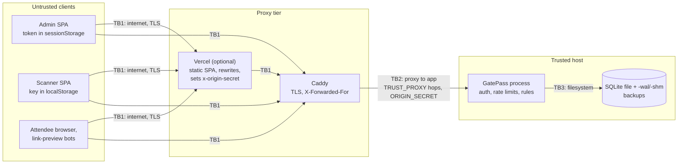

# Threat model

Scope: the GatePass server (`src/server/`), the admin and scanner web apps (`src/client/`), the attendee pass page, and the two supported deployments (single host with Caddy; Vercel static front + API host, see [ADR 0007](decisions/0007-hosting.md)). Requirement references are to [OWASP ASVS 5.0](https://github.com/OWASP/ASVS/tree/v5.0.0/5.0/en) chapters. Reporting and operator duties: [SECURITY.md](../SECURITY.md).

GatePass assumes one organiser (or one team sharing one admin token) running one instance. It is not a multi-tenant ticketing platform.

## Assets

| Asset | Where it lives | Why it matters |
| --- | --- | --- |
| Pass tokens | In the QR / pass link (`/p/<43-char token>`) held by the attendee; only `sha256(token)` in `passes.token_hash`. | Bearer credential for one entry. Whoever presents it first gets in. |
| Scanner keys (`gps_…`) | Door device `localStorage`; only `sha256(key)` in `scanners.key_hash`. | Lets a device redeem passes of one event (optionally one gate). |
| Admin token | `ADMIN_TOKEN` environment variable; admin browser `sessionStorage`. | Full control: events, passes, scanners, policies, exports. |
| Attendee PII | `passes.attendee_name`, `attendee_email` in SQLite, backups, `.pre-v<N>.bak` files, CSV exports; name on the pass page and in scanner results. | Personal data. |
| Redemption integrity | `redemptions` (primary key `pass_id`), `scans`. | A pass admits at most once; the log says which device admitted whom. |
| Capacity integrity | `admission_policies.admitted_count` with `CHECK (capacity IS NULL OR admitted_count <= capacity)`. | A slot never admits more than its capacity; counter equals redemptions. |
| Door availability | The one Node process, its SQLite file, the network path from the venue. | If the server is unreachable, nobody can be admitted (no offline mode). |

## Actors

| Actor | Has | Wants / can |
| --- | --- | --- |
| Attendee | Own pass link. | Get in once; view the pass page. |
| Pass forwarder | A legitimate pass (screenshot or link). | Let several people in on one pass. |
| Malicious attendee | Any pass link they obtain; network access to public routes. | Forge or guess tokens, enter outside the window or at the wrong gate, inject content into names that end up in exports or pages, probe the API. |
| Door staff | A scanner device and its key. | Admit people. A dishonest one could admit people without valid passes only by holding valid codes; could misuse the device. |
| Lost or stolen device | Scanner key in `localStorage`, or an admin browser tab with the token in `sessionStorage`. | Whoever finds it can redeem (scanner) or administer (admin, until the tab closes). |
| Network attacker | Position on the venue Wi-Fi or path to the server. | Read or alter plain-HTTP traffic; spoof forwarding headers; flood the server. |
| Internet scanner / bot | Public reachability. | Enumerate `/p/` tokens, guess credentials, fetch links (link-preview bots), exhaust CPU. |
| Compromised CDN / proxy | Sees all traffic it terminates (Caddy; Vercel in the split setup), including `Authorization` headers and `/p/` paths. | Read or replay any credential passing through it. |
| Server operator | Shell on the host, the environment, the SQLite file and backups. | Trusted. Can read all PII, change any row, or replace the code. |

## Trust boundaries

- **TB1 (browser ↔ edge).** Everything from clients is untrusted: bodies and queries are parsed with strict zod schemas, credentials are checked on every request. TLS terminates at Caddy (or Vercel); the app itself does not enforce HTTPS.
- **TB2 (edge ↔ app).** The app trusts `X-Forwarded-For` for exactly `TRUST_PROXY` hops (`true` is refused). In the Vercel setup the app also requires `X-Origin-Secret`, so requests that bypass Vercel are refused. The proxy sees every credential.
- **TB3 (app ↔ SQLite file).** Only the app process and the operator touch the file. Constraints, triggers and the transaction model hold even if application checks are bypassed, but not against someone who edits the file directly.

## Threats and mitigations

STRIDE category in the first column. "Test" names the `it(...)` title in `tests/` that exercises the control.

| # | Threat | Mitigation | Code | Test | Residual risk | ASVS 5.0 |
| --- | --- | --- | --- | --- | --- | --- |
| S1 | Guess or forge a pass token. | 256-bit random tokens; lookup by SHA-256; unknown and malformed codes → `invalid` with no details; unknown `/p/` tokens and malformed ones get identical 404s without rendering a QR. | `tokens.ts`, `gatepass.ts` `redeem`, `viewPass` | tokens: "generates distinct 256-bit base64url tokens"; redemption: "reports unknown code %j as invalid without details", "answers unknown and malformed tokens identically" | None practical. | V11 Cryptography |
| S2 | Forwarded screenshot used by several people. | Single redemption (S/T rows below); duplicates reported `already_redeemed` with the first redemption time; attendee name shown to door staff; `repeated_duplicate` and `multi_gate` alerts on the operations dashboard. | `admission.ts`, `operations.ts` | redemption: "admits a valid pass once, then reports the original redemption"; policies-api: "summarises admissions per gate, capacity usage and suspicious patterns" | The first presenter gets in, even if it is not the named attendee. Staff must check names/ID when that matters. | V2 Validation and Business Logic (V2.3) |
| S3 | Redeem without a scanner, or with the admin token. | Separate scanner auth: SHA-256 of the key against unrevoked scanners; admin token is not a scanner key. | `app.ts` `requireScanner` | security-api: "requires a scanner key for scanning; the admin token is not a scanner key" | — | V6 Authentication, V8 Authorization |
| S4 | Guess the admin token or a scanner key online. | `ADMIN_TOKEN` ≥ 24 chars (config refuses shorter); constant-time compare; `FailureThrottle` in `requireAdmin`/`requireScanner`: after 60 failed authentications per IP in 5 minutes, further **invalid** attempts get 429 with `Retry-After`. Valid credentials from the same IP are never refused by it. | `config.ts`, `tokens.ts` `safeEqual`, `http.ts` `FailureThrottle`, `app.ts` | security-api: "%s %s requires the admin token", "throttles failed authentication per IP without locking out valid credentials from that IP" | Per-IP and in memory: a distributed guesser is limited by token entropy, not by the throttle. A human-chosen 24-character token is weaker than a generated one. | V6 Authentication, V2.4 Anti-automation |
| S5 | Spoof `X-Forwarded-For` to pick a fresh rate-limit bucket. | Express trusts only `TRUST_PROXY` hops; `TRUST_PROXY=true` is refused at startup; compose sets `1` behind Caddy. | `config.ts`, `app.ts` | security-api: "ignores spoofed X-Forwarded-For when no proxy is trusted", "rejects configuration that would trust spoofed forwarding headers" | A wrong hop count (too high) re-opens spoofing; too low collapses all clients into the proxy's IP. | V13 Configuration |
| S6 | Bypass the CDN and talk to the origin directly with forged headers. | `ORIGIN_SECRET` (≥ 32 chars): every request except `/api/health` must carry it; Vercel sets it on proxied requests, replacing any client value. | `app.ts`, `vercel.mjs` | security-api: "refuses requests without the origin secret when a CDN fronts the API" | Static shared secret; rotation is manual (change both sides). | V13 Configuration |
| S7 | Lost or stolen scanner device. | Per-device keys; revocation takes effect on the next request; the scanner app clears the key on 401; scans record the device. | `gatepass.ts` `revokeScanner`, `authenticateScanner` | security-api: "rejects a scanner key immediately after revocation" | Until someone revokes it, the device can redeem its event's passes (only at its gate if bound). | V6 Authentication |
| T1 | Two scans of one pass at the same moment both admitted. | One `BEGIN IMMEDIATE` transaction per redemption; `redemptions.pass_id` primary key ([ADR 0003](decisions/0003-redemption-atomicity.md)). | `db.ts` `transaction`, `gatepass.ts` `redeem` | redemption: "admits exactly one of 25 concurrent HTTP scans of the same pass"; database: "admits a pass once when a second connection redeems it too", "admits exactly one of 8 simultaneous redemptions of one pass", "allows at most one redemption row per pass" | None known. | V2.3 Business Logic Security |
| T2 | More people admitted than a slot's capacity. | Conditional `UPDATE … WHERE admitted_count < capacity` inside the redeem transaction; `CHECK` constraint; lowering capacity below admissions is refused. | `policies.ts` `claimCapacity`, `updatePolicy`; migration 2 in `db.ts` | database: "never exceeds slot capacity when 12 different passes race for 5 places", "makes over-admitting a capacity-limited policy impossible even with direct SQL"; policies-api: "stops at capacity under 30 concurrent HTTP scans of different passes", "refuses to lower capacity below admissions already made" | None known. | V2.3 |
| T3 | Admission outside the allowed time or gate. | Window = policy window, else event start/end (start inclusive, end exclusive); gate-bound scanners refuse passes whose policy excludes their gate. | `admission.ts` | admission: "enforces the event window when the pass has no policy (start inclusive, end exclusive)", "restricts gates only when both the scanner and the policy specify them"; policies-api: "rejects passes scanned before the event starts (previously accepted)", "enforces timed entry windows", "admits through allowed gates only and explains wrong gates safely" | Unrestricted scanners admit at any gate. Clock accuracy of the server decides the window edges. | V2.3 |
| T4 | Reference another event's gate or policy (IDOR) to admit or reconfigure across events. | Service checks (`assertGate`, `assertPolicy`) and SQLite triggers on passes, scanners and policy-gate links. | `policies.ts`, migration 2 in `db.ts` | policies-api: "refuses cross-event gates, policies and scanner bindings (IDOR)"; database: "rejects cross-event references through triggers" | — | V8 Authorization |
| T5 | SQL injection through codes, search or IDs. | Every value is a bound parameter; `LIKE` wildcards escaped. | all of `src/server/` | redemption: "reports unknown code %j as invalid without details" (includes `'; DROP TABLE passes; --`); events-api: "filters and searches passes" | — | V1 Encoding and Sanitization (V1.2) |
| T6 | Script or SVG injection through names or pass designs. | Pass page escapes all values and has its own CSP with no scripts; React escapes in the SPA; designs are normalised (hex colours, preset logos, unknown keys dropped). | `pass-page.ts`, `src/qr/design.ts` | redemption: "escapes attendee and event names"; security: "rejects SVG attribute injection and unsafe logo references", "drops unknown keys so arbitrary client data is never persisted" | — | V1, V3 Web Frontend Security |
| T7 | Spreadsheet formula injection through attendee names in CSV exports. | Cells starting with `=`, `+`, `-`, `@`, tab or carriage return are prefixed with `'`; all cells quoted. | `src/client/csv.ts` | csv: "neutralises spreadsheet formulas in attendee-controlled cells" | Only the GatePass exporter is covered; data copied out by other means is not. | V1.2 |
| T8 | A link-preview bot or prefetch redeems a pass by opening its link. | No GET route changes state; redemption is only `POST /api/scanner/redeem` with a scanner key. | `app.ts`, `gatepass.ts` `viewPass` | redemption: "shows the pass without redeeming it" | — | V4 API and Web Service |
| T9 | An upgrade or downgrade corrupts or misreads the database. | Each migration in one transaction with its version bump; backup before migrating; newer schema refused; foreign-key check after migrating; corrupt file stops startup. | `db.ts` | database: "upgrades a version 1 database with data, keeps old passes valid and backs it up first", "rolls back a failing migration completely", "refuses to open a database written by a newer schema", "fails loudly on a corrupt database file instead of replacing it" | Backups contain PII and must be protected like the database. | V15 Secure Coding and Architecture |
| R1 | Dispute over who admitted someone, or who changed what. | Every scan attempt stored in `scans` with scanner, gate and outcome; redemptions record scanner, gate and policy; admin mutations write `audit_log`. | `gatepass.ts`, `audit.ts` | events-api: "revokes passes idempotently and records the action in the audit log"; database: thread tests count `scans` rows | All admin actions are attributed to `admin` (shared token). Logs live in the same database; the operator can edit them. | V16 Security Logging and Error Handling |
| I1 | Database or backup leak yields working passes or keys. | Only SHA-256 hashes of tokens and keys are stored. | `tokens.ts`, `gatepass.ts` | database: "never stores raw tokens" | Names and emails are stored in clear text in the database and backups. | V14 Data Protection, V11 |
| I2 | Credentials leak into logs, `Referer` or caches. | `Referrer-Policy: no-referrer`; `Cache-Control: no-store` on `/api` and `/p`; `X-Robots-Tag: noindex` on pass pages; scanner key delivered in a URL fragment; Caddy access log not enabled; tokens never returned by list endpoints. | `app.ts`, `deploy/Caddyfile` | security-api: "sends security headers and disables caching on API responses", "never returns tokens or token hashes from list endpoints", "never returns scanner keys after creation" | Any proxy that logs request paths (including a CDN) records `/p/<token>` values. | V14, V13 |
| I3 | A scanner of event A learns about event B's passes. | Another event's pass is stored as `wrong_event`, reported as `invalid`, with no pass or policy details. | `gatepass.ts` `redeem` | redemption: "does not admit or reveal a pass from another event"; policies-api: "never reveals policy details for another event’s pass" | — | V8 Authorization |
| I4 | Internal errors reveal SQL, paths or stack traces. | Generic 500 body; details only in the server log. | `http.ts` `errorHandler` | security-api: "returns a generic 500 without SQL or stack details and keeps serving" | — | V16 |
| I5 | XSS steals the scanner key (`localStorage`) or admin token (`sessionStorage`). | CSP `script-src 'self' 'wasm-unsafe-eval'`, no inline scripts; React output escaping; `frame-ancestors 'none'`; pass page has no scripts at all. | `app.ts`, `vercel.mjs` | security-api: "sends security headers and disables caching on API responses" | Any XSS that did occur could read both stores. Accepted (see findings). | V3 Web Frontend Security |
| I6 | Plain-HTTP interception of pass links or credentials. | TLS at Caddy with automatic certificates; HSTS; startup warning when `NODE_ENV=production` and `APP_PUBLIC_URL` is not HTTPS. | `deploy/Caddyfile`, `index.ts` | — | The app does not refuse plain HTTP; correct deployment is the operator's job. | V12 Secure Communication |
| D1 | Request floods from one client. | `/api/*` except `/api/scanner/*`: 600/min per IP; `/p/:token` 60/min per IP; JSON bodies ≤ 100 kB; zod length limits. | `app.ts`, `http.ts` | security-api: "maps malformed JSON and oversized bodies to 4xx" | Limits are in process memory and per IP; volumetric attacks need upstream filtering. | V2.4 Anti-automation |
| D2 | Gates behind one NAT throttle each other, or someone on the venue network locks the gates out. | `/api/scanner/*` is exempt from the per-IP limit and is limited per device after authentication: session 60/min (`scanner-session:<id>`), redeem 240/min (`scanner:<id>`). The failure throttle refuses only invalid credentials, so valid scanner keys keep working while a neighbour on the same IP is throttled. | `app.ts`, `http.ts` | security-api: "rate-limits scans per device, so gates sharing one NAT address do not throttle each other" (625 scans from one IP across 3 devices), "throttles failed authentication per IP without locking out valid credentials from that IP" | Requests to `/api/scanner/*` with an invalid key are limited only by the failure throttle (each still costs one hash lookup). | V2.4 |
| D3 | CPU exhaustion through QR rendering. | `/api/qr/custom` requires the admin token and is limited to 120/min; size clamped to 200–2000 px; `data` ≤ 1024 chars; the pass page renders a QR only for tokens that exist (unknown or malformed tokens get a static 404). | `app.ts`, `src/qr/renderer.ts` | security-api: "requires the admin token (CPU-heavy rendering is not public)", "answers invalid input with 400 instead of 500" | Holding one pass link allows up to 60 renders per minute per IP. | V2.4 |
| D4 | Redemption slows down as events grow. | `redeem` uses only indexed single-row lookups (token hash, event, policy and its gates); no per-event aggregates on the hot path. | `gatepass.ts` `redeem` | Benchmark ([testing.md](testing.md#benchmark)) | One SQLite writer serialises redemptions (~2,300–2,500/s measured on x64). | V15 |
| D5 | Server or venue network outage stops entry. | — (single instance, online-only by design). | — | — | Accepted: no offline scanning, no failover. | — |
| E1 | Scanner key used on admin routes. | Admin middleware accepts only `ADMIN_TOKEN`. | `app.ts` `requireAdmin` | security-api: "%s %s requires the admin token" (tries a scanner key on every admin route) | — | V8 Authorization |
| E2 | Clickjacking of the admin or scanner UI. | `frame-ancestors 'none'`, `X-Frame-Options: DENY`. | `app.ts`, `vercel.mjs` | security-api: "sends security headers and disables caching on API responses" | — | V3 |
| E3 | Compromised proxy or CDN replays credentials. | Out of the app's control. Single-host deployment keeps the number of parties that see credentials to one proxy on the same machine. | — | — | A compromised proxy can read and replay every token and key it carries. | V12, V13 |
| E4 | Malicious or careless operator. | Trusted by design. Hashing means even the operator cannot recover tokens from the database. | — | — | Full access to PII and records; no tamper evidence. | — |

## Security review findings (this iteration)

Ordered by severity, then exploitability.

| # | Severity | Finding | Exploitability | Resolution | Evidence | Status |
| --- | --- | --- | --- | --- | --- | --- |
| 1 | High | Passes with no policy were admitted at any time before expiry, including before the event started. | Trivial: any pass holder (or a forwarded copy) could be admitted early, before door staff or capacity controls were in place. | Default policy window is the event's start/end; `too_early` / `too_late`. | `admission.ts`; policies-api "rejects passes scanned before the event starts (previously accepted)"; admission "enforces the event window …" | Fixed |
| 2 | Medium | Redeem rate limit (240/min) was per IP, so every gate behind one venue NAT shared it; it was also counted before authentication. | Likely at any multi-gate venue on one uplink; an unauthenticated client on the same network could exhaust it. | Redeem limit keyed per scanner device, after authentication (completed by #9). | `app.ts`; security-api "rate-limits scans per device …" | Fixed |
| 3 | Medium | `/api/qr/custom` was public and CPU-heavy (renders up to 2000 px SVG/PNG). | Anyone on the internet, up to the per-IP limit from many IPs. | Admin token required; 120/min. | `app.ts`; security-api "requires the admin token (CPU-heavy rendering is not public)" | Fixed |
| 4 | Medium | `TRUST_PROXY=true` would trust any client-supplied `X-Forwarded-For`, letting clients choose their rate-limit bucket. | Needs that misconfiguration; then trivial. | Value refused at config load; hop count required. | `config.ts`; security-api "rejects configuration that would trust spoofed forwarding headers" | Fixed |
| 5 | Medium | No throttling of failed authentication beyond the general 600/min limit. | Online guessing of a weak human-chosen admin token. | 60 failed authentications per IP per 5 minutes, then 429 for further invalid attempts (final form in #9). | `http.ts` `FailureThrottle`; security-api "throttles failed authentication per IP without locking out valid credentials from that IP" | Fixed |
| 6 | Medium | Attendee names exported to CSV could start with `=`, `+`, `-`, `@` and execute as formulas in a spreadsheet. | Needs an attendee-chosen name and an organiser opening the export. | Such cells (also tab and CR) are prefixed with `'`; every cell quoted. | `src/client/csv.ts`; csv "neutralises spreadsheet formulas …" | Fixed |
| 7 | Low / performance | `redeem` loaded the event with per-event counts (O(passes) per scan). | Load-dependent: 273 req/s at concurrency 50 with 5000+ passes in the first benchmark run. | `redeem` reads only window and status; measured again ([testing.md](testing.md#benchmark)). | `gatepass.ts` `redeem` | Fixed |
| 8 | Low | Migrations ran without a pre-upgrade backup, and an older build could open a newer database. | Operational accident during upgrade or rollback. | `<file>.pre-v<N>.bak` written and verified before migrating; newer schema refused. | `db.ts`; database migration tests | Fixed |
| 9 | Medium | Found in this review, after #2 and #5 were fixed: the per-IP `/api` limit (600/min) and the failed-authentication limiter (60/5 min, built on `express-rate-limit`) ran before the per-device redeem limit. All gates behind one NAT shared 600 requests/min, and once 60 bad-credential requests came from that address, every request from it, including valid scanners, got 429 until the window ended. | Any device on the venue network could lock out every gate on it; large venues could reach 600/min with legitimate scans. | `/api/scanner/*` exempt from the per-IP limit, with per-device session (60/min) and redeem (240/min) limits; failed authentication counted by `FailureThrottle`, which refuses only further invalid attempts. | `app.ts`, `http.ts`; security-api "rate-limits scans per device …", "throttles failed authentication per IP without locking out valid credentials from that IP" | Fixed |
| 10 | Medium | One shared admin token; no per-user accounts, roles or per-person audit identity. | Anyone with the token has full control; actions are attributed to `admin`. | Accepted for a single-organiser tool. Rotate by changing `ADMIN_TOKEN` and restarting. | `app.ts` `requireAdmin` | Accepted |
| 11 | Medium | Restoring a backup re-validates passes redeemed after the backup was taken. | Needs a restore during or after an event; those passes could be admitted again. | Accepted. Operators should restore only between events, or reconcile against the scan log first. | `db.ts` `backupDatabase`; database "backs up a live database, verifies it, and restores it" | Accepted |
| 12 | Low | The pass page shows the event and attendee name to anyone with the link. | Needs the link, which is the credential itself. | Accepted: the link is the ticket; `noindex`, `no-store`, `no-referrer`. | `pass-page.ts` | Accepted |
| 13 | Low | The scanner key in `localStorage` (and the admin token in `sessionStorage`) is readable by any XSS. | Needs an XSS; none known. | Accepted; mitigated by strict CSP, no inline scripts, React escaping. | `app.ts` CSP | Accepted |
| 14 | Low | Rate-limit counters are in process memory: per process, reset on restart. | Restart clears limits; multiple processes would multiply them (unsupported topology). | Accepted for the single-process design; add proxy limits for more. | `http.ts` | Accepted |
| 15 | Low | No offline scanning. | A venue network or server outage stops admission. | Accepted: single use needs the server ([ADR 0002](decisions/0002-hashed-bearer-tokens.md)). | — | Accepted |

## Checked and found OK

- **SQL**: every value reaches SQLite as a bound parameter (`?` or named). The only interpolated SQL fragments are module constants (column lists, the timeline bucket expression) and the integer migration version.
- **GET routes**: none writes to the database. Pass state changes only through admin `POST`/`PATCH` routes and `POST /api/scanner/redeem`; the pass page is read-only.
- **Pass page**: event name, venue, attendee name and dates are HTML-escaped; the page has `default-src 'none'` and no scripts.
- **Tokens and keys**: stored only as SHA-256 hashes; returned only once; admin token compared in constant time.
- **Errors**: 500 responses are generic (`Internal server error`); 4xx responses carry only the validation message (with the field path) or the application's own conflict message.
- **Dependencies**: `npm audit` reported 0 known vulnerabilities on 2026-11-07. That only compares installed versions with published advisories; it is not a security review, and it says nothing about this code.

## Out of scope

Denial of service beyond per-IP limits, compromise of the host OS, Docker or the proxy, physical attacks on door devices beyond revoking their keys, and legal duties for processing attendee data.
